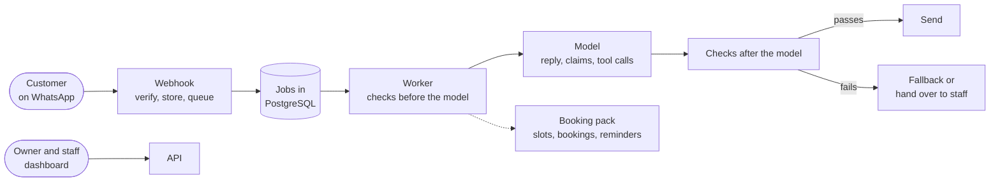

# polyglot-sales-agent

**A WhatsApp assistant for appointment-based small businesses.** It answers
customers in their own language, using only what the business has entered,
books the appointment in the chat, and hands over to a person when it
should.

> **Status: design complete, no code yet.** Requirements and design are
> written and independently reviewed; the build starts with milestone M2.
> Nothing here runs today. Progress is in [`docs/STATUS.md`](docs/STATUS.md).

This is a **portfolio and reference implementation**, built in the open to
show a complete software lifecycle and a careful AI lifecycle. It is not a
commercial product, and version 1.0 runs against a simulated WhatsApp, with
no real customers or phone numbers. The reasons are in
[ADR 0001](docs/adr/0001-positioning-and-v1-scope.md).

## The problem

In many markets a small business's customers do not use its website. They
message it on WhatsApp. For a salon, a clinic or a tutoring centre, that
creates four problems:

| Problem | What happens |
| --- | --- |
| **Slow replies** | The owner is busy with a client and answers an hour later, or the next morning. The customer has booked somewhere else |
| **Many languages** | Customers write in Arabic, English, Urdu, Hindi and more, often mixed or typed in Latin letters. Staff are comfortable in one or two |
| **No-shows** | Nobody has time to send reminders by hand, so booked slots go empty |
| **Trust** | An owner will not let a bot answer for them if it might invent a price or promise a slot that is taken |

Whether this pain is strong enough that businesses would pay to solve it
has not been tested. No business has been asked.

## What it is designed to do

- **Answer** questions about services, prices, opening hours and policies
  in the customer's language, from the business's own data and nothing else.
- **Book** an appointment in the conversation: find a free slot, create the
  booking, send a fixed confirmation.
- **Remind** the customer before the appointment, with buttons to confirm,
  reschedule or cancel.
- **Hand over** to a person when the customer asks, when it cannot answer,
  or when the topic is one it must not handle, such as medical advice.
- **Give the owner a dashboard** to enter their data, read conversations,
  take one over and see results.

An illustration of the intended behaviour, written by hand. It is not
output from a running system.

```text
Customer   السلام عليكم، كم سعر تنظيف البشرة؟
Assistant  [You are chatting with an automated assistant.]
           وعليكم السلام. تنظيف البشرة 150 ريال ومدته 45 دقيقة.
           هل تودين حجز موعد؟
Customer   yes, tomorrow after 5 pm
Assistant  Tomorrow, Wednesday 18 November, I have 17:30 and 18:15.
           Which suits you?
Customer   5:30
Assistant  [Booked: Facial, Wednesday 18 November, 17:30. You will get a
           reminder; reply STOP to opt out.]
```

## How it is designed



- **Multi-tenant from the start.** Every business's data is separated in the
  database by row-level security, not only by application code.
- **A core and use-case packs.** The core handles messages, handover,
  consent and safety. Everything about appointments lives in the `booking`
  pack ([ADR 0012](docs/adr/0012-core-and-pack-boundary.md)).
- **Guardrails are code first.** Rules that code can enforce do not depend
  on the model choosing to follow them: tenant isolation, acting only for
  the customer in the conversation, honouring an opt-out, staying silent
  when staff have taken over.
- **What code cannot enforce is said plainly.** The truth of what the
  assistant says is checked where code can detect a value and measured by
  evals otherwise. A manipulated model can still say something false; the
  [guardrail policy](docs/ai/guardrail-policy.md) lists exactly what holds
  and what does not.
- **Evals before prompts.** The [eval plan](docs/ai/eval-plan.md) was
  written before any prompt, with fixed pass-or-fail gates for the failures
  that matter most.

Stack: TypeScript, Node.js, Fastify, PostgreSQL, Next.js. No Redis and no
vector database in version 1.0. Each choice has a decision record.

## Where things are

| Phase | State | Evidence |
| --- | --- | --- |
| 1. Requirements | Done, reviewed | [Vision](docs/requirements/vision.md) · [36 user stories with 224 acceptance criteria](docs/requirements/user-stories.md) · [51 non-functional requirements](docs/requirements/nfr.md) · [37 risks](docs/requirements/risks.md) · [glossary](docs/requirements/glossary.md) |
| 2. Design | Done, reviewed | [Architecture](docs/design/architecture.md) · [state machines](docs/design/state-machines.md) · [data model](docs/design/data-model.md) · [API](docs/design/api.md) and [OpenAPI file](docs/design/openapi.yaml) · [threat model](docs/design/threat-model.md) · [12 decision records](docs/adr/README.md) |
| AI lifecycle | Planned, reviewed | [Guardrail policy](docs/ai/guardrail-policy.md) · [eval plan](docs/ai/eval-plan.md) · [compliance notes](docs/compliance.md) |
| 3. Build | Not started | Milestones M2 to M5 in [`AGENTS.md`](AGENTS.md), section 9 |
| 4 to 6. Verify, release, operate | Not started | |

There are no test results, eval scores or benchmarks, because nothing has
been built or run. None will appear here until they are real.

## How this project is built

An AI coding agent (Claude) writes the documents and, later, the code. A
human maintainer sets the scope, makes the decisions reserved for a person,
and reviews and merges every pull request. The working agreement the agent
follows is [`AGENTS.md`](AGENTS.md).

At each phase gate the work is reviewed by a separate AI agent that has no
knowledge of the session that wrote it. Its report is committed unedited,
with the author's answer to every finding below it. The ten reports so far
are in [`docs/reviews/`](docs/reviews/). They are worth reading for what
they found: the design review reported 20 serious defects, including a
guardrail claim that was simply false, and two more rounds were needed
before none remained open.

The limits of this method are stated in the repository and repeated here:

- The reviewers are the same kind of model as the author and share some of
  its blind spots.
- Many lesser findings are tracked as open issues, not fixed.
- No person has reviewed the requirements or the design in detail.
- No one with security, legal or clinical training has reviewed anything.

## Before any real use

Version 1.0 is not meant for real customers. Before it could be, at least
these would be needed: a review by people with security and data-protection
expertise; the emergency-message rules written and checked by a fluent
speaker of each language and by someone with crisis training; every
assumption about WhatsApp's rules re-read from the source; and a pilot with
a consenting business.

## Licence

[MIT](LICENSE)
