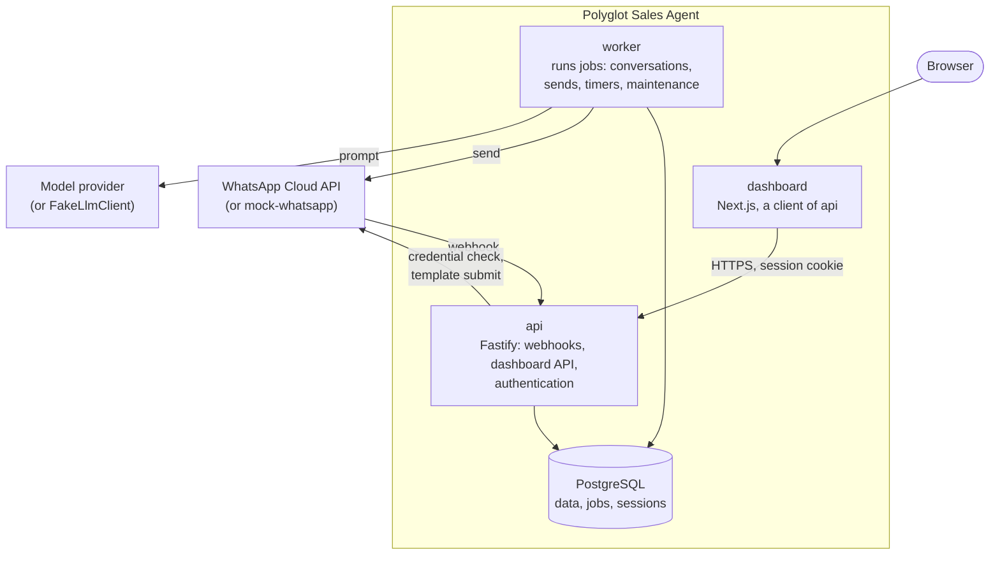
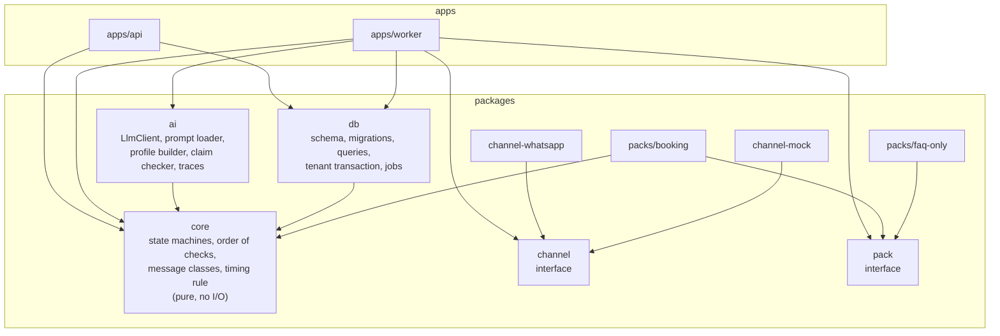
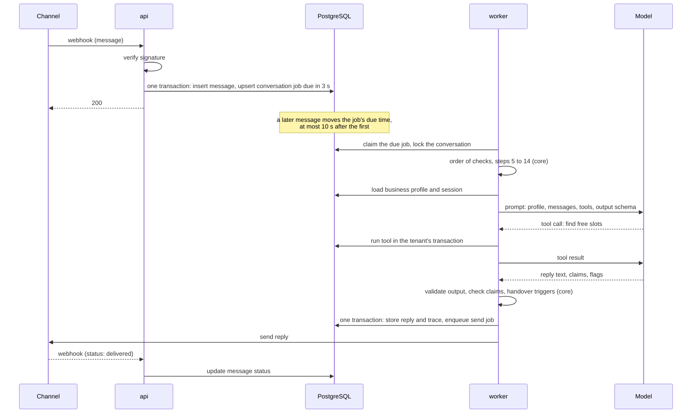
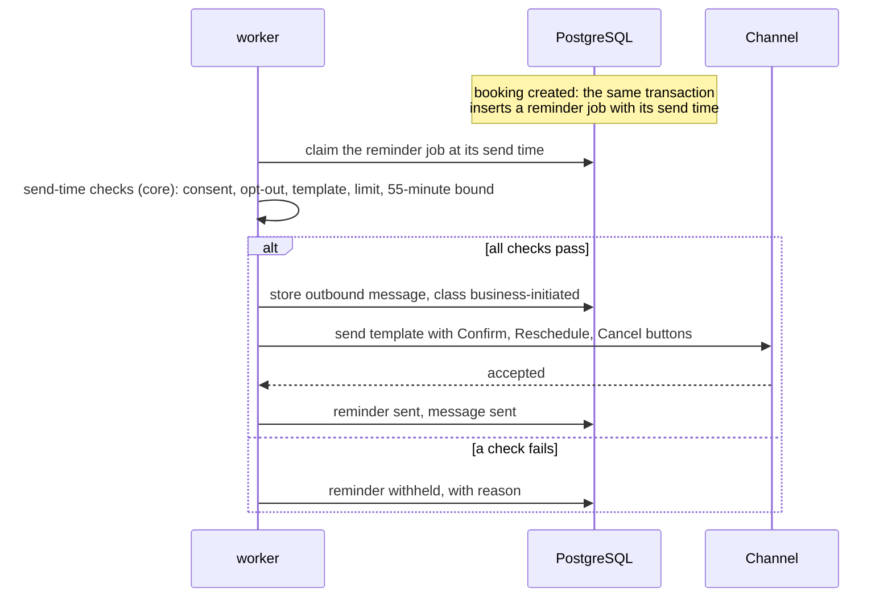
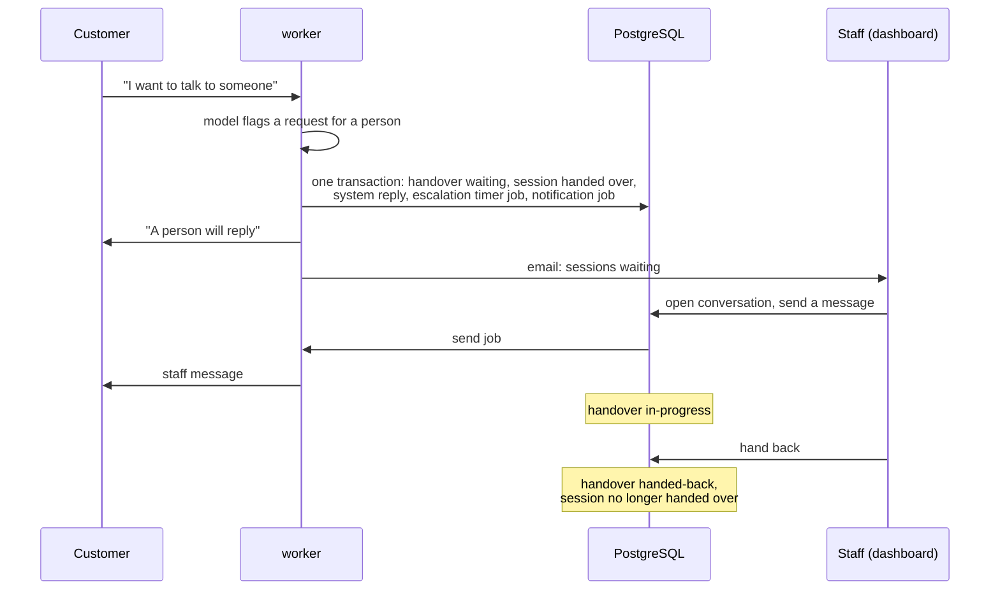

# Architecture

Status: draft for maintainer review · Phase 2 (design) · Issue #39

This document follows the twelve sections of the arc42 template. The section
list was read from <https://arc42.org/overview/> and
<https://docs.arc42.org/home/> on 2026-11-16, as search extracts. Diagrams use
the levels of the C4 model (context, container, component), drawn as Mermaid
flowcharts; the C4 model's own site was not read, so no conformance to its
notation is claimed.

It describes the design for version 1.0. Nothing here is built yet.

## 1. Introduction and goals

### What the system does

A business connects its WhatsApp number. The system answers its customers'
messages in the customer's language from the business's own data, books
appointments, sends reminders, and hands a conversation to staff when it
should not answer. Staff and owners use a web dashboard. Scope and
positioning are in `docs/adr/0001-positioning-and-v1-scope.md`; behaviour is
in `docs/requirements/` and `docs/design/state-machines.md`.

### Quality goals

The five that shape the architecture, in priority order.

| # | Goal | Why it leads | Measured by |
| --- | --- | --- | --- |
| 1 | **Tenant isolation.** One business never sees another's data. | A leak harms real people and cannot be undone. | NFR-S1 |
| 2 | **Stated facts are true.** A price or a time the assistant states matches the business's data. | A wrong price is worse than no reply. | NFR-A2, US-C4 |
| 3 | **Customers' choices are honoured.** Opt-out, consent and deletion always take effect. | Privacy, and the channel's own rules. | NFR-V1, NFR-V3 |
| 4 | **No message lost or answered twice.** | The product's basic promise. | NFR-R1, NFR-R2 |
| 5 | **A new use case is a new pack**, with no change to the core. | The design's central bet. | NFR-M1 |

Speed and cost matter (NFR-P2, NFR-C1) but give way to these five when they
conflict.

### Stakeholders

| Who | What they need from the architecture |
| --- | --- |
| End customer | Fast, correct replies; a person on request; to be left alone on request |
| Business owner, staff | A dashboard that reflects exactly what the assistant did and why |
| Maintainer | A codebase one person can understand, test and run |
| A reviewer of the repository | To see how each requirement is met, and to check it |

## 2. Constraints

| Constraint | Consequence |
| --- | --- |
| One maintainer directing an AI agent | Few moving parts; one language; one database (ADRs 0002 to 0004) |
| Version 1.0 runs against a mock channel and a fake model client until the maintainer supplies accounts | The channel and the model sit behind interfaces from the first commit (ADR 0005) |
| The channel's rules: 24-hour reply window, approved templates, opt-in, per-message fees, no ordering guarantee (`docs/compliance.md`) | A channel adapter that enforces them; delivery tracking; templates as data |
| No real customer data is processed (ADR 0001) | Synthetic fixtures only; the README and system card must say so (NFR-L2) |
| Conversation data may not train or evaluate models (NFR-V6) | Eval datasets are written, never harvested |
| Must run from a fresh clone in five commands (NFR-M4) | No dependency on an outside account for the local stack |

## 3. Context and scope

### External interfaces

| Neighbour | Direction | What crosses | Trust |
| --- | --- | --- | --- |
| WhatsApp Cloud API | In | Webhooks: customer messages, delivery statuses, template status changes | Authenticated by signature; content is untrusted customer input |
| WhatsApp Cloud API | Out | Messages, template submissions, credential checks | Authenticated with the tenant's own credentials |
| Language model provider | Out and back | The business profile, the session's messages, tool results; structured output | Output is untrusted until validated and its claims checked (ADR 0007) |
| Email service | Out | Invitations, password resets, staff and operator notifications | No customer message text in any email |
| Browser | In and out | Dashboard requests | Authenticated by session (ADR 0008) |

In development and in CI the first two neighbours are replaced by
`mock-whatsapp` and `FakeLlmClient`, and email is written to a log.

What leaves the system about a customer: message text and tool results go to
the model provider, with no phone number and no name added by the system
(NFR-V7). Nothing about a customer goes to the email service.

## 4. Solution strategy

| Quality goal | Approach | Decided in |
| --- | --- | --- |
| Tenant isolation | Row-level security in the database, set per transaction from a server-held value; tools scoped on the server | ADR 0003, ADR 0008 |
| Stated facts are true | The model receives the business's data as identified items and must return a claim for each stated value; code checks each claim | ADR 0006, ADR 0007 |
| Customers' choices honoured | Opt-out and consent are handled by code before the model is involved; every outbound message passes checks decided by its class | State machines, sections 1, 6 and 7 |
| No message lost or duplicated | The webhook stores the message and its job in one transaction; a unique message ID; one worker per conversation | ADR 0004 |
| A new use case is a new pack | The core defines interfaces; a pack supplies tools, templates, a profile schema and evals | Section 5 below |
| Understandable by one person | A modular monolith: one repository, one database, two kinds of process | ADR 0002 |
| Rules that interact over time | Pure state-machine functions in `packages/core`, tested exhaustively | `state-machines.md` |

## 5. Building block view

### Level 1: containers

| Container | Responsibility | Does not |
| --- | --- | --- |
| `api` | Verify and store webhooks and enqueue their jobs; serve the dashboard API; authenticate users | Call the model; send customer messages itself |
| `worker` | Claim and run jobs: process a conversation, send a message, fire a timer, run maintenance | Accept inbound HTTP |
| `dashboard` | Render screens; call `api` | Hold secrets; reach the database |
| PostgreSQL | Hold all state, including jobs (ADR 0004) and login sessions (ADR 0008) | |
| `mock-whatsapp` | Development and CI only: imitate the Cloud API, and offer a test page to send customer messages | Ship in a deployment |

The webhook path does three things only: verify the signature, write the
message and its job in one transaction, answer 200. Everything else is the
worker's.

### Level 2: packages

| Package | Responsibility |
| --- | --- |
| `core` | The rules, as pure functions: the order of checks, the eight state machines, message classes and their pre-send checks, the reminder timing rule, quiet hours, metric definitions. No database, network, clock or framework import; time is passed in. |
| `db` | The schema and migrations; typed queries; the function that opens a transaction for a tenant and sets row-level security; the jobs table and its claim, retry and dead-letter logic. |
| `channel` | The interface a channel implements: verify a webhook, parse it into the system's own event types, send a free-form or template message, submit a template, check credentials. |
| `channel-whatsapp`, `channel-mock` | Implementations. All knowledge of Meta's payloads lives in the first. |
| `ai` | `LlmClient` and its adapters; loading versioned prompts; building the business profile; validating structured output; checking claims; writing traces. |
| `pack` | The interface a pack implements (below). |
| `packs/booking`, `packs/faq-only` | Implementations. |
| `integrations` | Reserved for v1.1. Empty in v1.0. |

**Dependency rule.** `core` imports nothing from this repository. No package
imports from `apps`. The core never imports a pack; packs are registered with
the worker at start-up. An import-boundary test in CI enforces all three.

### What a pack provides

| Part | Purpose |
| --- | --- |
| Profile schema | The business data this pack needs (for `booking`: services, opening hours, policies) and how it is rendered for the model as identified items |
| Tools | Functions the model may call, each with an argument schema; they receive the tenant and contact from the server, never from the model |
| Prompt fragments | Versioned text describing the pack's task to the model |
| Templates | The pre-approved messages the pack sends, per language |
| Scheduled events | The business-initiated messages the pack creates (for `booking`: reminders, booking-change notices) and their timing rules |
| Buttons | Button payloads the pack handles by code (for `booking`: Confirm) |
| Session labels | What the pack records about a session (for `booking`: whether it was an inquiry) |
| Dashboard sections | The screens the pack adds (for `booking`: bookings, blocked time, attendance) |
| Evals | The pack's dataset and graders |

`faq-only` provides a profile schema, one prompt fragment and evals, and
nothing else. If adding it requires a change under `packages/core`, the
interface above is wrong (NFR-M1).

One part of the core knows about bookings: section 1 of the state machines
gives the Confirm button its own step. In the code that step is "a button a
pack has registered as handled by code", so the core stays unaware of what
the button means.

## 6. Runtime view

### An inbound message is answered

If a new message arrives while the model is working, the worker finds it when
it re-reads the conversation before storing the reply, discards the reply and
starts again (US-C11, criterion 2).

### A reminder is sent

No model is involved. A reminder is sent in degraded mode and while a session
is handed over.

### A conversation is handed to staff

### Timers

Every timer in `state-machines.md` is a job with a due time. Changing state
and creating or cancelling its timers happen in one transaction, so a timer
cannot outlive the state it belongs to.

| Timer | Job created when | Cancelled when |
| --- | --- | --- |
| Batching window | An inbound message is stored | It runs |
| Awaiting-retry attempt, 15-minute expiry | The mark is set | The mark is cleared |
| Reminder | A booking is created or moved | The booking is cancelled or moved |
| Escalation | A handover becomes `waiting` or `detached` | It leaves both, or a follow-up is accepted |
| Follow-up expiry (7 days), detached expiry (14 days) | The handover enters the state | It leaves the state |
| Session end | Each message, replacing the previous one | A newer message |
| Rate-pause end | The pause starts | It runs |
| Delivery wait (10 s) | A message is sent while another is queued behind it | A delivered status arrives |
| Daily: retention, credential checks, template status refresh | Recurring | Never |

A timer job re-reads the state when it runs and does nothing if the state has
moved on. Timers are therefore safe to run late or twice.

## 7. Deployment view

| Environment | What runs | Channel | Model |
| --- | --- | --- | --- |
| Local | `docker compose up`: `api`, one `worker`, `dashboard`, PostgreSQL, `mock-whatsapp` | Mock | Fake, or a real provider if the developer sets a key |
| CI | The same containers, started by the workflow | Mock | Fake; a real provider only in the eval job, once a provider is chosen |
| Staging and production | `api`, one or more `worker`, `dashboard`, PostgreSQL | Not decided | Not decided |

The hosting target is ADR 0009 and the model provider is ADR 0010; both are
proposed and wait for the maintainer.

Workers are identical and stateless; more can be added. Correctness under
several workers rests on row locking for jobs and an advisory lock per
conversation (ADR 0004), and is tested with two workers (NFR-R6).

Migrations run as a separate step before new code starts, and each has a
tested reverse step (NFR-O4).

## 8. Crosscutting concepts

**Tenancy.** Every unit of work runs inside `withTenant(tenantId, fn)`, which
opens a transaction and sets the tenant for row-level security. The tenant
comes from the receiving number (webhooks), the session row (dashboard) or
the job's payload (workers); never from a browser field or from the model.
Cross-tenant operator jobs use a separate role and one named module.

**Transactions and jobs.** A state change and the jobs that follow from it
are written in one transaction. External calls (channel, model, email) are
made by jobs, outside any transaction, and are designed to be repeated
safely.

**Idempotency.** Inbound: a unique channel message ID. Tools: each
state-changing tool call carries a key derived from the session and the
model's call, so a repeated call finds the first result. Outbound: a message
row is created before the send and its status moves forward only.

**Time.** All rules take the current time as an argument. Production passes
the clock; tests pass a fixed or stepped time. Times are stored in UTC;
tenant-local calculations (quiet hours, opening hours, reminders) use the
tenant's time zone and are in `core`.

**Fixed texts.** Disclosure, fallback, confirmations, the rate notice and
handover messages are stored per language, added by code, and never written
by the model. A missing language falls back to the tenant default.

**Errors.** A job that throws is retried with backoff and ends in a
dead-letter state with an operator alert (NFR-R5). A failure the rules
anticipate (provider timeout, send rejected) is a typed result, not an
exception, and is handled by the state machines.

**Logging and tracing.** Structured JSON logs with request, tenant, job and
conversation identifiers. No message text, phone number or contact name in
logs or traces (NFR-V2); a test scans the logs of an end-to-end run. One
trace per model call (US-C10).

**Configuration and secrets.** Configuration from the environment, validated
at start-up. Secrets from the environment or a secret manager; tenants'
channel credentials encrypted at rest with a key held outside the database
(NFR-S5).

**Security.** The threat model is `docs/design/threat-model.md` (issue #42).

**Testing.** `core` is tested exhaustively as pure functions, replacing the
Python models in `docs/design/models/`. Integration tests run against a real
PostgreSQL. End-to-end tests drive whole conversations through
`mock-whatsapp`. The plan is `docs/test-plan.md`, written in M2.

## 9. Architecture decisions

All in `docs/adr/`; the index is `docs/adr/README.md`. ADRs 0001 to 0008 are
accepted; 0009 (hosting) and 0010 (model provider) are proposed.

## 10. Quality requirements

The full list is `docs/requirements/nfr.md`. These scenarios show how the
architecture meets the five quality goals.

| Goal | Scenario | Response | Requirement |
| --- | --- | --- | --- |
| Tenant isolation | A query is written without a tenant filter | It returns no rows from another tenant, because row-level security adds the filter | NFR-S1 |
| Tenant isolation | The model is manipulated into asking a tool for another tenant's booking | The tool runs in the calling tenant's transaction; the row is invisible | NFR-S1, NFR-A1 |
| Facts are true | The model states a price that differs from the stored one | The claim check fails; the fallback is sent instead | US-C4, NFR-A2 |
| Choices honoured | An opted-out contact has a reminder due | The send-time check withholds it | NFR-V1 |
| Choices honoured | A customer opts out while the tenant's credentials are broken | The opt-out is applied at step 5, before the tenant-answering check | US-C7 |
| Nothing lost | The worker stops after the webhook answered 200 | The job is still in the database and runs when a worker returns | NFR-R1 |
| Nothing duplicated | The channel redelivers a webhook five times | The unique message ID rejects four inserts | NFR-R2 |
| New pack | `faq-only` is added | No file under `packages/core` changes | NFR-M1 |

## 11. Risks and technical debt

### How the four highest risks are addressed

| Risk | In the architecture | What remains |
| --- | --- | --- |
| **R-A1** The assistant states a wrong price, time or policy | Data reaches the model as identified items (ADR 0006); each stated amount, time or date needs a claim that code checks against the named item (ADR 0007, layer 5); availability comes only from tools | Facts with no checked value, and confirming a wrong value the customer supplied, are measured by evals, not blocked |
| **R-T2** Cross-tenant data leak | Row-level security with a non-bypassing role (ADR 0003); the tenant is set on the server (ADR 0008); generated tests on every table | The operator role bypasses it by design; its use is confined to one module |
| **R-A2** Prompt injection causes data exposure or an unintended tool call | The model is given only one tenant's data; tools are scoped and validated on the server; steps 1 to 14 of the order of checks never consult the model (ADR 0007) | A manipulated model can still write a misleading reply within its own tenant's data; evals measure this |
| **R-C1** Breaking the channel's messaging rules restricts a tenant's number | The channel adapter and the message-class checks enforce the reply window, templates, consent and opt-out for every outbound message, in one place (state machines, section 7) | The mock channel may differ from the real one (R-T3); no live test has been run |

### Technical debt and known limits

| Item | Why it exists | When it is paid |
| --- | --- | --- |
| Two design models in Python in a TypeScript project | They were the fastest way to check the tables | Replaced by `core` tests in M2 to M5 |
| The handover model checks one invariant of three | Stated in `state-machines.md` | Tests for H1 and H3 in M4 |
| 72 open `review-finding` issues, Medium and Low, some holding several findings (counted 2026-11-16) | Each review's unfixed findings were tracked, not fixed | As design or build reaches each story |
| No second factor on sign-in | ADR 0008 | Before any use with real data |
| One database for data and jobs | ADR 0004 | If the load test fails |
| Fidelity of the mock channel | No live number in v1.0 | A supervised live test, if the maintainer runs one |
| No version of any library is verified | ADRs name approaches | When each is added in M2 |

## 12. Glossary

`docs/requirements/glossary.md`.
