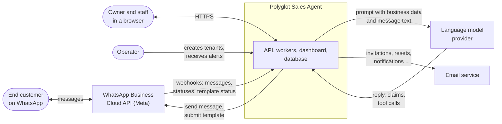
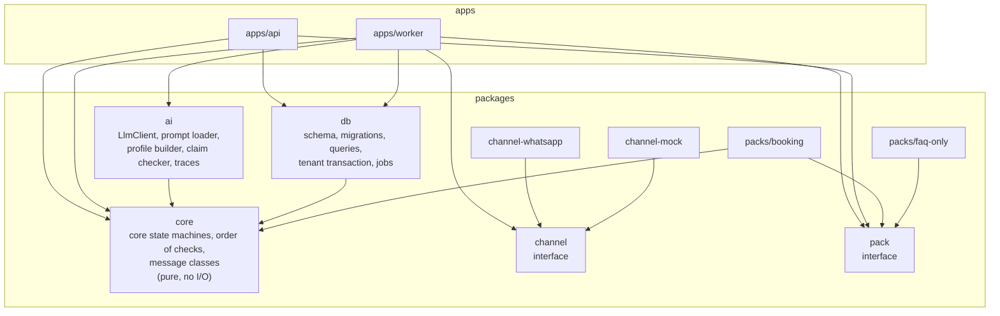
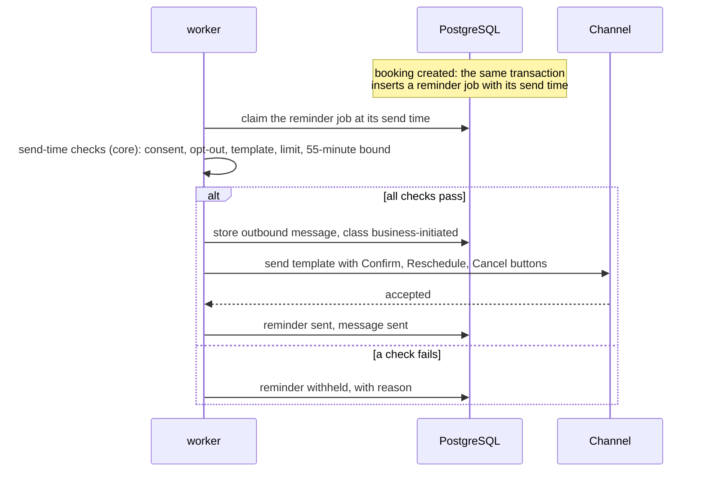
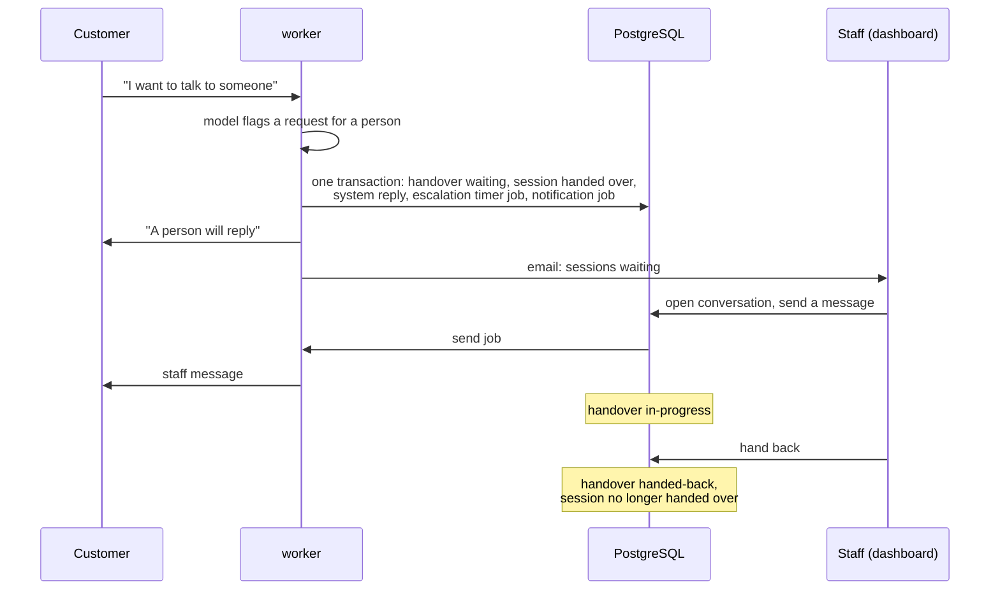

# Architecture

Status: draft for maintainer review · Phase 2 (design) · Issue #39

This document follows the twelve sections of the arc42 template. The section
list was read from <https://arc42.org/overview/> and
<https://docs.arc42.org/home/> on 2026-11-16, as search extracts. Diagrams use
the levels of the C4 model (context, container, component), drawn as Mermaid
flowcharts; the C4 model's own site was not read, so no conformance to its
notation is claimed.

It describes the design for version 1.0. Nothing here is built yet.

## 1. Introduction and goals

### What the system does

A business connects its WhatsApp number. The system answers its customers'
messages in the customer's language from the business's own data, books
appointments, sends reminders, and hands a conversation to staff when it
should not answer. Staff and owners use a web dashboard. Scope and
positioning are in `docs/adr/0001-positioning-and-v1-scope.md`; behaviour is
in `docs/requirements/` and `docs/design/state-machines.md`.

### Quality goals

The five that shape the architecture, in priority order.

| # | Goal | Why it leads | Measured by |
| --- | --- | --- | --- |
| 1 | **Tenant isolation.** One business never sees another's data. | A leak harms real people and cannot be undone. | NFR-S1 |
| 2 | **Stated facts are true.** A price or a time the assistant states matches the business's data. | A wrong price is worse than no reply. | NFR-A2, US-C4 |
| 3 | **Customers' choices are honoured.** Opt-out, consent and deletion always take effect. | Privacy, and the channel's own rules. | NFR-V1, NFR-V3 |
| 4 | **No message lost or answered twice.** | The product's basic promise. | NFR-R1, NFR-R2 |
| 5 | **A new use case is a new pack**, with no change to the core. | The design's central bet. | NFR-M1 |

Speed and cost matter (NFR-P2, NFR-C1) but give way to these five when they
conflict.

### Stakeholders

| Who | What they need from the architecture |
| --- | --- |
| End customer | Fast, correct replies; a person on request; to be left alone on request |
| Business owner, staff | A dashboard that reflects exactly what the assistant did and why |
| Maintainer | A codebase one person can understand, test and run |
| A reviewer of the repository | To see how each requirement is met, and to check it |

## 2. Constraints

| Constraint | Consequence |
| --- | --- |
| One maintainer directing an AI agent | Few moving parts; one language; one database (ADRs 0002 to 0004) |
| Version 1.0 runs against a mock channel and a fake model client until the maintainer supplies accounts | The channel and the model sit behind interfaces from the first commit (ADR 0005) |
| The channel's rules: 24-hour reply window, approved templates, opt-in, per-message fees, no ordering guarantee (`docs/compliance.md`) | A channel adapter that enforces them; delivery tracking; templates as data |
| No real customer data is processed (ADR 0001) | Synthetic fixtures only; the README and system card must say so (NFR-L2) |
| Conversation data may not train or evaluate models (NFR-V6) | Eval datasets are written, never harvested |
| Must run from a fresh clone in five commands (NFR-M4) | No dependency on an outside account for the local stack |

## 3. Context and scope

### External interfaces

| Neighbour | Direction | What crosses | Trust |
| --- | --- | --- | --- |
| WhatsApp Cloud API | In | Webhooks: customer messages, delivery statuses, template status changes | Authenticated by signature; content is untrusted customer input |
| WhatsApp Cloud API | Out | Messages, template submissions, credential checks | Authenticated with the tenant's own credentials. As built in M2: one credential for every tenant, from the worker's settings (#290) |
| Language model provider | Out and back | The business profile, the session's messages, tool results; structured output | Output is untrusted until validated and its claims checked (ADR 0007) |
| Email service | Out | Invitations, password resets, staff and operator notifications | No customer message text in any email |
| Browser | In and out | Dashboard requests | Authenticated by session (ADR 0008) |

In development and in CI the first two neighbours are replaced by
`mock-whatsapp` and `FakeLlmClient`, and email is written to a log.

What leaves the system about a customer: message text and tool results go to
the model provider, with no phone number and no name added by the system
(NFR-V7). Nothing about a customer goes to the email service.

## 4. Solution strategy

| Quality goal | Approach | Decided in |
| --- | --- | --- |
| Tenant isolation | Row-level security in the database, set per transaction from a server-held value; tools scoped on the server | ADR 0003, ADR 0008 |
| Stated facts are true | The model receives the business's data as identified items and must return a claim for each stated value; code checks each claim | ADR 0006, ADR 0007 |
| Customers' choices honoured | Opt-out and consent are handled by code before the model is involved; every outbound message passes checks decided by its class | State machines, sections 1, 6 and 7 |
| No message lost or duplicated | The webhook stores the message and its job in one transaction; a unique message ID; one worker per conversation | ADR 0004 |
| A new use case is a new pack | The core defines interfaces; a pack supplies tools, templates, a profile schema and evals | Section 5 below |
| Understandable by one person | A modular monolith: one repository, one database, two kinds of process | ADR 0002 |
| Rules that interact over time | Pure state-machine functions in `packages/core`, tested exhaustively | `state-machines.md` |

## 5. Building block view

### Level 1: containers

| Container | Responsibility | Does not |
| --- | --- | --- |
| `api` | Verify and store webhooks and enqueue their jobs; serve the dashboard API; authenticate users | Call the model; send customer messages itself |
| `worker` | Claim and run jobs: process a conversation, send a message, fire a timer, run maintenance. Record a heartbeat, which is its health probe | Accept inbound HTTP |
| `dashboard` | Render screens; call `api` | Hold secrets; reach the database |
| PostgreSQL | Hold all state, including jobs (ADR 0004) and login sessions (ADR 0008) | |
| `mock-whatsapp` | Development and CI only: stand in for Meta's servers. It accepts the send call that `channel-whatsapp` makes, and posts webhooks signed as Meta signs them; a test page plays the customer | Ship in a deployment. Listen on anything but this machine |

The webhook path does three things only: verify the signature, write the
message and its job in one transaction, answer 200. Everything else is the
worker's.

### Level 2: packages

| Package | Responsibility |
| --- | --- |
| `core` | The rules that hold for every pack, as pure functions: the order of checks, the six core state machines (handover, session, contact messaging permission, outbound message, provider availability, tenant), message classes and their pre-send checks, quiet hours, and the core metric definitions. No database, network, clock or framework import; time is passed in. It contains nothing about bookings (ADR 0012). |
| `db` | The schema and migrations; typed queries; the function that opens a transaction for a tenant and sets row-level security; the jobs table and its claim, retry and dead-letter logic. |
| `channel` | The interface a channel implements: verify a webhook, parse it into the system's own event types, send a free-form or template message, submit a template, check credentials. Since M3 unit U5 a message from a customer is a text (which may say it was a caption), a tap on a button (what the button carried, and the message it answers) or a type that is not read; a channel states its limits, sends a text with buttons, and refuses before any call a message outside those limits. Template sending, template submission and the credentials check are not built |
| `channel-whatsapp` | The WhatsApp implementation. All knowledge of Meta's payloads lives here. In development and CI it talks over HTTP to the `mock-whatsapp` app, so the same code runs as in a deployment, against another address |
| `channel-mock` | A second implementation that lives in memory, with a format of its own. It imitates nothing; it is what a test uses when the test is not about WhatsApp, and it is the second implementation that shows the interface fits more than one channel (NFR-M2) |
| `ai` | `LlmClient` and its adapters; loading versioned prompts; building the business profile; validating structured output; checking claims; writing traces. |
| `pack-interface` | The type of a pack and of its parts, the lookup of a pack by name and the check of a pack's name (ADR 0014). Built in M3 unit U4 with the name and the prompt fragment; tools and claim kinds are added by the units that first use them. |
| `packs/registry` | The packs a deployment runs, by name, and nothing else. Imported only by `main.ts` of the api and of the worker (ADR 0014); nothing imports it yet. |
| `packs/booking` | Everything about appointments: the booking and reminder state machines, the reminder timing rule, slots and capacity, its tables and migrations, its tools, templates, buttons, timers, API routes, settings and metrics (ADR 0012). As built in M2 it holds only the list of its names, which a test keeps out of the core; the pack itself is M5's |
| `packs/faq-only` | The trial pack: a prompt fragment and evals. It uses the core business profile and adds no code. |
| `integrations` | Reserved for v1.1. Empty in v1.0. |

**The two mocks** (Gate 2 finding S34, decided in M2 unit U6). They are not
alternatives.

| | `apps/mock-whatsapp` | `packages/channel-mock` |
| --- | --- | --- |
| What it replaces | Meta's servers | The whole WhatsApp channel |
| How it is reached | Over HTTP, by `channel-whatsapp` | In the test's own process |
| Used by | The tests in `apps/mock-whatsapp`, which run `channel-whatsapp` against it over HTTP and feed its webhooks to the webhook guard; a developer, through its test page; the end-to-end tests, when they exist (U10) | The contract tests, as the second channel that must pass them; tests of the worker and of the webhook path that are not about WhatsApp, when those exist (U7, U8) |
| What it shows | That the code which will talk to Meta sends and reads what was documented on the fixtures' date | That the interface is enough for a channel with another format. That nothing outside `channel-whatsapp` knows about WhatsApp is not shown by it; a test on names now does part of it (`packages/channel/src/boundary.test.ts`, M3 unit U5): outside the channels, only the file of each app that builds a channel and the stand-in for Meta name one (#285) |

Neither proves that Meta behaves as documented. Only the supervised live
test before v1.0.0 does (risk R-T3).

**Dependency rule.** `core` imports nothing from this repository. No package
imports from `apps`. The core never imports a pack; packs are registered with
`worker` and with `api` at start-up, since a pack supplies both tools and
routes (ADR 0012), and with `ops`, which names the packs a tenant can be
created on. How a pack is registered is decided in ADR 0014. The diagram
above has the edge from `api` to `pack`; it does not draw the registry
package, the edge from the interface to `core`, or `ops`. An
import-boundary test in CI enforces the three rules of this paragraph.

### What a pack provides

| Part | Purpose |
| --- | --- |
| Profile schema | The business data this pack needs (for `booking`: services, opening hours, policies) and how it is rendered for the model as identified items |
| Tools | Functions the model may call, each with an argument schema; they receive the tenant and contact from the server, never from the model |
| Prompt fragments | Versioned text describing the pack's task to the model |
| Templates | The pre-approved messages the pack sends, per language |
| Scheduled events | The business-initiated messages the pack creates (for `booking`: reminders, booking-change notices) and their timing rules |
| Buttons | Button payloads the pack handles by code (for `booking`: Confirm) |
| Session labels | What the pack records about a session (for `booking`: whether it was an inquiry) |
| Dashboard sections | The screens the pack adds (for `booking`: bookings, blocked time, attendance) |
| Evals | The pack's dataset and graders |

`faq-only` provides a profile schema, one prompt fragment and evals, and
nothing else. If adding it requires a change under `packages/core`, the
interface above is wrong (NFR-M1).

ADR 0014 says which of these parts are built in M3 (tools, prompt
fragments, and claim kinds, which this table lacks) and which wait for
M5; where it differs from this table, it is the later record.

ADR 0012 adds four parts to this list: migrations for the pack's own tables,
a settings schema, an API route plug-in, and timers. It also says what the
core does with each.

**What belongs to the core and what to the booking pack** is decided in
ADR 0012. In short: the core owns services with their prices, policies and
opening hours, because every pack answers questions about them. The booking
pack owns everything that exists only because appointments do: a service's
duration and capacity, slots, bookings, blocked periods, reminders, the
Confirm button, and the booking settings. Sections 4 and 5 of the state
machines are the booking pack's; step 6 of the order of checks is, in code,
"a button a pack has registered as handled by code".

The trial pack `faq-only` cannot prove this boundary, because it adds no
code. The proof is a boundary test (ADR 0012): nothing under `packages/core`,
the core migrations or the core API routes may name a booking table, type or
route.

## 6. Runtime view

### An inbound message is answered

If a new message arrives while the model is working, the worker finds it when
it re-reads the conversation before storing the reply, discards the reply and
starts again (US-C11, criterion 2). What that means for a booking the first
attempt already made is defined next.

As built in M3 unit U2: the same holds for a reply that is stored and not
yet sent. The send job holds it back while a newer message of the customer
waits, and the next turn discards it and answers everything. After two
replies in a row have been dropped in a session, the third is sent
(`design/notes/m3-u2-sessions.md`, D1 to D9; decisions row 38).

### What the webhook does with each kind of event

Decided in M2 unit U7 (Gate 2 finding S8, #177). The webhook's transaction
is the application role's, inside the tenant of the receiving number. It
does the least that makes the event safe to acknowledge; everything that
decides anything runs in the worker.

| Event | The webhook's transaction writes | Queues | Runs later, in the worker |
| --- | --- | --- | --- |
| A message from a customer, of any type: a text, a caption (stored as a text that says so), a tap (stored with what the button carried and without a body) or one that is not read | The contact, if new, found as the data model's table "Which contact a message belongs to" says (#284). The conversation, if new. The message, once: its channel identifier is unique per tenant and direction | One `process-conversation` job for the conversation, due at once, if at least one of its messages was new | Every step of "Processing one turn": opt-out, buttons, the reply window, the session, the model. None of them runs in the request |
| The same message again | Nothing | Nothing | |
| A delivery status | The status of the outbound message it names, and only forwards: `sent`, then `delivered`, then `read`; `failed` only before delivery. A status for a message nobody sent changes nothing | Nothing | |
| Anything for a receiving number no tenant has | One row in `unroutable_events` for each event: the channel, the two identifiers and the kind. Written by the cross-tenant role | Nothing | |
| A body that cannot be read | One row in `unparsed_events`: a hash, the size and a code. Written by the cross-tenant role | One `operator-alert` job, once per body | |
| A readable body with items left out as malformed | The rest as above, then one row in `unparsed_events` with the count | One `operator-alert` job, once per body | |

One webhook can carry events for several receiving numbers. Each number's
events are one transaction, however the channel grouped them in the body;
if a later one fails the answer is 503, the channel sends the webhook
again, and what was already stored is skipped. Messages already stored are
found with one query for the whole webhook, so a large one sent again is
answered quickly.

As built in M3 unit U2, the webhook's transaction also puts the message in
its session, opens the reply window, and does all of it under a lock on
the conversation's row, which starting a turn, ending a turn and claiming a
message to send take too (`design/notes/m3-u2-sessions.md`, sections 0 to
2). The table above still says the session and the reply window run later,
in the worker; step 4 of the order of checks puts them with the store, and
that is what is built. The job is due 3 seconds after the message, and the
turn checks the batching window itself. In place of steps 4a to 11 and 13
to 15 the worker still sends an echo of the customer's text (#290).

### Processing one turn

A **turn** is one attempt to answer one batch. This section is the authority
for how leases, tools, checks and sends fit together. It answers Gate 2
findings S1, S2, S3 and A13.

1. **Lease.** The worker takes the conversation lease (ADR 0004) and renews
   it before each model attempt.
2. **Context.** The prompt holds the session's messages **and the results of
   every tool call already completed in this session**, read from
   `tool_calls`. A restarted or retried turn therefore sees a booking that an
   earlier attempt made.
3. **Tools.** A tool runs in its own short transaction in the tenant's scope.
   **That transaction first checks the lease token**, as the store step
   does; a worker that has lost the lease cannot change anything. A tool
   that changes state then does three things in the same transaction: the
   change, its `tool_calls` row, and the job that sends the **fixed
   confirmation text** for it. The confirmation is sent because the tool
   succeeded. It does not wait for, or depend on, the model's reply.
4. **Recognising a repeat.** The model's call identifier is never used.
   The thing being changed decides:
   - *Create:* a partial unique index allows one active booking per contact,
     service and start time. A second create that hits it returns the
     existing booking. After a cancellation the slot can be booked again,
     because the cancelled booking is no longer active.
   - *Move:* the update applies only if the booking is still at the start
     time the call was told it had. If it is already at the new time, the
     call returns it unchanged. Moving back and forth is therefore possible.
   - *Cancel:* cancelling a cancelled booking returns it unchanged.
   - *Read-only tools* are never deduplicated.

   **A repeat changes nothing, queues no confirmation, and does not count as
   "a state-changing tool succeeded in this turn" for step 6.** Its
   `tool_calls` row records which earlier call it repeated.
5. **Reply.** After the last tool result the model returns its reply, claims
   and flags, and code runs the output checks.
6. **If the reply fails a check after a state-changing tool succeeded in this
   turn,** no fallback is sent: the customer already has the confirmation,
   which is true. The failure is recorded and does not count towards the
   two-fallback handover. If a flag is set, the handover or other fixed text
   is sent as usual, after the confirmation.
7. **If the turn is discarded** because a newer message arrived, or because
   the lease was lost, the reply text is dropped. Tools that ran stay done,
   and their confirmations are already queued. The next turn sees them (2).
8. **Store.** One transaction checks the lease token, stores the reply and
   the trace, and enqueues the send job. If the token is no longer the
   worker's, nothing is stored.

### Sending a message once

The channel is called outside any transaction, and nothing here assumes the
channel offers a way to ask whether it has a message (an assumption; see
the threat model, section 1). So a call for a message ends in one of three
ways:

| Outcome | What it is |
| --- | --- |
| Accepted | The channel answered with its identifier for the message |
| Refused | The channel answered and said no, or the message was never sent. The customer has nothing |
| Unknown | A timeout, a broken connection, a fault on the channel's side (HTTP 5xx or 408), an answer that could not be read, or **a worker that stopped** after the call started and before its result was recorded. The customer may have the message |

A stopped worker and a timeout are the same case and get the same rule
(Gate 2 finding V5, #235). What follows an outcome depends only on the
message's class, and every class has a row (finding V6, #236):

| Class | After a refusal the channel says can be retried | After an unknown outcome |
| --- | --- | --- |
| Assistant reply, system reply, staff message | Called again: three calls in all, after 2 and 8 seconds, then `failed` with the channel's code, or with `unconfirmed` if an earlier call for it ended unknown | **Called once more.** A customer waiting for an answer is worse off with none than with two. If that call is unknown too, `failed` with the code `unconfirmed`: never a third |
| Service notice (the holding message, `handover_followup`), business-initiated (reminder, booking notice) | The same | **Not called again.** `failed` with the code `unconfirmed`. A second message the business started, which may be paid for, is worse than a missed one |

A refusal the channel says cannot be retried is `failed` at once, for every
class: with the channel's code, or with `unconfirmed` if an earlier call for
the same message ended unknown, because the customer may then have it. No message is ever called for more than
three times, and at most one unknown outcome is ever followed by another
call. So a customer can receive at most two copies of a reply and at most
one of anything else, whatever the channel and the workers do (NFR-R2);
the policy is one function in `packages/core`, and a test walks every
sequence of outcomes.

How a message moves:

| Step | What happens |
| --- | --- |
| Before the call | In one transaction the oldest waiting message of the conversation moves `pending` → `sending`, with the time and the count of calls |
| After the call | In one transaction the result is recorded: `sent` with the channel's identifier, back to `pending` with the earliest time of the next call, or `failed` with a code. The record applies only if the message is still in the call that worker started |
| Found in `sending` for more than 2 minutes | The outcome is unknown, and the table above decides. This is looked at when a send job for the conversation next runs: a later message's job, or the stopped worker's own job once its claim has run out, which is 5 minutes |
| Found waiting more than 15 minutes after it could first have gone (after it was stored, or after the time it was last put off to) | Not sent. `failed` with the code `expired` if the channel was never left holding it, `unconfirmed` otherwise. An answer that arrives hours late is worse than none. **This holds whatever kept it waiting**: a dead job, no worker running, or a queue more than 15 minutes behind. The customer's message has by then been marked as dealt with, so nothing answers it; each such message is reported as `send-failed expired`. A call under way that is not yet 2 minutes old is left alone however old the message is |

**Order within a conversation.** One job, `send-messages`, sends what waits
in a conversation, oldest first, one message at a time. While the oldest is
being sent or waits to be called again, nothing behind it goes, so a
message stuck in `sending` holds the next one until it is resolved as
above and never lets it overtake (NFR-R6). A message that ends `failed`
does not hold up the next. Waiting for the previous message to be reported
delivered, or 10 seconds (NFR-R7), is not built (#290).

One run of the job makes at most 20 calls and stops at the first that is
not accepted, so that a slow channel in one conversation costs the other
jobs one call's wait, not twenty.

**When the send job itself dies** (it failed six times, for instance with
the database unreachable), an operator alert is queued and the
conversation's waiting messages stay where they are: nothing sweeps for
them. They are looked at when the next message for that conversation is
stored, or when an operator retries the job (U9). By then those older than
15 minutes expire as above; they are not sent late.

So "exactly one reply" (US-C1 criterion 9) holds for a worker that stops
before the message is marked `sending`, and for one that stops after the
result is recorded. A worker that stops in between leaves an unknown
outcome. The restart test stops the worker at each point and shows, for a
reply and for a business-initiated message: before the mark, one copy;
after the mark and before the call, one copy of a reply (from the second
call) and none of the other; after the channel accepted and before that
was recorded, two copies of a reply and one of the other; after the
record, one copy.

As built in M2 unit U8, every message is sent as a free-form text and no
pre-send check runs; the classes other than an assistant reply are stored
only by tests. See #290.

### A reminder is sent

No model is involved. A reminder is sent in degraded mode and while a session
is handed over.

### A conversation is handed to staff

### Timers

Every timer in `state-machines.md` is a job with a due time. Changing state
and creating or cancelling its timers happen in one transaction, so a timer
cannot outlive the state it belongs to.

| Timer | Job created when | Cancelled when |
| --- | --- | --- |
| Batching window | An inbound message is stored. As built: a webhook queues one job for each conversation it stored a message for, due 3 seconds later, and the turn checks the window, so a job is never moved | It runs |
| Awaiting-retry attempt, 15-minute expiry | The mark is set | The mark is cleared |
| Reminder | A booking is created or moved | The booking is cancelled or moved |
| Escalation | A handover becomes `waiting` or `detached` | It leaves both, or a follow-up is accepted |
| Follow-up expiry (7 days), detached expiry (14 days) | The handover enters the state | It leaves the state |
| Session end | Each message, replacing the previous one. **Not built:** as of M3 unit U2 a session is ended when its conversation is next touched; the unit that first needs an end with no new message builds this timer | A newer message |
| Rate-pause end | The pause starts | It runs |
| Delivery wait (10 s) | A message is sent while another is queued behind it | A delivered status arrives |
| Daily: retention, credential checks, template status refresh | Recurring | Never |

A timer job re-reads the state when it runs and does nothing if the state has
moved on. Timers are therefore safe to run late or twice.

## 7. Deployment view

| Environment | What runs | Channel | Model |
| --- | --- | --- | --- |
| Local | `docker compose up`: `api`, one `worker`, `dashboard`, PostgreSQL, `mock-whatsapp` | Mock | Fake, or a real provider if the developer sets a key |
| CI | The same containers, started by the workflow | Mock | Fake; a real provider only in the eval job, once a provider is chosen |
| Staging and production | `api`, one or more `worker`, `dashboard`, PostgreSQL | Not decided | Not decided |

The hosting target is ADR 0009 and the model provider is ADR 0010; both are
proposed and wait for the maintainer.

Workers are identical and stateless; more can be added. Correctness under
several workers rests on row locking for jobs and a lease per conversation
with a token check (ADR 0004). The test with two workers (NFR-R6) is to be
written in M2.

Migrations run as a separate step before new code starts, and each has a
tested reverse step (NFR-O4).

## 8. Crosscutting concepts

**Tenancy.** Every unit of work runs inside `withTenant(tenantId, fn)`, which
opens a transaction and sets the tenant for row-level security. The tenant
comes from the receiving number (webhooks), the session row (dashboard) or
the job's payload (workers); never from a browser field or from the model.
Cross-tenant operator jobs use a separate role and one named module.

**Transactions and jobs.** A state change and the jobs that follow from it
are written in one transaction. External calls (channel, model, email) are
made by jobs, outside any transaction (the one exception is the credential
check when an owner enters credentials, which `api` makes while the owner
waits). Each is designed so that a repeat is harmless or is not made; see
"Sending a message once".

**Idempotency.** Inbound: a unique channel message ID. Tools: no key; a
repeat is recognised from the thing changed ("Processing one turn", step 4). Outbound: a message
row is created before the send, moves through `sending`, and is re-sent or
not according to its class ("Sending a message once"). Jobs: a dedupe key
where two events could enqueue the same work.

**Time.** All rules take the current time as an argument. Production passes
the clock; tests pass a fixed or stepped time. Times are stored in UTC;
tenant-local calculations use the tenant's time zone: quiet hours and
opening hours are in `core`, and the timing of reminders is the booking
pack's (ADR 0012).

**Fixed texts.** Disclosure, fallback, confirmations, the rate notice and
handover messages are stored per language, added by code, and never written
by the model. A missing language falls back to the tenant default.

**Errors.** A job that throws is retried with backoff and ends in a
dead-letter state with an operator alert (NFR-R5). A failure the rules
anticipate (provider timeout, send rejected) is a typed result, not an
exception, and is handled by the state machines.

**Logging and tracing.** Structured JSON logs with request, tenant, job and
conversation identifiers. No message text, phone number or contact name in
logs or traces (NFR-V2); a test scans the logs of an end-to-end run. One
trace per model call (US-C10).

As built in M3 unit U6 (design note `notes/m3-u6-traces.md`): the api and
the worker write every line through one function in `core`, which gives
each line the same keys, null where there is none, and has **no key that
can hold a sentence**: a value that does not fit its pattern is written
as `invalid`. The api writes one line for each request it answers, with
an identifier it makes itself; the worker writes one for each job it
runs. A failure to start is a code, the settings it names and short
reasons, not a sentence. A test finds any write to the console or a
stream outside the two `main.ts` files. The trace of a model call is
written by the model client itself: `generate` takes the call's place
(tenant, session, turn) and hands the result on only after the trace is
stored, so a reply is never made from a call that left no record. The
scan of a whole run's logs is M3 unit U18's.

**Configuration and secrets.** Configuration from the environment, validated
at start-up. Secrets from the environment or a secret manager; tenants'
channel credentials encrypted at rest with a key held outside the database
(not built in M2: the worker has one credential, in its settings, #290)
(NFR-S5).

**Security.** The threat model is `docs/design/threat-model.md` (issue #42).

**Testing.** `core` is tested exhaustively as pure functions, replacing the
Python models in `docs/design/models/`. Integration tests run against a real
PostgreSQL. End-to-end tests drive whole conversations through
`mock-whatsapp`. The plan is `docs/test-plan.md`, written in M2.

## 9. Architecture decisions

All in `docs/adr/`; the index is `docs/adr/README.md`, which gives each
record's status. ADRs 0001 to 0008 and 0011 were accepted by the maintainer
merging them. ADR 0012 (core and pack boundary) is proposed in the pull
request that answers the Gate 2 review. ADRs 0009 (hosting) and 0010 (model
provider) are proposed and need the maintainer.

## 10. Quality requirements

The full list is `docs/requirements/nfr.md`. These scenarios show how the
architecture meets the five quality goals.

| Goal | Scenario | Response | Requirement |
| --- | --- | --- | --- |
| Tenant isolation | A query is written without a tenant filter | It returns no rows from another tenant, because row-level security adds the filter | NFR-S1 |
| Tenant isolation | The model is manipulated into asking a tool for another tenant's booking | The tool runs in the calling tenant's transaction; the row is invisible | NFR-S1, NFR-A1 |
| Facts are true | The model states a price that differs from the stored one | The claim check fails; the fallback is sent instead | US-C4, NFR-A2 |
| Choices honoured | An opted-out contact has a reminder due | The send-time check withholds it | NFR-V1 |
| Choices honoured | A customer opts out while the tenant's credentials are broken | The opt-out is applied at step 5, before the tenant-answering check | US-C7 |
| Nothing lost | The worker stops after the webhook answered 200 | The job is still in the database and runs when a worker returns | NFR-R1 |
| Nothing duplicated | The channel redelivers a webhook five times | The unique message ID rejects four inserts | NFR-R2 |
| New pack | `faq-only` is added | No file under `packages/core` changes | NFR-M1 |

## 11. Risks and technical debt

### How the four highest risks are addressed

| Risk | In the architecture | What remains |
| --- | --- | --- |
| **R-A1** The assistant states a wrong price, time or policy | Data reaches the model as identified items (ADR 0006); each stated amount, time or date needs a claim that code checks against the named item (ADR 0007, layer 5); availability comes only from tools | Facts with no checked value, and confirming a wrong value the customer supplied, are measured by evals, not blocked |
| **R-T2** Cross-tenant data leak | Row-level security with a non-bypassing role (ADR 0003); the tenant is set on the server (ADR 0008); generated tests on every table | The operator role bypasses it by design; its use is confined to one module |
| **R-A2** Prompt injection causes data exposure or an unintended tool call | The model is given only one tenant's data; tools are scoped and validated on the server; steps 1 to 14 of the order of checks never consult the model (ADR 0007) | A manipulated model can still write a misleading reply within its own tenant's data; evals measure this |
| **R-C1** Breaking the channel's messaging rules restricts a tenant's number | The channel adapter and the message-class checks enforce the reply window, templates, consent and opt-out for every outbound message, in one place (state machines, section 7) | The mock channel may differ from the real one (R-T3); no live test has been run |

### Technical debt and known limits

| Item | Why it exists | When it is paid |
| --- | --- | --- |
| Two design models in Python in a TypeScript project | They were the fastest way to check the tables | Replaced by `core` tests in M2 to M5 |
| The handover model checks one invariant of three | Stated in `state-machines.md` | Tests for H1 and H3 in M4 |
| 72 open `review-finding` issues, Medium and Low, some holding several findings (counted 2026-11-16) | Each review's unfixed findings were tracked, not fixed | As design or build reaches each story |
| No second factor on sign-in | ADR 0008 | Before any use with real data |
| One database for data and jobs | ADR 0004 | If the load test fails |
| Fidelity of the mock channel | No live number in v1.0 | A supervised live test, if the maintainer runs one |
| No version of any library is verified | ADRs name approaches | When each is added in M2 |

## 12. Glossary

`docs/requirements/glossary.md`.
