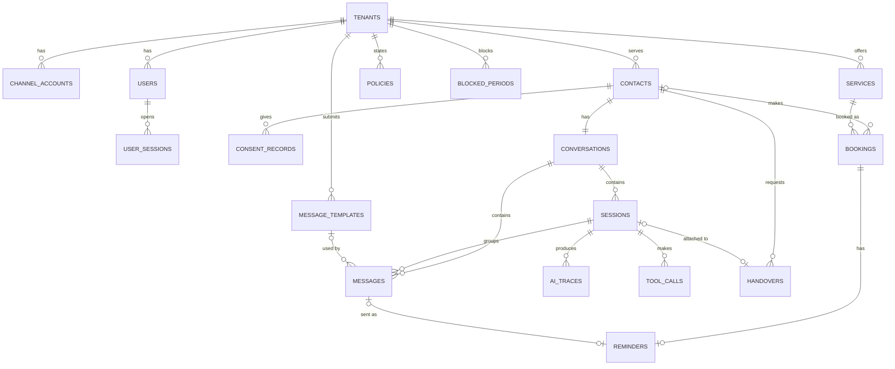

# Data model

Status: draft for maintainer review · Phase 2 (design) · Issue #40

The tables of version 1.0, how each is scoped to a tenant, which constraints
enforce the invariants of `docs/design/state-machines.md`, and what happens
to every personal field on retention and deletion.

The database is PostgreSQL with row-level security (ADR 0003). Jobs and login
sessions are tables here too (ADRs 0004 and 0008). Column types are indicative;
the migrations in milestone M2 are the definition.

**Built so far** (M2 units U4, U5 and U7, `packages/db/migrations/`):
`tenants`, `channel_accounts`, `channel_routes`, `contacts`,
`conversations`, `messages`, `audit_log`, `jobs`, `worker_heartbeats`,
`unparsed_events` and `unroutable_events`, each with only the
columns the walking skeleton uses. A column described below may not exist yet; the migrations are the
record of what does.

## Conventions

- Every table has `id` (UUID) and `created_at` unless stated.
- "Tenant-owned" means the table has a non-null `tenant_id` and a row-level
  security policy that admits only rows of the transaction's tenant.
- Times are stored in UTC with time zone. Tenant-local rules are computed in
  `packages/core` from the tenant's time zone.
- Money is an integer in the currency's minor unit, with the tenant's
  currency code.
- State columns hold exactly the state names of `state-machines.md`.
- **Personal data** is marked ⚑. The inventory at the end lists every such
  field.

## Diagram

Not drawn: `audit_log`, `jobs`, `channel_routes`, `unroutable_events`,
`suppressed_numbers`, `auth_tokens` and `service_state`, described below.

## Tenant and access

### `tenants` — tenant-owned (policy on its own `id`)

| Column | Notes |
| --- | --- |
| `name` | |
| `pack` | Exactly one (`booking`, `faq-only`) |
| `time_zone`, `default_language`, `template_languages`, `currency` | Required settings. `currency` is built in M3 unit U3, null until a profile is loaded, and is a code the platform's own list holds; `template_languages` is not built |
| `support_contact`, `notification_email` | Required settings. Business contact details, not customer data. Built in U3: the first is a phone number in international form or an email address, and is given to the model; the second is not |
| `business_hours`, `opening_hours` | Per weekday, zero or more periods. Built in U3 as a list of `{weekday, opens, closes}`, as the API design has them, with `opening_hours_updated_at`. The application role may change these six settings of its own row and nothing else of it |
| *(none for bookings)* | The booking settings are **not** columns here. They are the booking pack's, held in `pack_settings` (below; ADR 0012) |
| `quiet_start`, `quiet_end` (nullable pair) | Quiet hours |
| `escalation_minutes`, `message_retention_months` | |
| `answering` | Not built. As of U3 a function says which required settings are missing and whether a channel is connected; it is not stored. Derived and stored: required settings present and credentials verified (state machines, section 9) |
| `not_answering_notified_at` | So the owner and operator are emailed once per outage |

Allowed ranges are the glossary's settings table, enforced by check
constraints and again in the API.

### `channel_accounts` — tenant-owned

| Column | Notes |
| --- | --- |
| `channel` | `whatsapp` or `mock` |
| `receiving_number_id` | The channel's identifier for the business number. Unique across all tenants |
| `credentials_encrypted` | Encrypted with a key held outside the database (NFR-S5) |
| `verified_at`, `last_check_at`, `last_check_result` | `ok`, `rejected` or `indeterminate` |

### `users` — tenant-owned

| Column | Notes |
| --- | --- |
| `email` ⚑ | Staff personal data. Unique across all tenants |
| `password_hash` | Null until the invitation is accepted |
| `role` | `owner` or `agent` |
| `removed_at` | Soft removal, so audit entries keep their actor |

A constraint-backed check refuses removing or demoting the last owner of a
tenant (US-D7).

### `user_sessions` — tenant-owned

`session_id_hash` (unique), `user_id`, `last_used_at`. Deleting a user's rows
ends their sessions (ADR 0008).

### `auth_tokens` — tenant-owned

Invitations and password resets: `token_hash` (unique), `kind`, `user_id`,
`expires_at`, `used_at`.

## Customers and conversations

### `contacts` — tenant-owned

| Column | Notes |
| --- | --- |
| `phone` ⚑ | E.164. Unique per tenant. Null after deletion or retention, and for a customer the channel gave no number for |
| `channel_user_id` ⚑ | The channel's own identifier for the person: for WhatsApp, the business-scoped user ID. Unique per tenant, whatever number stands beside it. 1 to 128 characters with no space |
| `phone_hash`, `phone_hash_key_version` | Keyed one-way hash of the number, made as described under `suppressed_numbers`. Kept after deletion only if opted out |
| `profile_name` ⚑ | As sent by the channel. Never given to the model (NFR-V7) |
| `last_language` | A language code. Not treated as personal on its own. Built in M3 unit U8 (migration 0011): the language of the last reply stored for the contact, set only when that language is a supported one, so that one unsupported turn does not replace a supported language known before. It is the model's word. A fixed text is sent in it when the turn and the session give nothing newer (`notes/m3-u8-fixed-texts.md`, section 3) |
| `opted_out_at` | Null when not opted out |
| `last_inbound_at` | The reply window is open while this is under 24 hours ago. The earlier of the channel's time for the newest message and the time it was stored; never moved back |
| `rate_paused_until` | |
| `anonymised_at` | Set when personal fields were removed |

#### Which contact a message belongs to

Decision 16. The channel gives a number, an identifier, or both. "Holds"
means a contact of this tenant has that value now. Two things never
happen: an identifier is never changed, and a contact is never given
another contact's conversation.

A number belongs to the identifier the channel last sent it with. So the
first thing done with a message that carries both is this: **any contact
with a different identifier that holds the number loses it.** Its row keeps
its identifier and its conversation, and has no number until its person
writes again from one. Then:

| The message carries | What exists, after that | The contact used | What changes |
| --- | --- | --- | --- |
| An identifier, with or without a number | A contact holds the identifier | That contact | If a number came and nobody holds it now, the contact takes it: a changed number is followed. If a contact with no identifier holds it, nothing changes |
| An identifier and a number | Nobody holds the identifier; a contact with no identifier holds the number | That contact | It takes the identifier |
| An identifier, with or without a number | Nobody holds either | A new contact with what came | |
| A number only | A contact holds the number | That contact, with or without an identifier | Nothing |
| A number only | Nobody holds it | A new contact with the number | |

What follows from the table and is accepted:

- A person first seen by number alone and later by identifier alone is two
  contacts, and stays two even when a message then carries both: the
  message goes to the contact with the identifier, and the other keeps the
  number. Nothing merges contacts (#288).
- A contact known by number alone is taken by whichever identifier first
  arrives with that number. If the number had passed to a new person
  before any identifier was seen, that person joins the old holder's
  conversation. Without an identifier the two cannot be told apart.
  `compliance.md` records that every message webhook carries the identifier
  since April 2026, so this needs a contact made before then, or a channel
  that sends none.
- A number alone reaches whoever holds it now. After it has passed on with
  an identifier, that is the new person.
- A contact with an identifier never holds a number that the channel has
  since sent with a different identifier. It can hold an old number of its
  own: when its person writes from a new number that a contact with no
  identifier already holds, it keeps the number it had (table, row 1).
  A later message from that old number alone then joins its conversation.
  So a contact's number is one the channel paired with that person at
  some time, not always the latest.
- For the same reason a person can go without a number however often they
  write with one, while a contact with no identifier holds it.
- Arrivals at the same moment can fail once and succeed when sent again:
  two contacts taking one number (23505), two people swapping numbers or
  two webhooks with the same new customers in opposite order (40P01), and
  several new identifiers with one number (`contact-conflict`). Each is
  answered 503, and the channel sends the webhook again. None was seen to
  fail for good, or to store a message in the wrong contact.

Each row of the table is a test in `packages/db/test/inbound.test.ts`, as
are the sequences of the review's finding W1 and the verification's X2.

### `consent_records` — tenant-owned

`contact_id`, `source` (`chat`, `staff`, `opt-in`), `recorded_at`,
`staff_user_id` (nullable), `subject_type` and `subject_id` (nullable: what
the consent was given about, named by the pack; the core does not interpret
them). Rows are never updated.

### `pack_settings` — tenant-owned

`pack`, `values` (a JSON object), `updated_at`. One row per tenant. Holds
the settings a pack declares in its settings schema (ADR 0012). The core
validates a save against that schema, which carries the defaults and ranges,
and never names a key. For the booking pack: booking horizon, slot interval,
total concurrent bookings, minimum notice, change cut-off, reminder lead
time. A tenant on `faq-only` has an empty object.

### `suppressed_numbers` — tenant-owned

`phone_hash`, `key_version`, `opted_out_at`. Written when an opted-out
contact is deleted, so the opt-out applies if the number appears again
(US-D5). Holds no number.

**How the hash is made** (threat T36, issue #160). Phone numbers are few
enough to try them all, so a plain hash could be reversed by anyone who read
the table. The hash is therefore keyed:

- The number is first put in one form: E.164 digits only, with no plus sign,
  spaces or punctuation.
- The hash is HMAC-SHA-256 over the tenant's identifier and that number,
  with a secret key. Including the tenant means the same number has a
  different hash in each tenant, so hashes cannot be matched across tenants.
- The key is held outside the database, in the same way as the
  credential-encryption key (NFR-S5), and is a different key from it. It is
  never logged.
- `contacts.phone_hash` is made the same way.

**Key rotation.** A stored hash cannot be made again under a new key,
because the number is no longer held. So each row records the `key_version`
it was made with. After a rotation, new rows use the new key; the old key is
kept for reading only, and an incoming number is checked under every key
version that still has rows. An old key can be destroyed only when no row
uses it, which for this table may be never. If an old key is destroyed
early, the opt-outs made under it are lost; that is a decision for the
operator, to be written in the runbook.

**What remains.** Someone who has both the table and the key can still
reverse the hashes. And a keyed hash of a phone number is still personal
data in a disguised form; the inventory below treats it as such.

### `conversations` — tenant-owned

`contact_id` (unique per tenant: one conversation per contact),
`channel_account_id`,
`lease_token`, `lease_expires_at` (the processing lease of ADR 0004; both
null when no worker holds it).

### `sessions` — tenant-owned

| Column | Notes |
| --- | --- |
| `conversation_id`, `started_at`, `last_message_at`, `ended_at` | A partial unique index allows one session with `ended_at` null per conversation. `last_message_at` is the stored time of the newest customer message, or the time the worker recorded that the channel accepted the newest message of ours; a delivery or read receipt does not move it. `ended_at` is written when the conversation is next touched after the 24 hours, so a row without it may already be over; one function decides (`packages/db/src/sessions.ts`). **Built in M3 unit U2, with `reply_discards` and `pack_outcome`; the columns below arrive with the units that use them** |
| `reply_discards` | How many replies in a row were dropped because the customer wrote again; at 2 the next is sent (decisions row 38) |
| `disclosed_at` | When the session's customer was told that an automated assistant is replying: when the channel accepted a message that carried the disclosure (M3 unit U8, migration 0011; `notes/m3-u8-fixed-texts.md`, section 4). Null until then. Set back to null when that message is reported failed later and no other message of the session that carried the disclosure is sent, delivered or read; the next message sent then carries it. A customer can so be told twice in a session. They can also have read a message without it, when the message that carried it fails after a later one was sent (`notes/m3-u8-fixed-texts.md`, D2c) |
| `guardrail_fallbacks` | How many fallbacks in a row the customer was sent, 0 to 100. Built in M3 unit U9 (migration 0012; `notes/m3-u9-fallback.md`, section 3). It moves when the channel accepts a message: plus 1 for a fallback, 0 for any other reply of the assistant; a message that is refused, discarded or expires changes nothing. Reaching 2 hands over (US-C6, 2), which is not built: the count goes on rising |
| `unreadable_batches` | How many batches in a row could not be read, 0 to 3. Built in M3 unit U10 (migration 0014; `notes/m3-u10a-emergency-unsupported.md`, section 3). Plus 1 when the unsupported-type reply is stored; 0 when a turn ends for a batch with text, and when the session is handed over. The third hands over |
| `assistant_replies` | The other counter of state machines, section 3. Not built |
| `awaiting_retry_since`, `provider_fallback_sent_at` | State machines, section 8 |
| `language`, `unsupported_language` | For US-C3 and metrics. Built in M3 unit U7 (migration 0010; design note `notes/m3-u7-turn.md`, section 7). `language` is two small letters: what the model said the customer wrote in, at the session's latest reply; a reply whose language the model could not tell leaves it as it was. `unsupported_language` becomes true when a reply's language is not one of the supported ones, and is never set back. Both are the model's word, not a fact |
| `is_inquiry`, `pack_outcome`, `had_handover`, `contained` | Written when the session ends (US-C19). `is_inquiry` is set by the model; the others by code. `pack_outcome` is a short label the pack supplies (for the booking pack: created, changed, cancelled or none); the core stores it without interpreting it |

### `messages` — tenant-owned

| Column | Notes |
| --- | --- |
| `conversation_id`, `session_id` | Nothing in the schema ties the session to the same conversation; one function writes both |
| `answered_by` | For a customer's message: the reply that answered it. Null while not dealt with, and for one dealt with by no reply. It is how a discarded reply's messages are found again |
| `direction` | `inbound` or `outbound` |
| `turn_id`, `language` | For an assistant's reply made by a turn with the model (M3 unit U7): the turn, which joins the reply to the traces of the calls behind it, and the language that turn reported (`und` when the model could not tell). Null on every other row. The language is kept on each reply so that a session's mark can be checked and worked out again |
| `disclosure`, `lead`, `buttons` | For a message of ours only (M3 unit U8, migration 0011). `disclosure`: the disclosure's text when this message carried it, at most 150 characters; set or cleared each time the message is taken to be sent, so it is what the last try sent. `lead`: a fixed text that code put before the body (today only the answer to "am I talking to a person?"), at most 700. `buttons`: null, or a list of 1 or 2, each the payload and the title shown; set to null when a message stored with buttons was sent without them, so that the row says what the customer saw. What was sent is the disclosure, the lead and the body, each that is present, a blank line between. The model is given the body only |
| `fallback` | True on a reply of the assistant that is the fallback: the model's answer failed a check, the row has no body, and its `lead` is the fallback text (M3 unit U9, migration 0012). Stored as the turn's reply so that every rule a reply has holds for it; its `language` is `und`, since what a refused answer said of the language is not kept |
| `class` | For outbound: one of the five message classes |
| `kind` | `text`, `button`, `template`, or the channel's name for a type that is not read (`image`, `audio` and so on). The first three are the system's own: a channel's type of one of those names that was not read is stored as `unknown`, and a template's quick reply that could not be read as `quick-reply`. From a customer, `button` is a tap that was read, and has a payload (a constraint; migration 0008) |
| `channel_sent_at` | For a message from a customer, the time the channel says it was sent. `created_at` is when the row was stored, taken per row, so the messages of one webhook keep their order |
| `error_code` | For a `failed` message: the channel's code, or one of the worker's own: `unconfirmed` (after some call for it nobody knew whether the channel had it, so the customer may have it; decision 19), `expired` (it waited more than 15 minutes to be sent, and no call for it ended unknown; it may have been called for and refused), `no-channel`, `unsupported-kind`. Letters, digits, `_` and `-`, at most 40 |
| `handled_at` | For a message from a customer: when a turn dealt with it. Null until then (decision 18) |
| `send_attempts`, `unknown_outcomes` | For a message to send: how many times the channel was called for it, and how many of those calls ended with nobody knowing whether it was accepted. The second is the resend counter of US-C1 criterion 9 |
| `sending_at`, `send_not_before` | When the call under way started, set exactly while the status is `sending`; and the earliest time of the next call after a refusal that can be retried |
| `channel_message_id` | Unique per tenant and direction when not null. This constraint is the deduplication of US-C1. Per direction, so that a customer's message can never be dropped for sharing an identifier with one that was sent |
| `body` ⚑ | The text. Null for unsupported types, whose content is never stored, for a tap (a button's title is not the customer's words and is not kept), and null after retention or deletion. For a caption, the words typed under the picture or video |
| `button_payload` | For a tap from a customer, what the button carried: 1 to 256 printable ASCII characters without spaces. Set exactly for an inbound `button`. Untrusted: it comes from the customer's app. The core reads its owner and its action (`core.stop`); what follows is the owner's (for the booking pack's Confirm: the booking and the start time it was sent for). **The handler must check that the booking belongs to the sending contact** |
| `in_reply_to` | For a tap: the channel's identifier of the message it answers, as the tap named it, or null. Text, not a link: the message it names may get its identifier later, or never. One function finds, when asked, the message sent in the same conversation under that identifier; none found means "not matched", never "forged" (design note `notes/m3-u5-buttons-captions.md`, section 3) |
| `caption_of` | `image` or `video` for a text that was typed under one; null otherwise. The media is not fetched and nothing of it is kept |
| `template_id`, `template_variables` ⚑ | Variables can hold a service name and a time; treated as personal with the message |
| `status` | `pending`, `held`, `discarded`, `withheld`, `sending`, `sent`, `delivered`, `read`, `failed` |
| `withheld_reason` | |
| `sent_by_user_id` | For staff messages |
| `fee_amount`, `fee_currency` | As reported by the channel; null if not reported |
| `received_while_not_answering` | |
| `sent_at`, `delivered_at` | |

### `handovers` — tenant-owned

**As built in M3 unit U11** (migration 0013; `notes/m3-u11-handover.md`):
`tenant_id`, `contact_id`, `session_id`, `state`, `reasons`, `urgent`,
`created_at`, `attached_at`, `detached_at`, `closed_reason`, `ended_at`.
Only `waiting`, `detached` and `closed-unanswered` (reason `expired`)
are entered: the other states need staff. The columns below for staff,
the escalation clock and the follow-up are **not built**; M4 adds them
with the code that fills them. In M3 a handover is also detached 24
hours after it was attached, since nobody can reply; M4 takes that out.
`messages.handover_id` and `messages.tells` (`handover` or `emergency`)
mark the message of ours that told the customer; it is a system reply,
never held back or discarded for a newer message. `reply_checks.outcome`
may be `handed-over`.

| Column | Notes |
| --- | --- |
| `contact_id`, `session_id` (nullable) | Attached to a session only in `waiting` and `in-progress` |
| `state` | The seven states of state machines, section 2 |
| `reasons` | An array; new triggers append |
| `urgent`, `urgent_notified_at` | Set when the reason `emergency` is added; never cleared for that handover. The second records the one immediate email |
| `held_by_user_id` | Nullable |
| `answered_at` | Set when the first staff message is accepted by the channel |
| `followup_message_id`, `followup_accepted_at` | At most one follow-up |
| `detached_at`, `overdue_at`, `holding_message_id` | |
| `escalation_elapsed_seconds`, `escalation_counted_to` | The business-hours clock |
| `closed_reason`, `ended_at` | For `closed-unanswered` |

**A partial unique index on `contact_id` over the four open states enforces
invariant H1** (one open handover per contact) in the database, so it does
not depend on application code. A check constraint requires `session_id` to
be non-null exactly in `waiting` and `in-progress`, which is invariant H3's
data side.

## Business data (the `booking` pack)

### `services` — tenant-owned

`name`, `description`, `price_minor`, `active`, `updated_at` are the core's
(built in M3 unit U3; lengths are the API design's). `name_key` is the name
as two are compared, made by the loader's one function and unique within a
tenant, so that the database's collation decides nothing.
`duration_minutes` and `capacity` belong to the booking pack and are held in
its own table, `booking_service_settings`, keyed by service (ADR 0012). A
service with bookings is deactivated, not deleted. Until a pack has rows
that point at one, the operator's loader deletes a service that a profile
file no longer names.

### `booking_service_settings` — tenant-owned, booking pack

`service_id` (unique), `duration_minutes` (5 to 480), `capacity` (1 to 50),
`updated_at`. Check constraints hold the ranges of US-D2. A service with no
row here cannot be booked; the booking pack's dashboard section creates the
row when the owner adds a service.

### `policies` — tenant-owned

`title`, `body`, `updated_at`. Owner-entered text; delimited as data when
given to the model. Built in M3 unit U3; `title_key` is unique within a
tenant, as `name_key` is for a service.

### `blocked_periods` — tenant-owned

`starts_at`, `ends_at`, `created_by_user_id`.

### `bookings` — tenant-owned

Owned by the booking pack (ADR 0012), as are `reminders`, `blocked_periods`
and the booking columns described under `services` and `tenants`: they live
in the pack's own migrations and in tables or columns the core never names.

| Column | Notes |
| --- | --- |
| `contact_id` | Nullable: set to null when the contact is anonymised and the booking is in the past |
| `service_id`, `starts_at`, `ends_at` | `ends_at` is `starts_at` plus the service's duration at the time of booking |
| `state` | `booked`, `confirmed`, `cancelled`, `attended`, `missed` |
| `created_via` | `chat` or `staff` |
| `consent_recorded` | For a booking made by staff: whether staff ticked that the customer agreed to messages about it (US-C13 criterion 3) |
| `request_key` | For a booking created by staff: the request's `Idempotency-Key`, unique per tenant, so a repeated request finds the first booking. Null for a booking made in chat, where the partial unique index over contact, service and start time does the same job (NFR-R3) |
| `confirmed_at`, `cancelled_at`, `outcome_recorded_by_user_id` | |

There is no free-text column (US-B2). Capacity (invariant B1) is not a
constraint: it is checked under an advisory lock in the same transaction as
the write (ADR 0003).

### `reminders` — tenant-owned

`booking_id`, `state` (`none`, `scheduled`, `sent`, `withheld`, `cancelled`),
`for_start_at` (the appointment time it was computed for), `scheduled_for`,
`message_id`, `withheld_reason`. A partial unique index allows one reminder
in `scheduled` per booking.

### `message_templates` — tenant-owned

`key` (for example `booking_reminder`, `handover_followup`), `language`,
`category`, `channel_template_id`, `status`, `status_updated_at`. Unique on
tenant, key and language.

## AI and audit

### `reply_checks` — tenant-owned

`id`, `tenant_id`, `created_at`, `session_id`, `turn_id`, `outcome`
(`passed`, `blocked`, `error`), and `o1`, `o7`, `o6`, `o3`, `o5`: for each
check of the guardrail policy's section 4 either `passed`, a code of the
checker's fixed list, or null when the check did not run. One row for a
turn whose reply or fallback was stored, written in that transaction and
never changed (M3 unit U9, migration 0012; `notes/m3-u9-fallback.md`,
section 6). A turn that stored nothing leaves no row. **No text of the
reply, of a claim or of the customer**: each column is held to a pattern
of lower-case letters and hyphens. The reply that failed is stored
nowhere. Not in the retention table yet.

### `early_receipts` — tenant-owned

`id`, `tenant_id`, `created_at`, `channel_message_id`, `status` (`sent`,
`delivered`, `read`, `failed`), `error_code`. A receipt that arrived for
a message no row has the channel's identifier of yet: the channel can
report on a message between accepting it and the worker storing that it
did. Kept, and applied by the step that records the send (M3 unit U8,
migration 0011; `notes/m3-u8-fixed-texts.md`, D2b). One row for a tenant,
an identifier and a status. Removed when applied, and after a day when
a new one is kept: a receipt for a message this system never sent stays
that long. Holds nothing of a customer: an identifier the channel made,
and a code.

### `tool_calls` — tenant-owned

Built in M3 unit U7 (migration 0010; design note `notes/m3-u7-turn.md`,
section 6), without `repeat_of`, which comes with the first tool that
changes anything (M5).

`session_id`, `turn_id`, `tool`, `arguments`, `result`, `outcome` (`done`,
`refused`, `failed`), `created_at`, `ended_at` (the design's `result_at`:
a call that failed has no result). The application may insert and read.
A record of each call; **it has no unique key and
does not make calls idempotent** (Gate 2 verification, V1). Idempotency is
carried by the thing changed: a partial unique index on active bookings for
create, a conditional update for move, and cancel is idempotent by nature
(`architecture.md`, "Processing one turn", step 4). Read-only tools are never
deduplicated. The row gives claims a result to name,
with the time the 10-minute rule needs.

**`arguments` and `result` are treated as the customer's text** (decisions
row 49). The design said they hold "identifiers and times, not customer
text"; but the model writes a tool's arguments and can copy a customer's
words into them, and a result can repeat them, so that could not be made
true. Each is removed (set to null) when the row is older than the
tenant's retention period, by the row's own time, and when the contact's
data is deleted or anonymised. Those jobs are M5's and will need a grant
to update the two columns. The rest of the row holds no text and is kept.

### `ai_traces` — tenant-owned

Built in M3 unit U6 (migration 0009; design note
`notes/m3-u6-traces.md`). One row for every call to the model, written
by the model client itself before the caller has the result. The
application may insert and read; it may not change or delete.

| Column | Notes |
|---|---|
| `session_id` | The session the call was made for; this tenant's |
| `turn_id`, `turn_started_at` | One identifier for all the calls of a turn, made each time the turn's job runs (there is no table of turns), and when the turn began |
| `started_at`, `latency_ms` | When the adapter was called, and how long until it answered, failed or ran out of time |
| `prompt_names`, `prompt_versions` | The prompts the request was assembled from, in order: 1 to 8. (The design had one name and one version; a request can have a pack's fragment too) |
| `model` | As the adapter gave it; `other` for a name that does not fit the pattern. Null when the call gave no answer |
| `input_tokens`, `output_tokens` | Null when `model` is |
| `cost_micros`, `price_input`, `price_output` | An estimate in millionths of a US dollar, rounded up, and the two prices it was worked out from. **Null is "unknown", which is not zero:** a call out of time, a failure, a model with no price set. Not the provider's bill |
| `tool_names` | The tools an answer asked for, by name, in order; 4 at most |
| `outcome`, `outcome_code` | `ok`, `invalid-output`, `timeout`, `provider-error`, `fault`; and the code of the second and fourth |

`guardrail_results` is not a column, and will not be: a trace is written
once, and what the checks said of an answer is known only later. It is
in `reply_checks`, below, which shares the turn's identifier with the
traces of the turn. **No message text, no phone number, no name** (US-C10):
no column holds free text, and each text column has a pattern the table
checks. One function sums a session's cost, and gives beside the sum how
many of the session's calls have no cost.

### `audit_log` — tenant-owned

`actor_user_id` (nullable for the system), `action`, `subject_type`,
`subject_id`, `details`. Append-only: the application role has no update or
delete privilege on it. `details` never holds a phone number, a name or
message text; a deletion entry records the contact's `id`, not its number.

## Tables outside tenant scoping

These have no row-level security, because they are read before a tenant is
known or belong to no tenant. Each is listed with what it can reveal.

| Table | Columns | Why unscoped | What it reveals |
| --- | --- | --- | --- |
| `channel_routes` | `receiving_number_id`, `tenant_id` | The webhook must find the tenant from the receiving number | Which tenant owns a business number. No customer data |
| `jobs` | `type`, `tenant_id` (nullable), `payload`, `run_at`, `attempts`, `state`, `locked_until`, `last_error`, `dedupe_key` | A worker claims a job before it knows the tenant. Unlike the other tables here it does have row-level security, of its own kind (decision 13). As built, `subject_id` stands in place of `dedupe_key` (decision 15) | Identifiers only. **A job payload never holds message text, a phone number or a name**; a test checks this. `last_error` is a sanitised code |
| `unparsed_events` | `channel`, `payload_hash`, `size_bytes`, `error_code`, `items_left_out`, `received_at`. As built there is no `receiving_number_id`: a body that cannot be read has none to give | A validly signed event that could not be parsed has no tenant yet | Metadata only. **The raw event, the sender's number and any text are not stored.** The hash is a plain SHA-256, not keyed: a body short enough to guess, a few bytes, could be found from it by trying. A body with a person's number in it is a whole webhook and is not short, and a guessable body tells nothing of anyone. Rows are to be deleted after 30 days (Gate 2 finding S6); the job that does it is not built (#288) |
| `unroutable_events` | `channel`, `receiving_number_id`, `channel_message_id`, `kind`, `received_at` | No tenant exists for them | Metadata only. The sender's number and the message body are **not stored**, because they belong to people the system has no relationship with |
| `worker_heartbeats` | `worker_id`, `started_at`, `last_seen_at` | One row per worker process, so that something outside the worker can tell whether one is alive (ADR 0004, amendment) | Nothing personal |
| `service_state` | One row: `normal` or `degraded`, since when, and whether the operator is holding it in `degraded` | Service-wide | Nothing personal |
| `operator_log` | `invocation_id` (the same in a command's two rows), `command`, `arguments`, `operator_name`, `phase` (`started` or `finished`), `outcome` (`ok` or a short code), `subject_id` (the row the command made or changed), `at` | Operator actions belong to no tenant | No role but the table's owner, the migration role, holds the privilege to change or remove a row, and a trigger refuses the owner's plain statements too; the owner could remove that guard with a schema change. Only the cross-tenant role may insert and read, and it cannot set a row's identifier or time; as built the application role has no privilege on it (ADR 0011, amendment). `ops` records only a pack, a time zone, a language, a limit and a job's identifier; the database also refuses a value with a space, an `@` or a `+`, which is a net under that rule and not the rule. A created row is recorded by its identifier. `operator_name` is the name the operator gave, which is a person's |
| Migration bookkeeping | | | Nothing personal |

### Access before the tenant is known

Three lookups must cross tenants. Each is one function in one module, run
with the cross-tenant role, and returns only what the next step needs.

| Lookup | Input | Returns |
| --- | --- | --- |
| Route a webhook | Receiving number identifier | Tenant identifier |
| Authenticate a request | Session identifier from the cookie | User, tenant, role |
| Start a sign-in, invitation or reset | Email address or token | User and tenant identifiers, password hash for comparison |

Work that crosses tenants by design: creating a tenant and the other
operator commands of ADR 0011, the daily credential check, the retention
job, claiming and running jobs, and the worker's heartbeat with its
readiness probe. In the request path, as built in M2: recording an event
for a number no tenant has (`unroutable_events`), recording a body that
could not be read (`unparsed_events`) with its `operator-alert` job, and
the API's readiness check. Nothing else may use the cross-tenant role. It
has no privilege on `services` or `policies`, and of `tenants` it reads
and inserts only the columns that are not settings: the operator's `profile` commands work as the application role
inside one tenant's scope (ADR 0011, amendment of 2026-11-23).

What enforces it today is narrower than "which modules": a test fails if
any source file outside `packages/db` names the database driver, imports
that package's inner files or its testing entry, or builds a module name
at run time. The API therefore reaches the database only through the
functions it is given for the webhook, each of which takes a handle that
cannot run a query. (The package's job, lease and migration functions take
a connection; nothing outside the package and its tests can make one.) A test of which *modules*
may hold the cross-tenant handle is not built (#162).

## Constraints that carry invariants

| Invariant or rule | Enforced by |
| --- | --- |
| A message is processed once (US-C1) | Unique `channel_message_id` per tenant and direction |
| One open handover per contact (H1) | Partial unique index on `handovers` |
| A handover is attached exactly in `waiting` and `in-progress` (H3, data side) | Check constraint on `handovers` |
| One active session per conversation | Partial unique index on `sessions` |
| One booking per repeated tool call (NFR-R3) | Partial unique index on `bookings` over contact, service and start time, for bookings in `booked` or `confirmed`. After a cancellation the same slot can be booked again |
| One scheduled reminder per booking | Partial unique index on `reminders` |
| A tenant keeps at least one owner (US-D7) | Trigger or deferred constraint on `users` |
| Settings stay in range (US-D11) | Check constraints on `tenants` for core settings; the pack's settings schema, applied by the core on save, for `pack_settings` |
| Service fields stay in range (US-D2) | Check constraints on `services` and `booking_service_settings` |
| The audit log is append-only | Privileges of the application role |
| No row is visible across tenants (NFR-S1) | Row-level security on every tenant-owned table; a test fails on a table without a policy |
| Capacity is never exceeded (B1) | Not a constraint: advisory lock plus check in one transaction; a concurrency test |

Putting H1 in the database closes a gap the design models left open: the
handover model could not check it, because it held one handover by
construction.

## Personal data: inventory, retention and deletion

"Retention" is the daily job of NFR-V4 with the tenant's message-retention
setting. "Deletion" is the owner's request under US-D5, completed within 24
hours.

| Field | Whose | Retention job | Deletion on request |
| --- | --- | --- | --- |
| `messages.body`, `messages.template_variables` | Customer | Set to null when the message is older than the retention period, whatever the age of other messages | Set to null for all the contact's messages |
| `contacts.phone`, `contacts.profile_name` | Customer | Set to null when the contact has no message within the period, no future booking and no booking that started within the period | Set to null |
| `contacts.phone_hash` | Customer | Removed with the phone number, unless opted out | Removed, unless opted out, when it moves to `suppressed_numbers` |
| `bookings.contact_id` | Customer | Set to null with the contact's anonymisation, for past bookings | Future bookings are cancelled and their slots freed; then set to null |
| `consent_records` | Customer | Deleted with the contact's anonymisation | Included in the export; then deleted |
| `handovers.contact_id` | Customer | Kept; the contact row it points to is anonymised | Open handovers end as `closed-unanswered` or `answered`; kept |
| `sessions`, `ai_traces` | Customer, indirectly | Kept: they hold no text, number or name. A session's `language` is a language code | Kept |
| `tool_calls` | Customer, indirectly | `arguments` and `result` removed with the conversation's text, by the row's own age: they can hold a customer's words (decisions row 49). The rest of the row kept | `arguments` and `result` removed; the rest kept |
| `audit_log` | Staff and system | Kept | Kept; it never held the number |
| `users.email` | Staff | Kept while the user exists | Not covered by US-D5. Set to null 12 months after `removed_at` |
| `tenants.support_contact`, `notification_email` | Business | Kept | Not personal data of a customer |

What a deleted or anonymised contact leaves behind: a `contacts` row with an
`id`, `last_language`, timestamps and `anonymised_at`; sessions and bookings
with no personal field; and, only if they had opted out, a hash in
`suppressed_numbers`. Past metrics therefore do not change (glossary).

The export of US-D5 contains: the contact row, every message with its text,
bookings, consent records and the opt-out time.

### What the retention rule does not cover

- **Free text inside a message that names someone else.** A customer can
  write another person's name or number. It is deleted with the message.
- **Backups.** A deleted field remains in backups until they expire. Backup
  retention is set with the hosting decision (ADR 0009) and must be stated to
  tenants.
- **The model provider's own retention** of what it was sent. It depends on
  the provider's terms (ADR 0010).
- **Logs.** They hold no personal data by design (NFR-V2), so they are not
  purged per contact.

## What this does for the record of processing

Saudi Arabia's data-protection rules require a controller to keep records of
categories of data, retention periods and recipients
(`docs/compliance.md`, Part B). The inventory above is written so that a
tenant can use it for that: categories are the ⚑ fields, the retention period
is the tenant's own setting, and the recipients are the channel and the model
provider (`architecture.md`, section 3). Whether it is sufficient is a
question for a lawyer (open question OQ-4).

## Decisions made here

| # | Decision | Why |
| --- | --- | --- |
| 1 | Unroutable events store metadata only, not the sender's number or the message body | They concern people with no relationship to any tenant. US-C1 says "the event is stored"; this narrows what "the event" holds |
| 2 | Job payloads hold identifiers only | The `jobs` table is outside tenant scoping |
| 3 | Invariant H1 is a database constraint | It was the invariant the model could not check |
| 4 | Staff email is set to null 12 months after removal | No requirement covered staff personal data. The number is the agent's proposal |
| 5 | A removed user is soft-removed | So audit entries keep their actor |
| 6 | The content of unsupported message types is never stored, only the type | US-C12 says it is not sent to the model; this also keeps voice notes and images out of the database |
| 7 | The phone hash is HMAC-SHA-256 over tenant and number, with a key outside the database and a key version on each row | A plain hash of a phone number can be reversed by trying every number (T36, #160). The choice of HMAC-SHA-256 is the agent's and has not been reviewed by anyone with security training |
| 8 | A signed event that cannot be parsed is recorded as metadata only, to be kept 30 days (nothing deletes the rows yet, #288) | The raw event would hold a stranger's number and text outside tenant scoping (Gate 2 finding S6). It replaces what `api.md` first said |
| 9 | Booking tables and columns are owned by the booking pack | ADR 0012 |
| 10 | Foreign keys between tenant-owned tables include `tenant_id`, and uniqueness rules are per tenant where they can be | A foreign-key or uniqueness check is not subject to row-level security. Found while building M2 unit U4 |
| 11 | `channel_routes` is written only by a trigger on `channel_accounts` | So the two cannot disagree (Gate 2 finding S22) |
| 12 | The cross-tenant role sees all rows through a policy of its own, not by bypassing row-level security | No special role attribute is needed, and the tables it may reach are listed in the migrations (ADR 0003, amendment) |
| 13 | `jobs` is not outside tenant scoping. The application role, in one tenant's transaction, may add a job for that tenant, see which of its jobs exist (not what they hold) and delete a queued one. The cross-tenant role claims them | The webhook queues a job in the tenant's transaction, and a timer is cancelled in the transaction that moves its state; with no policy the application role could read and change every tenant's jobs. Found while building M2 unit U5 |
| 14 | A finished job is deleted; job states are `queued`, `running` and `dead` | Nothing to archive (ADR 0004, amendment) |
| 15 | `jobs.subject_id`, a UUID, replaces `dedupe_key` | A timer has to be found again to be cancelled; an identifier cannot carry text. There is no uniqueness on it (ADR 0004, amendment) |
| 16 | A contact has the channel's own identifier as well as a number, either of which may be missing. The identifier is the person; the number is something a person holds for a time. Every case is in the table under `contacts`, "Which contact a message belongs to" | Since April 2026 a WhatsApp customer who uses a username arrives with no number (#284). **The agent's decision, awaiting the maintainer.** Reworked after the Gate 4 review of unit U7 (finding W1): the first version let a number carry one person's conversation to another. What is still not done: nothing merges two contacts that turn out to be one person (#288) |
| 17 | `unparsed_events` and `unroutable_events` each have the channel's name and a uniqueness rule | The channel sends an unanswered webhook again, and a slow request can commit after it was answered 503; the same event must be one row |
| 18 | `messages.handled_at` marks a customer's message that a turn has dealt with | The worker must know what is still to answer, so that a job run twice answers once. The design does this with sessions and batches, which do not exist until M3. **The agent's decision**; M3 unit U2 built sessions and batches and kept it: a batch is the open session's messages without the mark (`design/notes/m3-u2-sessions.md`) |
| 19 | A message has a count of calls and a count of unknown outcomes; `unconfirmed` is a code in `error_code`, not a status or a withheld reason | Gate 2 finding V6 (#236): "never a third" needs a counter, and `unconfirmed` had no home. A withheld message was never attempted, which is not true of this one. **The agent's decision** |

Decision 1 changes how US-C1 is read and decision 4 adds a rule; both are
noted for the Gate 2 review and are not yet reflected in the stories.

## Not covered here

- Indexes for performance. They are added with the queries in M2 to M5.
- The `faq-only` pack's data: it reuses `policies`.
- Exact column types and the SQL of the row-level security policies, which
  are the migrations.
