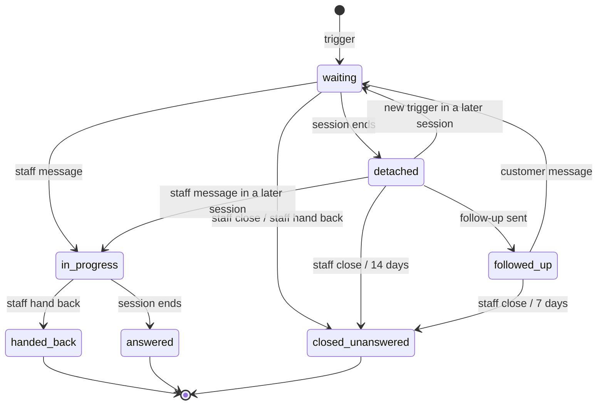

# State machines

Status: draft for maintainer review · Phase 2 (design) · Issue #126

Three rounds of review found that almost every serious defect in the
requirements was in how rules interact over time. This document replaces
prose with tables for those rules. For each machine it gives the states, the
events, what happens for every state and event pair that can occur, and the
invariants that must always hold.

Where a table decides something the requirements left open or got wrong, the
decision is listed in "Decisions made here" at the end, and the requirements
were changed in the same pull request. From now on, for the behaviour covered
here, **the tables are the authority and the acceptance criteria are tests of
them.**

Terms and numbers are those of `docs/requirements/glossary.md`.

## 1. Order of checks for an inbound message

Many defects were questions of precedence. This is the single order in which
an inbound webhook is handled. A step that ends handling says so.

| # | Check | Result |
| --- | --- | --- |
| 1 | Signature valid? | No: HTTP 401, nothing stored. **Ends.** |
| 2 | Message ID already stored? | Yes: HTTP 200. **Ends.** |
| 3 | Receiving number maps to a tenant? | No: store as unroutable, HTTP 200. **Ends.** |
| 4 | Store the message in its conversation; start or extend the session; open or extend the reply window; HTTP 200 | Always |
| 5 | Is it an opt-out or opt-in keyword or button? | Yes: apply it by code (machine 6). Send the confirmation only if the tenant is answering. **Ends**, unless the batch holds other text. |
| 6 | Tenant answering? | No: mark the message `received-while-not-answering`; if the session is handed over it joins the waiting session. **Ends.** |
| 7 | Contact paused for rate? | Yes: no reply, no model call, no handover. **Ends.** If this message is the one that crosses the limit, send the rate notice once and start the pause. |
| 8 | Contact has an open handover in state `followed-up`? | Yes: attach it to this session (machine 2), tell the customer a person will reply, notify staff. **Ends.** |
| 9 | Session handed over? | Yes: the message joins the waiting session; no assistant reply. **Ends.** |
| 10 | Is it the person button? | Yes: hand over with reason `requested`. **Ends.** |
| 11 | Wait for the batching window to close. If another message arrives, restart from step 5 for it and discard any unsent reply | |
| 12 | Batch holds no text? | Yes: send the unsupported-type reply; count it; on the third consecutive such batch hand over with `unsupported-content`. **Ends.** |
| 13 | Degraded mode? | Yes: mark the session `awaiting-retry`; send the fallback under the 15-minute rule. **Ends.** |
| 14 | Call the model (machine 8 on failure); run the handover triggers and output checks; send the reply | |

Consequences worth stating, because each was once a defect:

- Opt-out (step 5) is applied before the tenant-answering check (step 6), so
  it takes effect even when the tenant cannot reply.
- Rate limiting (step 7) comes before handover (steps 8 to 10), so a flood
  cannot create handovers or notifications. A paused contact who taps the
  person button is not handed over until the pause ends.
- A handed-over session (step 9) never reaches the model, whatever else is
  true.

## 2. Handover

A handover is a request for staff attention about one contact.

**Invariant H1.** A contact has at most one open handover. A new trigger
while one is open adds its reason to that handover and re-attaches it to the
current session; it does not create a second.

**Invariant H2.** Every handover reaches exactly one terminal state.

**Invariant H3.** While a handover is `waiting` or `in-progress`, the session
it is attached to is handed over and the assistant does not reply in it.

### States

| State | Meaning | Open? |
| --- | --- | --- |
| `waiting` | Attached to an active session. No staff message yet. | Yes |
| `in-progress` | Attached to an active session. Staff have sent at least one message. | Yes |
| `detached` | Its session ended with no staff message. Attached to no session. | Yes |
| `followed-up` | Detached, and `handover_followup` has been sent. | Yes |
| `handed-back` | Staff handed back after answering. | Terminal |
| `answered` | Its session ended after staff answered. | Terminal |
| `closed-unanswered` | Ended with no staff message. Stores a reason. | Terminal |

"Unanswered", as counted in the handover-rate metric, means open in
`waiting`, `detached` or `followed-up`, or terminal in `closed-unanswered`.



### Transitions

A dash means the event cannot occur in that state.

| Event | `waiting` | `in-progress` | `detached` | `followed-up` |
| --- | --- | --- | --- | --- |
| Customer message | Joins the waiting session. Stay. | Joins the session. Stay. | Not a handover event: the assistant answers it in a new session. Stay. | Attach to the customer's current session, which becomes handed over. Tell the customer a person will reply. Notify staff. → `waiting` |
| New handover trigger (story US-C6) | Add the reason. Stay. | Add the reason. Stay. | Attach to the current session, which becomes handed over. → `waiting` | As for a customer message. → `waiting` |
| Staff message | → `in-progress` | Stay. | Possible only if a later session has opened the reply window. Attach to that session, which becomes handed over. → `in-progress` | — (the reply window stays closed until the customer writes, and that message moves the handover to `waiting`) |
| Staff hand back | → `closed-unanswered`, reason `handed-back-unanswered`. The assistant answers the customer's next message. | → `handed-back`. The assistant answers the customer's next message. | — | — |
| Staff close, with a reason | → `closed-unanswered` | — (hand back instead) | → `closed-unanswered` | → `closed-unanswered` |
| Staff send follow-up | — (reply window is open; write a message) | — | If sent → `followed-up`. If withheld or failed: stay, show the reason on the handover, and the action stays available. | — (one follow-up per handover) |
| Session ends | → `detached` | → `answered` | — | — |
| 7 days since the follow-up, no customer message | — | — | — | → `closed-unanswered`, reason `no-response` |
| 14 days since it was last detached | — | — | → `closed-unanswered`, reason `expired` | — |
| Escalation time elapses, counted in business hours only | Mark overdue. Send the holding message if the reply window is open. Once per handover. | — | — | — |
| Contact opts out | Stay. Staff may still reply in the session; `handover_followup` becomes unavailable. | Stay. | Stay; follow-up unavailable. | Stay. |
| Contact deleted (US-D5) | → `closed-unanswered`, reason `contact-deleted` | → `answered` | → `closed-unanswered`, reason `contact-deleted` | → `closed-unanswered`, reason `contact-deleted` |
| Removed staff user held it (US-D7) | Stay, unheld. | Stay, unheld. | — | — |

Checks against the invariants:

- **H2.** `waiting` leaves by staff action or session end. `in-progress`
  leaves by hand back or session end, and a session always ends after 24
  hours of silence. `detached` leaves by staff action, a new trigger or 14
  days. `followed-up` leaves by a customer message, staff action or 7 days.
  A handover can cycle `waiting` → `detached` → `waiting`, but only when the
  customer writes again; with no further customer message it ends within 14
  days of detaching.
- **H1.** Triggers in every open state are absorbed, as the second row shows.

## 3. Session

| State | Meaning |
| --- | --- |
| `active` | Fewer than 24 hours since the last message in either direction. |
| `ended` | 24 hours passed with no message. Terminal; the next message starts a new session. |

A session carries these independent marks while active:

| Mark | Set by | Cleared by |
| --- | --- | --- |
| Disclosed | The first outbound message of the session | Never |
| Handed over | A handover attaching to it (machine 2) | That handover leaving `waiting` or `in-progress` |
| Awaiting retry | Machine 8 | Machine 8 |
| Consecutive guardrail fallbacks (0, 1, 2) | A fallback sent because an output check failed | Any assistant reply that passes; reaching 2 hands over |
| Consecutive unreadable batches (0 to 3) | A batch with no text | Any text; reaching 3 hands over |
| Assistant reply count | Each assistant reply | Never; reaching the turn cap hands over |

When a session ends: an attached handover moves as in machine 2; an
`awaiting-retry` mark is dropped; and the session record of US-C19 is
written.

**Invariant S1.** A session is handed over if and only if a handover in
`waiting` or `in-progress` is attached to it.

## 4. Booking

| State | Meaning |
| --- | --- |
| `booked` | Created; start time in the future or past, no outcome yet. |
| `confirmed` | The customer tapped Confirm on the reminder. |
| `cancelled` | Terminal. |
| `attended` | Staff recorded attendance after the start time. |
| `missed` | Staff recorded a no-show after the start time. |

| Event | `booked` | `confirmed` | `attended` / `missed` | `cancelled` |
| --- | --- | --- | --- | --- |
| Customer taps Confirm, before the start | → `confirmed` | Stay. | — | Tell the customer the booking was cancelled. |
| Customer reschedules, earlier than the change cut-off | Move; free the old slot. Stay `booked`. Reminder: machine 5 "rescheduled". | Move. → `booked`. Reminder as before. | — | Say no booking is found. |
| Customer cancels, earlier than the change cut-off | → `cancelled`; free the slot. | → `cancelled`; free the slot. | — | Say it is already cancelled. |
| Customer asks to change or cancel inside the cut-off | No change; hand over with `late-change`. | Same. | — | — |
| Staff move it (no cut-off applies) | Move. Stay `booked`. Create a booking-change notice. | Move. → `booked`. Notice. | — | — |
| Staff cancel it | → `cancelled`. Notice. | → `cancelled`. Notice. | — | — |
| Staff mark attended or missed, after the start | → that outcome | → that outcome | Replace the outcome; audit log. | — |
| Staff mark it before the start | Refused. | Refused. | — | — |
| Contact deleted, booking in the future | → `cancelled`; free the slot. | Same. | — | Remove personal fields. |
| Contact deleted, booking in the past | Keep without personal fields. | Same. | Same. | Same. |

**Invariant B1.** At every instant, for every service, the number of
bookings in `booked` or `confirmed` whose intervals contain that instant is
no more than the service's capacity; and, if the tenant total is set, the
number across all services is no more than that total. Moving or creating a
booking is refused if it would break this. The check and the write happen in
one transaction.

A booking past its start with no outcome stays `booked` or `confirmed` and is
counted as "no outcome recorded" in the no-show metric.

## 5. Reminder

Each booking has at most one reminder.

| State | Meaning |
| --- | --- |
| `none` | No reminder will be sent for the booking as it stands. |
| `scheduled` | Has a send time. |
| `sent` | Handed to machine 7 and accepted by the channel. |
| `withheld` | Not sent; stores a withheld reason. |
| `cancelled` | The booking was cancelled first. |

### Timing rule

Run when a booking is created or moved. `now` is that moment; `lead` is the
reminder lead time; the floor is 60 minutes.

```text
due = start - lead
if due < now:                         -> none        (start is nearer than the lead time)
if due is not in quiet hours:         -> scheduled at due
Q = the quiet period that contains due
if (Q.start - 1 minute) > now:        -> scheduled at Q.start - 1 minute
if Q.end <= start - 60 minutes:       -> scheduled at Q.end
otherwise:                            -> withheld, too-late
```

Worked examples, with quiet hours 22:00 to 08:00. They were produced by
running `docs/design/models/reminder_timing.py`.

| Case | Result |
| --- | --- |
| Booked Mon 10:00 for Wed 07:30, lead 24 h | Scheduled Mon 21:59 |
| Booked Mon 23:00 for Wed 07:30, lead 24 h | Scheduled Tue 08:00 |
| Booked Mon 21:59:30 for Wed 07:30, lead 24 h | Scheduled Tue 08:00 |
| Booked Tue 07:00 for Tue 08:30, lead 1 h | Withheld, too-late |
| Booked Tue 06:00 for Tue 09:30, lead 2 h | Scheduled Tue 08:00 |
| Booked Mon 12:00 for Mon 20:00, lead 24 h | None |
| Moved on Tue 09:00 to Tue 15:00, lead 24 h | None |
| Booked Mon 10:00 for Wed 22:00, lead 24 h | Scheduled Tue 21:59 (22:00 itself is quiet) |
| Booked Mon 10:00 for Wed 08:00, lead 24 h | Scheduled Tue 08:00 (08:00 itself is not quiet) |

### Transitions

| Event | `none` | `scheduled` | `sent` | `withheld` |
| --- | --- | --- | --- | --- |
| Booking moved | Run the timing rule. | Run the timing rule again; clear the booking's confirmed state. | Run the timing rule; a second reminder may be sent for the new time. | Run the timing rule. |
| Booking cancelled | Stay. | → `cancelled` | Stay. | Stay. |
| Send time reached | — | Apply the send-time checks below. → `sent` or `withheld` | — | — |
| Customer taps Confirm, Reschedule or Cancel | — | — | Machine 4. | — |

### Send-time checks

Consent and opt-out are checked when the reminder is due, not when it is
scheduled, because they can change in between.

| # | Check | If it fails |
| --- | --- | --- |
| 1 | Contact has recorded consent | Withheld `no-consent` |
| 2 | Contact is not opted out | Withheld `opted-out` |
| 3 | An approved template exists in the contact's last known language or the tenant default | Withheld `no-template` or `template-unavailable` |
| 4 | The channel's daily recipient limit has room | Queue. When released, apply check 5, and if it is quiet hours hold to their end and apply check 5 again |
| 5 | The time is no later than 60 minutes before the start | Withheld `too-late` |

Check 5 applies however the reminder came to be late, so a reminder is never
sent less than 60 minutes before its appointment.

## 6. Contact messaging permission

Two facts are stored for a contact: a list of consent records, and whether
the contact is opted out. The effective state decides whether a
business-initiated message may be sent.

| Effective state | Condition |
| --- | --- |
| `no-consent` | No consent record, not opted out |
| `consented` | At least one consent record, not opted out |
| `opted-out` | Opted out, whatever consent records exist |

| Event | Effect |
| --- | --- |
| Contact books in chat | Add a consent record, source `chat-booking`. |
| Staff tick consent on a manual booking | Add a consent record, source `staff`. |
| Opt-out keyword, button, or recognised free-text request | Set opted out. Applied at step 5 of section 1, **whether or not the tenant is answering**. The confirmation is sent only if the tenant is answering. |
| Opt-in keyword, or explicit request to receive messages again | Clear opted out; add a consent record, source `opt-in`. |
| Contact deleted while opted out | Keep only a one-way hash of the number, marked opted out. |
| A number whose hash is marked opted out messages again | The new contact starts `opted-out`. |

A consent record added while a contact is opted out does not clear the
opt-out. Only the opt-in event does.

## 7. Outbound message

| State | Meaning |
| --- | --- |
| `pending` | Created; pre-send checks not yet run. |
| `held` | Waiting: for quiet hours to end, for the daily limit, or for the previous message in the conversation to be delivered. |
| `discarded` | An assistant reply dropped before sending because a newer message arrived or staff took over. Terminal. |
| `withheld` | Not attempted; stores a reason. Terminal. |
| `sent` | Accepted by the channel API. |
| `delivered`, `read` | Reported by the channel. |
| `failed` | Rejected by the channel or reported failed; stores the error code. Terminal. |

Pre-send checks depend only on the message class
(`glossary.md`, "Message classes"):

| Class | Consent | Opt-out | Quiet hours | Reply window closed |
| --- | --- | --- | --- | --- |
| Assistant reply | — | — | — | Cannot occur: it answers an inbound message |
| System reply | — | — | — | Cannot occur |
| Staff message | — | Blocked if the contact's only messages in the session are opt-out requests | — | Not sent; dashboard explains |
| Service notice: holding message | — | Blocked if opted out after the request | — | Not sent |
| Service notice: `handover_followup` | — | Blocked if opted out after the request | Held to the end | Sent as a template |
| Business-initiated | Required | Blocked | Per-kind rule | Sent as a template |

Sending:

| Event | Effect |
| --- | --- |
| Previous message in the conversation is `delivered`, or 10 seconds have passed since it was `sent` | The next `held` message may go |
| Send call accepted | → `sent` |
| Send call fails with a temporary error | Retry: 3 attempts in total, waits of 2 and 8 seconds, then → `failed` |
| Send call fails with a permanent error | → `failed` |
| Channel status event | → `delivered`, `read` or `failed` |

A `failed` or `withheld` business-initiated message, or a failed or withheld
`handover_followup`, is shown to staff: in the withheld-messages list, and
for the follow-up on the handover itself.

## 8. Provider availability and the awaiting-retry mark

Service-wide state:

| State | Entered when | Left when |
| --- | --- | --- |
| `normal` | Start; a health check succeeds in `degraded` | 5 sessions are marked `awaiting-retry` within 2 minutes |
| `degraded` | As above | A health check, run every 30 seconds, succeeds |

Per-session mark `awaiting-retry`:

| Event | Effect |
| --- | --- |
| 3 model attempts fail for a customer message | Set the mark. Send the fallback, unless a provider-failure fallback was sent in this session in the last 15 minutes. |
| A customer message arrives in `degraded` | Set the mark, same fallback rule, no model call. |
| 60 seconds since the last attempt, service `normal` | Attempt the answer. Success: send it, clear the mark. |
| Customer sends another message, service `normal` | Normal handling attempts the answer. Success clears the mark. |
| Service returns to `normal` | Attempt every marked session at once. |
| The latest unanswered customer message is 15 minutes old | Clear the mark. Hand over with reason `provider-failure`. |
| Session is handed over for any other reason | Clear the mark. The assistant does not answer later. |
| Session ends | Clear the mark. |

Provider failures do not count towards the consecutive-guardrail-fallback
mark of section 3.

**Invariant P1.** A marked session is answered or handed over within 15
minutes of the customer's latest message, in either service state.

## 9. Tenant

| State | Condition |
| --- | --- |
| `answering` | Every required setting is present and the channel credentials are verified |
| `not-answering` | Otherwise |

| Event | Effect |
| --- | --- |
| A setting is saved | Re-evaluate. |
| Credential check succeeds | Credentials verified. Re-evaluate. |
| Credential check is rejected by the channel, or the channel returns an authentication error on any call | Credentials not verified. Re-evaluate. On entering `not-answering` for this reason, email the tenant's notification address and the operator's alert address once. |
| Credential check cannot complete (timeout, channel unavailable) | **No change.** Retry within the hour. |
| Daily timer | Run a credential check. |
| Re-entering `answering` | Conversations with messages marked `received-while-not-answering` are listed as unanswered. The assistant does not answer them. An entry leaves the list when staff dismiss it or the customer writes again. |

Templates are not part of this state. A template that is missing, paused or
rejected withholds only the messages that need it.

## Decisions made here

Each row is a place where a table settles something the requirements left
open or had wrong. The requirements and the story issues were changed to
match in the same pull request.

| # | Decision | Resolves | Changed |
| --- | --- | --- | --- |
| 1 | A staff message from a `detached` or `followed-up` handover attaches it to the contact's current session, which becomes handed over, so the handover can end as `answered` or `handed-back`. | #118 (M1) | Glossary "Handover"; US-C14 |
| 2 | Handing back a handover that staff never answered ends it as `closed-unanswered`, reason `handed-back-unanswered`. | #119 (M2) | Glossary "Handover"; US-D3 |
| 3 | Opt-out and opt-in are applied by code before the tenant-answering check. | #124 (R5) | US-C7; US-C1 |
| 4 | A contact has at most one open handover; a new trigger is absorbed. | #125 (M7, which handover applies) | Glossary "Handover"; US-C6 |
| 5 | A `detached` handover closes as `expired` after 14 days, so every handover ends. | #125 (M7, no automatic end) | Glossary fixed values; US-C14 |
| 6 | The escalation time counts business hours only. | #125 (R3) | US-C14 |
| 7 | A withheld or failed follow-up is shown on the handover and may be tried again. | #125 (M6) | US-C14 |
| 8 | The assistant answers a customer's next session unless the handover is `followed-up`. | #125 (M7, contradiction) | US-C6 |
| 9 | Reminder timing is one function, run on create and on move; a start nearer than the lead time gives no reminder. | #123 (R4) | US-B3; glossary "Quiet hours rules" |
| 10 | No reminder is sent less than 60 minutes before the appointment, however it came to be late. | #117 (N6) | US-B3; glossary |
| 11 | Consent and opt-out are checked when a reminder is due, not when it is scheduled. A reminder for an opted-out contact is scheduled and then withheld unless they opt back in. | New; replaces "no reminder is scheduled" | US-B3 |
| 12 | A credential check that cannot complete changes nothing. | #117 (D4 note) | US-D6 |
| 13 | Rate limiting is applied before handover, so a paused contact cannot create handovers. | New | US-C17 |

## Not covered here

- The output check on replies (claims, value matching and normalisation):
  findings #120, #121, #122 and part of #125. It is not a state machine and
  belongs with the guardrail policy (#44) and the eval plan (#43).
- Dashboard sign-in sessions, invitations and password resets.
- The 44 findings of the second review (#73 to #116). Each is checked
  against these tables when design reaches its story.
