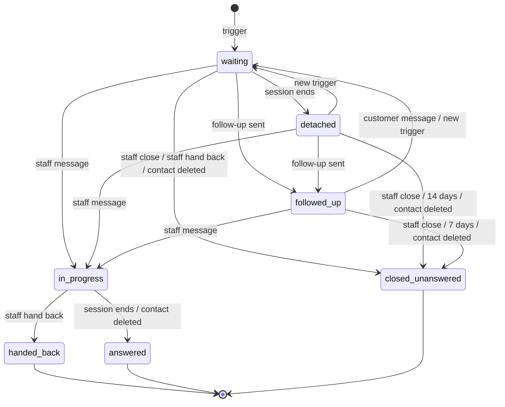

# State machines

Status: draft for maintainer review · Phase 2 (design) · Issue #126

Three rounds of review found that almost every serious defect in the
requirements was in how rules interact over time. This document replaces
prose with tables for those rules. For each machine it gives the states, the
events, what happens for every state and event pair that can occur, and the
invariants that must always hold.

Where a table decides something the requirements left open or got wrong, the
decision is listed in "Decisions made here" at the end, and the requirements
were changed in the same pull request. From now on, for the behaviour covered
here, **the tables are the authority and the acceptance criteria are tests of
them.**

Terms and numbers are those of `docs/requirements/glossary.md`.

## 1. Order of checks for an inbound message

Many defects were questions of precedence. This is the single order in which
an inbound webhook is handled. A step that ends handling says so. Each
inbound message is taken through the steps on its own; batching happens only
at step 12.

| # | Check | Result |
| --- | --- | --- |
| 1 | Signature valid? | No: HTTP 401, nothing stored. **Ends.** |
| 2 | Message ID already stored? | Yes: HTTP 200. **Ends.** |
| 3 | Receiving number maps to a tenant? | No: store as unroutable, HTTP 200. **Ends.** |
| 4 | Store the message in its conversation; start or extend the session; open or extend the reply window; HTTP 200 | Always |
| 4a | Does the text contain a phrase from the emergency list of the guardrail policy? Checked by code after the message is stored, in every tenant, contact, session and service state, and before the rate pause. | Yes: apply the emergency event of machine 2 (reason `emergency`, urgent, the immediate email under its hourly ceiling). If the tenant has verified channel credentials, send the emergency text, unless one was sent to this contact in the last 60 minutes; it replaces the ordinary handover message. While an urgent handover is open, a further emergency message adds nothing but is shown to staff like any message. If staff have closed or handed back and a new emergency message arrives, a new urgent handover opens and the same rule decides whether the text is sent again. **Continues** to step 5. |
| 5 | Is it the stop or start button, or a message whose whole text, trimmed and case-folded, equals an opt-out or opt-in keyword? | Yes: apply it by code (machine 6). Send the confirmation only if the tenant is answering. **Ends.** |
| 6 | Is it the Confirm button of a reminder? | Yes: apply it by code (machine 4), in every tenant, contact and session state. Send the result as a system reply only if the tenant is answering. **Ends.** |
| 7 | Does the contact have an open handover in state `followed-up`? | Yes: attach it to this session (machine 2 → `waiting`). If the tenant is answering and the contact is not paused, tell the customer a person will reply and notify staff. **Ends.** |
| 8 | Tenant answering? | No: mark the message `received-while-not-answering`; if the session is handed over it joins the waiting session. **Ends.** |
| 9 | Contact paused for rate? | Yes: no reply, no model call, no handover. **Ends.** If this message is the one that crosses the limit, send the rate notice once and start the pause. |
| 10 | Session handed over? | Yes: the message joins the waiting session; no assistant reply. If it is a Reschedule or Cancel button, send one system reply saying the booking is unchanged and a person will deal with the request. **Ends.** |
| 11 | Is it the person button? | Yes: hand over with reason `requested`. **Ends.** |
| 12 | Wait for the batching window to close; a later message that reaches this step joins the batch, and any reply not yet sent is discarded | As built in M3 unit U2: the send job holds an unsent assistant reply back while a newer customer message waits, and the turn that reaches this step discards it. At most two in a row are discarded in a session; the third is sent (decisions row 38). A batch is the open session's messages |
| 13 | Does the batch hold no text? A Reschedule or Cancel button counts as text. | Yes: send the unsupported-type reply; count it; on the third consecutive such batch hand over with `unsupported-content`. **Ends.** |
| 14 | Degraded mode? | Yes: mark the session `awaiting-retry`; send the fallback under the 15-minute rule. **Ends.** |
| 15 | Call the model (machine 8 on failure); run the handover triggers and output checks; send the reply | A Reschedule or Cancel button is given to the model as that request (US-B4). As built in M3 unit U11: steps 10 and 11 are checked by the turn before the model is called, and the handover triggers that exist (four flags, two fallbacks in a row) are run; in M3 a handover is also detached 24 hours after it was attached, since nobody can reply (`notes/m3-u11-handover.md`). As built in M3 unit U7: the model is called and its reply stored to send. **Not yet:** the output checks (U9), the handover triggers (U10, U11), machine 8 (U15). Until those, a reply is sent unchecked, a failed call fails the turn's job, and an answer that is refused gets no reply (`notes/m3-u7-turn.md`, sections 1 and 8) |

Messages that end at steps 5 to 9 all count towards the per-contact rate
limit.

In the handover machine, **"customer message" means an inbound message that
reaches step 7**: any message that is not an opt keyword, a stop or start
button, or a Confirm button. A call, and a message that ends at step 5 or 6,
opens the reply window but is not a customer message for the handover.

Consequences worth stating, because each was once a defect:

- Opt-out (step 5) is applied before the tenant-answering check (step 8), so
  it takes effect even when the tenant cannot reply.
- A reminder's Confirm button (step 6) is applied whatever else is true:
  tenant not answering, contact paused, session handed over, or degraded
  mode. It needs no model and changes only the customer's own booking.
- A customer's reply to a follow-up (step 7) re-attaches the handover even if
  the tenant is not answering or the contact is paused; only the
  acknowledgement and the notification wait on those.
- Rate limiting (step 9) comes before the person button (step 11), so a flood
  cannot create handovers. A paused contact's request for a person is not
  remembered; they must ask again after the pause.
- A handed-over session (step 10) never reaches the model. A Reschedule or
  Cancel tap there is not acted on, and the customer is told so.

## 2. Handover

A handover is a request for staff attention about one contact.

**Invariant H1.** A contact has at most one open handover. A new trigger
while one is open adds its reason to that handover and re-attaches it to the
current session; it does not create a second.

**Invariant H2.** Every handover reaches exactly one terminal state, and does
so even if no customer or staff member ever acts again.

**Invariant H3.** A session is handed over, and the assistant does not reply
in it, exactly while a handover in `waiting` or `in-progress` is attached to
it.

`docs/design/models/handover_machine.py` is an executable copy of the table
below. It explores every sequence of events to a depth of 8, and its output
lists the same 21 transitions between states that the table and diagram
show. What it establishes is narrower than the three invariants:

- **H2 is checked**, for the model: from every reachable open state, with
  only the session ending and the 7-day and 14-day timers firing, a terminal
  state is reached. This assumes that a session always ends and that timers
  fire.
- **H1 is not checked.** The model holds one handover per contact by
  construction. That no second handover is created depends on the code that
  creates handovers, and must be a test in milestone M4.
- **H3 is not checked.** The model has no session and no assistant. H3 is the
  definition of "attached", and must also be a test in M4.

The model also leaves out opt-out, the staff-message block of section 7, a
follow-up that is held and accepted later, and the escalation clock's value.
An independent verifier listed these differences
(`docs/reviews/2026-11-16-state-machines-verification-2.md`).

### States

| State | Meaning | Open? |
| --- | --- | --- |
| `waiting` | Attached to an active session. No staff message yet. | Yes |
| `in-progress` | Attached to an active session. Staff have sent at least one message. | Yes |
| `detached` | Its session ended with no staff message. Attached to no session. | Yes |
| `followed-up` | `handover_followup` has been sent and no customer message has arrived since. Attached to no session. | Yes |
| `handed-back` | Staff handed back after answering. | Terminal |
| `answered` | Its session ended after staff answered. | Terminal |
| `closed-unanswered` | Ended with no staff message. Stores a reason. | Terminal |

"Unanswered", as counted in the handover-rate metric, means open in
`waiting`, `detached` or `followed-up`, or terminal in `closed-unanswered`.

A staff message **answers** the handover at the moment the channel accepts
it (status `sent`).



### The urgent mark

A handover is **urgent** from the moment the reason `emergency` is added, and
stays urgent until it ends. With no open handover, an emergency opens one in
`waiting`, already urgent. Urgent changes three things and nothing else:

- The waiting list shows urgent handovers first.
- Staff are emailed at once, outside the five-minute throttle, **once per
  handover**. To stop many numbers using this to flood a mailbox, a tenant
  gets at most 5 such immediate emails an hour; beyond that an urgent
  handover is still first on the list and is covered by the next throttled
  email, whose subject says urgent.
- The customer gets the fixed emergency text in place of the ordinary
  handover message, at most once in 60 minutes (step 4a of section 1).

The escalation clock, the holding message, the follow-up and every staff
action work as for any other handover. The executable model does not cover
the urgent mark.

### Transitions

A dash means the event cannot occur in that state.

| Event | `waiting` | `in-progress` | `detached` | `followed-up` |
| --- | --- | --- | --- | --- |
| Customer message (reaches step 7) | Joins the waiting session. Stay. | Joins the session. Stay. | Not a handover event: the assistant answers it in a new session. Stay. | Attach to the customer's current session, which becomes handed over. → `waiting`. The escalation clock restarts. |
| New handover trigger (US-C6), including staff taking over a session | Add the reason. Stay. | Add the reason. Stay. | Attach to the current session. → `waiting`. Clock restarts. | Same as `detached`. → `waiting` |
| Staff message, possible only while the reply window is open | → `in-progress` | Stay. | Attach to the contact's current session, which becomes handed over. → `in-progress` | Same as `detached`. → `in-progress` |
| Staff hand back | → `closed-unanswered`, reason `handed-back-unanswered`. The assistant answers the customer's next message. | → `handed-back`. The assistant answers the customer's next message. | — | — |
| Staff close, with a reason | → `closed-unanswered` | — (hand back instead) | → `closed-unanswered` | → `closed-unanswered` |
| Staff send follow-up: available only while the reply window is closed and no follow-up has been sent for this handover | Detach from the session. If the channel accepts it → `followed-up`. | — | If the channel accepts it → `followed-up`. | — (one follow-up per handover) |
| Follow-up held, withheld or failed | Stay. Show the reason on the handover. The action stays available; a held follow-up moves the handover only when the channel accepts it. | — | Same. | — |
| Session ends | → `detached` | → `answered` | — | — |
| 7 days since the follow-up was accepted, still `followed-up` | — | — | — | → `closed-unanswered`, reason `no-response` |
| 14 days since it last became `detached`, still `detached` | — | — | → `closed-unanswered`, reason `expired` | — |
| Escalation time elapses. The clock counts business hours only, runs in `waiting` and `detached`, and is stopped and reset in every other state | Mark overdue. Send the holding message if the reply window is open and none was sent for this handover. | — | Mark overdue. No holding message. | — |
| Contact opts out | Stay. Staff may still reply in the session; `handover_followup` becomes unavailable. | Stay. | Stay; follow-up unavailable. | Stay. |
| Contact deleted (US-D5) | → `closed-unanswered`, reason `contact-deleted` | → `answered` | → `closed-unanswered`, reason `contact-deleted` | → `closed-unanswered`, reason `contact-deleted` |
| Removed staff user held it (US-D7) | Stay, unheld. | Stay, unheld. | — | — |
| Emergency (step 4a of section 1, or the model's emergency flag) | Add reason `emergency`; set **urgent**. Stay. | Add the reason; set urgent. Stay. | Attach to the contact's current session → `waiting`; add the reason; set urgent. | Same as `detached`. |

The overdue mark is cleared, and the clock restarts from zero, whenever the
handover is attached to a session again (by a customer message after a
follow-up, or by a new trigger), and when a follow-up is accepted. Otherwise
a handover is marked overdue at most once.

How each invariant is argued from the table (only H2 is also checked by the
model):

- **H2.** With nobody acting: `waiting` detaches when its session ends, and a
  `detached` handover closes after 14 days; `in-progress` ends as `answered`
  when its session ends; `followed-up` closes after 7 days. A handover can
  cycle between `waiting` and `detached` only when the customer writes again.
- **H1.** A trigger is absorbed in every open state.
- **H3.** A customer message in `detached` does not hand the new session
  over; in `followed-up` it does.

## 3. Session

| State | Meaning |
| --- | --- |
| `active` | Fewer than 24 hours since the last message in either direction. |
| `ended` | 24 hours passed with no message. Terminal; the next message starts a new session. |

A session carries these independent marks while active:

| Mark | Set by | Cleared by |
| --- | --- | --- |
| Disclosed | The first outbound message of the session | Never |
| Handed over | A handover attaching to it (machine 2) | That handover leaving `waiting` or `in-progress` |
| Awaiting retry | Machine 8 | Machine 8 |
| Consecutive guardrail fallbacks (0, 1, 2; as built in M3 unit U9 the count moves when the channel accepts the message, and goes on past 2 until the handover is built) | A fallback sent because an output check failed | Any assistant reply that passes; reaching 2 hands over |
| Consecutive unreadable batches (0 to 3) | A batch with no text | Any text; reaching 3 hands over |
| Assistant reply count | Each assistant reply | Never; reaching the turn cap hands over |

When a session ends: an attached handover moves as in machine 2; an
`awaiting-retry` mark is dropped; and the session record of US-C19 is
written.

As built in M3 unit U2: a session is ended when its conversation is next
touched after the 24 hours, by a message or by a turn, not by a timer. At
that moment its customer messages that nobody dealt with are marked as
dealt with and are not answered, and its assistant replies that never
reached the channel are discarded (`design/notes/m3-u2-sessions.md`, S3,
S10, W2; decisions row 40). The three effects above belong to later units.

**Invariant S1.** A session is handed over if and only if a handover in
`waiting` or `in-progress` is attached to it.

## 4. Booking

This machine and the reminder machine of section 5 are implemented in
`packages/packs/booking`, not in `packages/core` (ADR 0012).

| State | Meaning |
| --- | --- |
| `booked` | Created; start time in the future or past, no outcome yet. |
| `confirmed` | The customer tapped Confirm on the reminder. |
| `cancelled` | Terminal. |
| `attended` | Staff recorded attendance after the start time. |
| `missed` | Staff recorded a no-show after the start time. |

| Event | `booked` | `confirmed` | `attended` / `missed` | `cancelled` |
| --- | --- | --- | --- | --- |
| Customer taps Confirm, before the start, and the start time carried by the button equals the booking's | → `confirmed` | Stay. | — | Tell the customer the booking was cancelled. |
| Customer taps Confirm on a reminder sent for an earlier start time, or after the start | No change. Tell the customer the booking's current time. | Same. | No change. | Tell the customer the booking was cancelled. |
| Customer reschedules, earlier than the change cut-off | Move; free the old slot. Stay `booked`. Reminder: machine 5 "rescheduled". | Move. → `booked`. Reminder as before. | — | Say no booking is found. |
| Customer cancels, earlier than the change cut-off | → `cancelled`; free the slot. | → `cancelled`; free the slot. | — | Say it is already cancelled. |
| Customer asks to change or cancel inside the cut-off | No change; hand over with `late-change`. | Same. | — | — |
| Staff move it (no cut-off applies) | Move. Stay `booked`. Create a booking-change notice. | Move. → `booked`. Notice. | — | — |
| Staff cancel it | → `cancelled`. Notice. | → `cancelled`. Notice. | — | — |
| Staff mark attended or missed, after the start | → that outcome | → that outcome | Replace the outcome; audit log. | — |
| Staff mark it before the start | Refused. | Refused. | — | — |
| Contact deleted, booking in the future | → `cancelled`; free the slot. | Same. | — | Remove personal fields. |
| Contact deleted, booking in the past | Keep without personal fields. | Same. | Same. | Same. |

**Invariant B1.** At every instant, for every service, the number of
bookings in `booked` or `confirmed` whose intervals contain that instant is
no more than the service's capacity; and, if the tenant total is set, the
number across all services is no more than that total. Moving or creating a
booking is refused if it would break this. The check and the write happen in
one transaction.

A booking past its start with no outcome stays `booked` or `confirmed` and is
counted as "no outcome recorded" in the no-show metric.

## 5. Reminder

Each booking has at most one reminder.

| State | Meaning |
| --- | --- |
| `none` | No reminder will be sent for the booking as it stands. |
| `scheduled` | Has a send time. |
| `sent` | Handed to machine 7 and accepted by the channel. |
| `withheld` | Not sent; stores a withheld reason. |
| `cancelled` | The booking was cancelled first. |

### Timing rule

Run when a booking is created or moved. `now` is that moment; `lead` is the
reminder lead time; the floor is 60 minutes. Times are instants in the
tenant's time zone, and `start - lead` is computed on the local clock, so a
reminder keeps its local time across a daylight-saving change.

```text
due = start - lead
if due < now:                         -> none        (start is nearer than the lead time)
if due is not in quiet hours:         -> scheduled at due
Q = the quiet period that contains due
if (Q.start - 1 minute) > now:        -> scheduled at Q.start - 1 minute
if Q.end <= start - 60 minutes:       -> scheduled at Q.end
otherwise:                            -> withheld, too-late
```

Worked examples, with quiet hours 22:00 to 08:00. They were produced by
running `docs/design/models/reminder_timing.py`.

| Case | Result |
| --- | --- |
| Booked Mon 10:00 for Wed 07:30, lead 24 h | Scheduled Mon 21:59 |
| Booked Mon 23:00 for Wed 07:30, lead 24 h | Scheduled Tue 08:00 |
| Booked Mon 21:59:30 for Wed 07:30, lead 24 h | Scheduled Tue 08:00 |
| Booked Tue 07:00 for Tue 08:30, lead 1 h | Withheld, too-late |
| Booked Tue 06:00 for Tue 09:30, lead 2 h | Scheduled Tue 08:00 |
| Booked Mon 12:00 for Mon 20:00, lead 24 h | None |
| Moved on Tue 09:00 to Tue 15:00, lead 24 h | None |
| Booked Mon 10:00 for Wed 22:00, lead 24 h | Scheduled Tue 21:59 (22:00 itself is quiet) |
| Booked Mon 10:00 for Wed 08:00, lead 24 h | Scheduled Tue 08:00 (08:00 itself is not quiet) |
| Booked Mon 10:00 for Tue 15:00, lead 1 h | Scheduled Tue 14:00, exactly at the floor |
| Booked Tue 02:00 for Tue 09:00, lead 2 h | Scheduled Tue 08:00, exactly at the floor |
| Booked Tue 07:00 for Tue 09:00, lead 1 h | Scheduled Tue 08:00, exactly at the floor |
| Booked Tue 07:00 for Tue 08:59, lead 1 h | Withheld, too-late (08:00 is 59 minutes before) |

### Transitions

| Event | `none` | `scheduled` | `sent` | `withheld` |
| --- | --- | --- | --- | --- |
| Booking moved | Run the timing rule. | Run the timing rule again; clear the booking's confirmed state. | Run the timing rule; a second reminder may be sent for the new time. | Run the timing rule. |
| Booking cancelled | Stay. | → `cancelled` | Stay. | Stay. |
| Send time reached | — | Apply the send-time checks below. Stays `scheduled` while queued or held; → `sent` when the channel accepts it; → `withheld` if a check fails or the send fails | — | — |
| Customer taps Confirm (step 6 of section 1) | Machine 4, using the tap's booking and start time. | Same. | Same. | Same. |

### Send-time checks

Consent and opt-out are checked when the reminder is due, not when it is
scheduled, because they can change in between.

| # | Check | If it fails |
| --- | --- | --- |
| 1 | Contact has recorded consent | Withheld `no-consent` |
| 2 | Contact is not opted out | Withheld `opted-out` |
| 3 | An approved template exists in the contact's last known language or the tenant default | Withheld `no-template` or `template-unavailable` |
| 4 | The channel's daily recipient limit has room | Queue. When released, apply check 5, and if it is quiet hours hold to their end and apply check 5 again |
| 5 | The time is no later than 55 minutes before the start | Withheld `too-late` |

The timing rule never schedules a reminder later than 60 minutes before its
appointment, and it can schedule one at exactly that moment. Check 5 allows a
grace of 5 minutes for the checks, the ordering wait and send retries of
machine 7, and is applied again immediately before each send attempt. So a
reminder is never scheduled later than 60 minutes before, and never accepted
by the channel later than 55 minutes before, however it came to be late. The
model asserts both for every worked example.

## 6. Contact messaging permission

Two facts are stored for a contact: a list of consent records, and whether
the contact is opted out. The effective state decides whether a
business-initiated message may be sent.

| Effective state | Condition |
| --- | --- |
| `no-consent` | No consent record, not opted out |
| `consented` | At least one consent record, not opted out |
| `opted-out` | Opted out, whatever consent records exist |

| Event | Effect |
| --- | --- |
| Contact books in chat | Add a consent record, source `chat`, about that booking. The fixed confirmation text, sent by code, says that a reminder will be sent and how to stop it. |
| Staff tick consent on a manual booking | Add a consent record, source `staff`. |
| Opt-out keyword or stop button | Set opted out. Applied by code at step 5 of section 1, **whether or not the tenant is answering**. The confirmation is sent only if the tenant is answering. |
| Opt-out asked for in free text | Recognised by the model at step 15, so only when the message reaches that step. Set opted out; send the confirmation. A customer whose message cannot reach step 15 can always use the keyword or the button. |
| Opt-in keyword or opt-in button | Clear opted out; add a consent record, source `opt-in`. Applied by code at step 5. The "start button" of step 5 and this "opt-in button" are one button, with the payload `core.start` (decisions row 46, proposed with M3 unit U5) |
| Request in free text to receive messages again | Recognised by the model at step 15. **Does not clear the opt-out.** Code sends one fixed question with an opt-in button; only a tap on it clears the opt-out. A misread message therefore cannot restart messages. |
| Contact deleted while opted out | Keep only a one-way hash of the number, marked opted out. |
| A number whose hash is marked opted out messages again | The new contact starts `opted-out`. |

A consent record added while a contact is opted out does not clear the
opt-out. Only the opt-in event does.

## 7. Outbound message

| State | Meaning |
| --- | --- |
| `pending` | Created; pre-send checks not yet run. |
| `held` | Waiting: for quiet hours to end, for the daily limit, or for the previous message in the conversation to be delivered. |
| `discarded` | An assistant reply dropped before sending because a newer message arrived or staff took over. Terminal. |
| `withheld` | Not attempted; stores a reason. Terminal. |
| `sending` | The channel call has started and its result is not yet recorded. A message found here after 2 minutes has an unknown outcome, and its class decides what follows (`architecture.md`, "Sending a message once"). |
| `sent` | Accepted by the channel API. |
| `delivered`, `read` | Reported by the channel. |
| `failed` | Rejected by the channel or reported failed; stores the error code. Also a message whose outcome nobody knows and which is not called for again; it stores the code `unconfirmed`, and the customer may have it. Also a message that waited more than 15 minutes to be sent; it stores `expired`, or `unconfirmed` if a call for it had ended unknown. Terminal. |

Pre-send checks depend only on the message class
(`glossary.md`, "Message classes"):

| Class | Consent | Opt-out | Quiet hours | Reply window closed |
| --- | --- | --- | --- | --- |
| Assistant reply | — | — | — | Cannot occur: it answers an inbound message. It can, when a worker was stopped for a day: as built in M3 unit U2 the turn then marks the batch and makes no reply (decisions row 40) |
| System reply | — | — | — | Cannot occur |
| Staff message | — | Blocked if the contact's only messages in the session are opt-out requests | — | Not sent; dashboard explains |
| Service notice: holding message | — | Blocked if opted out after the request | — | Not sent |
| Service notice: `handover_followup` | — | Blocked if opted out after the request | Held to the end | Sent as a template |
| Business-initiated | Required | Blocked | Per-kind rule | Sent as a template |

Sending:

| Event | Effect |
| --- | --- |
| Previous message in the conversation is `delivered`, or 10 seconds have passed since it was `sent` | The next `held` message may go |
| As built in M2 (#290) | The next message goes when the one before it is `sent` or `failed`; the delivery wait is not built |
| Send call accepted | → `sent` |
| Send call refused, and the channel says it can be retried | Retry: 3 calls in total, waits of 2 and 8 seconds, then → `failed` |
| Send call ends with an unknown outcome: a timeout, a broken connection, a fault on the channel's side, or a worker that stopped | An assistant reply, a system reply or a staff message is called for once more, and after a second unknown outcome → `failed` with `unconfirmed`. A service notice or a business-initiated message → `failed` with `unconfirmed` at once |
| Send call refused for good | → `failed` |
| Channel status event | → `delivered`, `read` or `failed` |

A `failed` or `withheld` business-initiated message, or a failed or withheld
`handover_followup`, is shown to staff: in the withheld-messages list, and
for the follow-up on the handover itself.

## 8. Provider availability and the awaiting-retry mark

Service-wide state:

| State | Entered when | Left when |
| --- | --- | --- |
| `normal` | Start; a health check succeeds in `degraded` and the operator is not holding the state | 5 sessions are marked `awaiting-retry` within 2 minutes **and** a health check run at that moment fails; or the operator turns degraded mode on (ADR 0011). If that health check succeeds the service stays `normal` and the count starts again |
| `degraded` | As above | A health check, run every 30 seconds, succeeds. While the operator holds the state, health checks do not end it; only the operator turning it off does, after which the next successful health check returns the service to `normal` |

Per-session mark `awaiting-retry`:

| Event | Effect |
| --- | --- |
| A model response arrives but does not match the output schema | **Not a provider failure.** It is a failed output check: the fallback is sent and it counts towards the two-fallback handover of section 3. It never sets the mark and never counts towards degraded mode. |
| 3 model attempts end in a provider or network error or a timeout for a customer message | Set the mark. Send the fallback, unless a provider-failure fallback was sent in this session in the last 15 minutes. |
| A customer message arrives in `degraded` | Set the mark, same fallback rule, no model call. |
| 60 seconds since the last attempt, service `normal` | Attempt the answer. Success: send it, clear the mark. |
| Customer sends another message, service `normal` | Normal handling attempts the answer. Success clears the mark. |
| Service returns to `normal` | Attempt every marked session at once. |
| The latest unanswered customer message is 15 minutes old | Clear the mark. Hand over with reason `provider-failure`. |
| Session is handed over for any other reason | Clear the mark. The assistant does not answer later. |
| Session ends | Clear the mark. |

Provider failures do not count towards the consecutive-guardrail-fallback
mark of section 3.

**Invariant P1.** A marked session is answered or handed over within 15
minutes of the customer's latest message, in either service state.

## 9. Tenant

| State | Condition |
| --- | --- |
| `answering` | Every required setting is present and the channel credentials are verified |
| `not-answering` | Otherwise |

| Event | Effect |
| --- | --- |
| A setting is saved | Re-evaluate. |
| Credential check succeeds | Credentials verified. Re-evaluate. |
| Credential check is rejected by the channel, or the channel returns an authentication error on any call | Credentials not verified. Re-evaluate. On entering `not-answering` for this reason, email the tenant's notification address and the operator's alert address once. |
| Credential check cannot complete (timeout, channel unavailable) | **No change.** Retry within the hour. |
| Daily timer | Run a credential check. |
| Re-entering `answering` | Conversations with messages marked `received-while-not-answering` are listed as unanswered. The assistant does not answer them. An entry leaves the list when staff dismiss it or the customer writes again. |

Templates are not part of this state. A template that is missing, paused or
rejected withholds only the messages that need it.

## Decisions made here

Each row is a place where a table settles something the requirements left
open or had wrong. The requirements and the story issues were changed to
match in the same pull request.

| # | Decision | Resolves | Changed |
| --- | --- | --- | --- |
| 1 | A staff message from a `detached` or `followed-up` handover attaches it to the contact's current session, which becomes handed over, so the handover can end as `answered` or `handed-back`. | #118 (M1) | Glossary "Handover"; US-C14 |
| 2 | Handing back a handover that staff never answered ends it as `closed-unanswered`, reason `handed-back-unanswered`. | #119 (M2) | Glossary "Handover"; US-D3 |
| 3 | Opt-out and opt-in are applied by code before the tenant-answering check. | #124 (R5) | US-C7; US-C1 |
| 4 | A contact has at most one open handover; a new trigger is absorbed. | #125 (M7, which handover applies) | Glossary "Handover"; US-C6 |
| 5 | A `detached` handover closes as `expired` after 14 days, so every handover ends. | #125 (M7, no automatic end) | Glossary fixed values; US-C14 |
| 6 | The escalation time counts business hours only. | #125 (R3) | US-C14 |
| 7 | A withheld or failed follow-up is shown on the handover and may be tried again. | #125 (M6) | US-C14 |
| 8 | The assistant answers a customer's next session unless the handover is `followed-up`. | #125 (M7, contradiction) | US-C6 |
| 9 | Reminder timing is one function, run on create and on move; a start nearer than the lead time gives no reminder. | #123 (R4) | US-B3; glossary "Quiet hours rules" |
| 10 | A late reminder is withheld, however it came to be late; decision 16 gives the two bounds. | #117 (N6) | US-B3; glossary |
| 11 | Consent and opt-out are checked when a reminder is due, not when it is scheduled. A reminder for an opted-out contact is scheduled and then withheld unless they opt back in. | New; replaces "no reminder is scheduled" | US-B3 |
| 12 | A credential check that cannot complete changes nothing. | #117 (D4 note) | US-D6 |
| 13 | Rate limiting is applied before handover, so a paused contact cannot create handovers. | New | US-C17 |
| 14 | A customer's reply to a follow-up re-attaches the handover before the tenant-answering and rate checks; "customer message" for the handover is defined by step 7. | V1 | Section 1; US-C14 |
| 15 | A reminder's Confirm button is applied by code in every state; Reschedule and Cancel go to the assistant, and in a handed-over session the customer is told the booking is unchanged. | V2 | Section 1; US-B3 |
| 16 | Reminders are scheduled no later than 60 minutes before the appointment and accepted by the channel no later than 55 minutes before. | V3 | Section 5; US-B3; glossary |
| 17 | The escalation clock also runs in `detached`, restarts on re-attachment, and stops when a follow-up is sent. | V4 | Section 2; US-C14 |
| 18 | The follow-up is available whenever the reply window is closed and no staff message has been sent, including in `waiting`. | V5 | Section 2; US-C14 |
| 19 | The operator can hold the service in `degraded`; health checks do not end a held state. | ADR 0011 | Section 8 |
| 20 | An outbound message passes through `sending`; a reply left there is sent once more, a template is not. | Gate 2, S2 | Section 7 |
| 21 | Sections 4 and 5 (booking, reminder) belong to the booking pack, not the core. | Gate 2, S4; ADR 0012 | Sections 4, 5 |
| 22 | Degraded mode begins only if a health check fails at the moment the count is reached; invalid model output is not a provider failure. A customer who can make calls fail cannot degrade a healthy provider. | Gate 2, A1 | Section 8; US-C15 |
| 23 | An emergency phrase is checked by code as soon as the message is stored (step 4a), in every state and before the rate pause, with its own handover reason and an urgent mark. This is the one handover and notification that the rate pause of decision 13 does not stop; it is bounded per session and per tenant per hour instead. | Gate 2, A5; verification V2, V3 | Sections 1, 2; US-C6 |
| 24 | A free-text request to receive messages again does not lift an opt-out; only a keyword or the opt-in button does. | Gate 2, A12 | Section 6; US-C7 |

## Models

| File | What it checks |
| --- | --- |
| `docs/design/models/handover_machine.py` | Explores every event sequence of the handover machine to depth 8; checks invariant H2, that every state is reachable, that there is at most one follow-up per handover, and that a `detached` handover can become overdue. It does not check H1 or H3 |
| `docs/design/models/reminder_timing.py` | Computes the worked examples; asserts the 60-minute and 55-minute bounds for each |

The models are Python because they are small and need nothing installed. They
are design evidence, not product code; the product's own tests replace them
in milestone M2 and later.

## Not covered here

- The output check on replies (claims, value matching and normalisation):
  findings #120, #121, #122 and part of #125. It is not a state machine and
  belongs with the guardrail policy (#44) and the eval plan (#43).
- Dashboard sign-in sessions, invitations and password resets.
- The 44 findings of the second review (#73 to #116). Each is checked
  against these tables when design reaches its story.
