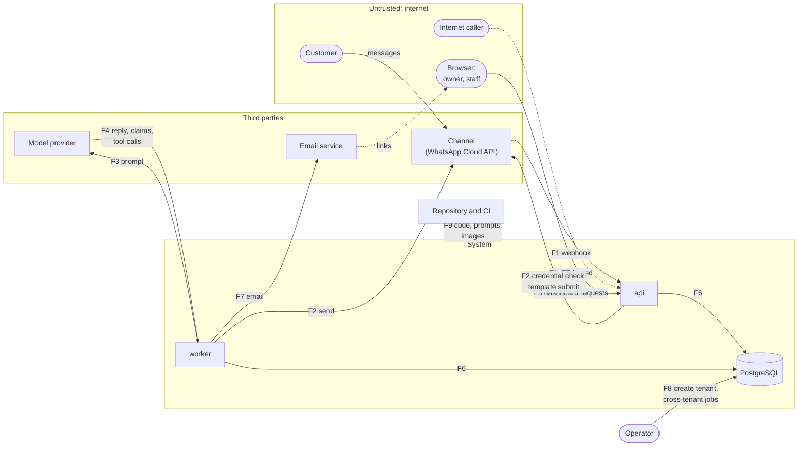

# Threat model

Status: draft for maintainer review · Phase 2 (design) · Issue #42

This document lists what could go wrong on purpose: who might attack the
system, through which data flow, and what stops them. It describes the
design for version 1.0. Nothing here is built or tested yet, so every
mitigation is a commitment, not a result.

## Method and sources

- **STRIDE.** Each flow that crosses a trust boundary is examined under six
  headings: spoofing, tampering, repudiation, information disclosure, denial
  of service and elevation of privilege. No source for STRIDE was read for
  this document; the six headings are used as commonly stated, and no
  conformance to any published method is claimed.
- **OWASP Top 10 for LLM Applications 2026.** The list of ten entries was
  read on 2026-11-16 from the publishing project's repository,
  <https://github.com/GenAI-Security-Project/GenAI-LLM-Top10/blob/main/2026/README.md>,
  as a tool extract that gave the status as published and the release date
  as 4 August 2026. Only the ten titles were read, not the text of each
  entry. On the same day the project's own page,
  <https://genai.owasp.org/llm-top-10/>, still presented the 2025 list as
  current. Section 6 therefore maps to the 2026 titles and gives the 2025
  number beside each. The mapping is this project's reading of the titles.
- Every mitigation links to a story, a requirement, a decision record or an
  issue. Thirteen gaps had none; they were opened as issues #154 to #166 and
  are listed in section 8.

Threats are numbered T1 onward and keep their numbers. "Residual" is what
remains after the mitigation.

## 1. Scope and assumptions

In scope: the `api`, `worker` and `dashboard` processes, the database, the
flows to the channel, the model provider and the email service, and the
repository's own build pipeline.

Assumptions. If one is false, the entries that rest on it must be redone.

| # | Assumption |
| --- | --- |
| A1 | The channel authenticates the sender of a message. The system trusts the sender number in a validly signed webhook. |
| A2 | The platform, network and database host are not designed (ADR 0009 is proposed). Threats to them, such as an attacker with host access, are **not modelled yet**. |
| A3 | All traffic between processes and to outside services is encrypted in transit. This becomes a requirement when ADR 0009 is decided. |
| A4 | The operator is trusted and is one person, the maintainer (glossary). |
| A5 | The model provider keeps to its terms. What it must promise is ADR 0010's subject. |
| A6 | Version 1.0 runs on a mock channel with synthetic data (ADR 0001). The entries below are written for a live deployment, because the design should be right before it is ever used with real data. |
| A7 | **Channel behaviour is assumed, not verified.** Every statement about the channel that this design relies on was read as a search extract, not in full, and one page could not be opened (`docs/compliance.md`, "How this was read"). The design assumes: (a) a webhook carries an HMAC-SHA-256 signature of the raw body in `X-Hub-Signature-256`; (b) the signing secret belongs to the app, so one secret covers every tenant; (c) an undelivered webhook is redelivered, with the same message identifier; (d) free-form messages are allowed for 24 hours after the customer's last message, and templates are needed outside that; (e) each template is approved per language, with no fallback; (f) a new business account may message a limited number of recipients per day; (g) delivery order is not guaranteed; (h) the send call offers no way to ask later whether a message was accepted. **Each must be re-read in full before any live channel is connected** (NFR-L1). On 2026-11-18 one page was fetched in full and confirms redelivery for up to 7 days; a new fact was found that the design did not assume: a customer may arrive with no phone number (#284). See `docs/compliance.md`, "Re-read on 2026-11-18". |

## 2. What is protected

| Asset | Why it matters | Goal in `architecture.md` |
| --- | --- | --- |
| Customers' messages, phone numbers and names | Personal data of people who never chose this software | 1, 3 |
| Each tenant's separation from every other | A leak cannot be undone | 1 |
| The truth of what is said in a business's name | A wrong price or a planted link is sent from the business's own number | 2 |
| Customers' choices: opt-out, consent, deletion | Privacy, and the channel's rules | 3 |
| A tenant's channel credentials | They allow sending as the business | 1 |
| Staff accounts | They open customers' conversations | 1 |
| Bookings and free slots | The business's income | 4 |
| The tenant's and operator's money | Each model call and each message beyond the channel's allowance costs money (`docs/compliance.md`) | — |
| The tenant's standing with the channel | A restricted number stops the business (risk R-C7) | 3 |
| The audit log and traces | Evidence of what happened | — |
| The repository, prompts and build pipeline | Whoever changes them changes the product | — |

## 3. Who might attack

| Actor | Starting position | Typical aim |
| --- | --- | --- |
| **Internet caller** | Can reach the public endpoints; has no credentials | Forge events, guess passwords, exhaust resources |
| **Customer** | Any person with a messaging account; controls message text, profile name and message rate | Extract data, manipulate the assistant, run up cost, disrupt bookings |
| **Many customers acting together** | Many phone numbers | The same, past per-number limits |
| **Staff user** (agent role) | A valid session in one tenant | Read or change more than the role allows |
| **Owner of another tenant** | A valid owner session in their own tenant | Reach a competitor's data |
| **Holder of a stolen session or password** | Whatever the account allows | The account's data |
| **The model** | Reads everything in its prompt; writes replies and tool calls | Not an attacker itself, but it does what the text it reads persuades it to. Treated as untrusted (ADR 0007) |
| **Compromised dependency or build step** | Code execution in CI or in the product | Steal secrets, alter behaviour |

## 4. Data flows and trust boundaries

| Flow | From → to | Boundary crossed | What crosses |
| --- | --- | --- | --- |
| F1 | Channel → `api` | Internet into the system | Customer messages, delivery statuses, template status |
| F2 | `worker`, `api` → channel | System out to a third party | Messages, templates, the tenant's credentials |
| F3 | `worker` → model provider | System out to a third party | Business profile, session messages, tool results |
| F4 | Model provider → `worker` | Untrusted output into the system | Reply text, claims, flags, tool calls |
| F5 | Browser → `api` | Internet into the system | Credentials, session cookie, requests |
| F6 | `api`, `worker` → database | Process to data store | Everything |
| F7 | `worker` → email service → a mailbox | System out to a third party | Invitations, reset links, notifications |
| F8 | Operator → system | Privileged access | Tenant creation, cross-tenant jobs |
| F9 | Repository and CI → running system | Build into production | Code, prompts, dependencies, secrets in CI |

## 5. Threats by flow

Category letters: **S** spoofing, **T** tampering, **R** repudiation, **I**
information disclosure, **D** denial of service, **E** elevation of
privilege.

### F1 — Webhook from the channel

| ID | Cat. | Threat | Mitigation | Link | Residual |
| --- | --- | --- | --- | --- | --- |
| T1 | S | An internet caller posts a forged message or status event | Signature checked over the raw body before anything is stored; invalid means 401 and nothing stored | NFR-S2, US-C1, state machines §1 step 1 | Depends on the channel's signing secret staying secret |
| T2 | T | A validly signed event is replayed to cause a second reply or a second booking | Unique message identifier per tenant; idempotent tools; a status only moves a message forward | NFR-R2, NFR-R3, data model "constraints" | The channel documents no timestamp for rejecting replays (NFR-S2) |
| T3 | S | A signed event names a receiving number that belongs to no tenant, or is crafted to reach another tenant | The tenant comes only from the receiving-number lookup; no tenant means the event is stored as metadata only | State machines §1 step 3, data model decision 1 | None known |
| T4 | D | Floods of unsigned or oversized requests consume the endpoint | Body size cap, rate limit on invalid signatures, constant-time comparison | **#154** | Volumetric attacks need the platform (A2) |
| T5 | D | One customer floods a tenant: model cost, staff notifications, handovers | Per-contact limit applied before any model call, handover or notification; batching; turn cap | NFR-S7, US-C17, US-C11, NFR-C2 | The first 20 messages in 5 minutes are still processed |
| T6 | D | Many numbers flood one tenant, past the per-contact limit: cost, a full waiting list, every free slot booked three at a time | Tenant-level ceiling and alert | **#157**, OQ-7 | Open until #157 is designed. Until then only the per-contact rules apply |
| T7 | R | A customer denies sending a message or tapping Confirm | Each inbound event is stored with the channel's identifier and time; button taps are handled by code and recorded | US-C1, US-B3, US-C19 | The record shows what the channel delivered, not who held the phone |
| T8 | S | A phone number is reassigned; the new holder is treated as the old contact and can see or cancel that contact's future bookings | Not mitigated in v1.0. Bookings hold no free text; retention deletes idle contacts | NFR-V4; stated as a limit in **#166** | Accepted for v1.0 |
| T9 | I | Events for unknown numbers accumulate personal data of people with no relationship to any tenant | Only metadata is stored | Data model decision 1 | None known |

### F2 — Sending through the channel

| ID | Cat. | Threat | Mitigation | Link | Residual |
| --- | --- | --- | --- | --- | --- |
| T10 | I | A tenant's channel credentials leak from the database, logs or an error message | Encrypted at rest with a key held outside the database; never logged; `last_error` is a sanitised code | NFR-S5, data model, **#162** | An attacker with both the database and the key has them |
| T11 | E | A message is sent with the wrong tenant's credentials | Credentials are read inside the tenant's transaction; the send job carries identifiers only | ADR 0003, data model decision 2, NFR-S1 | **Not yet in force.** As built in M2 the worker sends with one credential for every tenant, from its settings, and the receiving number is read in the tenant's transaction. That is enough for the mock channel and for nothing else (#290) |
| T12 | T | The system is made to message someone who opted out or never agreed, or outside the reply window | Every outbound message passes the checks of its class in code, at send time | NFR-V1, US-C7, US-C9, US-C13, state machines §7 | None known in design; the mock may differ from the live channel (R-T3) |
| T13 | T | Text supplied by a customer or owner is placed in a template variable to change what an approved template says | Template variables are filled by code from typed fields (service name, time), never from message text | US-C16; to be stated in the guardrail policy, #44 | An owner can still name a service misleadingly, within their own tenant |
| T14 | D | Abuse drives a tenant into the channel's recipient limit or lowers its quality rating, so reminders stop | Consent before business-initiated messages; utility-only templates; queue and withhold with reasons | US-C13, US-C16, US-D12, R-T8, R-C7 | The channel's own judgement is outside the system |

### F3 and F4 — To and from the model

The AI-specific threats are in section 6. The entries here are the plain
STRIDE view of the same two flows.

| ID | Cat. | Threat | Mitigation | Link | Residual |
| --- | --- | --- | --- | --- | --- |
| T15 | I | Personal data reaches the model provider beyond what is needed | No phone number and no contact name in any prompt; unsupported content is never stored or sent | NFR-V7, US-C12, data model decision 6 | The customer's own words are sent, and may contain anything |
| T16 | I | The provider keeps or trains on what it receives | Provider terms that exclude training, recorded in an ADR | NFR-V6, R-C3, ADR 0010 (proposed) | Open until ADR 0010 is decided |
| T17 | T | The response is malformed, or names a tool, tenant or identifier it was not given | Schema validation; unknown tools refused; identifiers resolve only inside the tenant's transaction | ADR 0007 layers 3 and 4, NFR-S1 | None known |
| T18 | D | The provider is slow or down | Timeout, bounded retries, degraded mode, automatic recovery; reminders need no model | US-C15, NFR-R4, R-T7 | Customers wait for a person |
| T59 | D | **A customer drives the whole service into degraded mode**, by sending input that makes model calls fail in five sessions within two minutes; every tenant then stops answering and is emailed | Degraded mode begins only if a provider health check fails at that moment, so failures a customer causes cannot degrade a healthy provider. Invalid model output is a failed check, not a provider failure. Degraded-mode emails are limited to one per tenant per hour. Limits per call bound a deliberately slow reply | State machines §8 decision 22, US-C15 criteria 6 and 10, **#158** | A customer can still make their own sessions fail and be handed over, within the per-contact limit. Whether input can force a timeout depends on the model and is not known |
| T19 | R | No one can tell later why a reply was sent | One trace per call with prompt version, model, tools and guardrail results | US-C10, NFR-A5 | Traces hold no text by design, so the exact wording is found only in the stored message |

### F5 — Dashboard requests

ADR 0008 required entries for credential stuffing, session theft, reset-link
abuse and cross-site request forgery. They are T20, T21, T23 and T24.

| ID | Cat. | Threat | Mitigation | Link | Residual |
| --- | --- | --- | --- | --- | --- |
| T20 | S | **Credential stuffing or guessing** against sign-in | Lockout after 5 failures in 15 minutes; minimum length 12; memory-hard hashing; per-source limit | NFR-S6, US-D1, ADR 0008, **#156** | No second factor in v1.0 (ADR 0008; **#166**). A reused password that is correct on the first try succeeds |
| T21 | S | **Session theft**: the cookie is stolen or fixed in advance | Cookie unreadable by scripts, HTTPS only, same-site; only a hash is stored; idle and total lifetimes; new identifier at sign-in; other sessions ended on password change | ADR 0008, US-D1, **#156** | A stolen cookie works until it expires or the user is removed |
| T22 | D | An attacker locks a known user out by failing sign-in on purpose | Lockout is temporary (15 minutes); per-source limit so one source cannot lock many accounts | NFR-S6, **#156** | A determined attacker can keep one account locked |
| T23 | S | **Reset-link and invitation abuse**: a link is guessed, reused, sent to an attacker's host, or used to learn which addresses have accounts | Random token, hash stored, single use, 1 hour or 7 days; identical response and timing for known and unknown addresses; links built from a configured address | US-D10, US-D7, ADR 0008, **#156** | Whoever controls the mailbox controls the account |
| T24 | T | **Cross-site request forgery**: another site makes a signed-in browser change something | Same-site cookie plus forgery protection on every state-changing request | ADR 0008 | None known |
| T25 | T | Stored script: markup in a customer message, profile name, model reply or business data runs in a staff browser | All such text rendered as characters; content security policy | **#155** | Open until built; this is the main route from a customer to a staff session |
| T26 | E | An agent-role user calls an owner-only route directly | Role checked on the server for every route; a test fails on a route with no declared role | US-D7, ADR 0008 | None known |
| T27 | E | A user of one tenant reaches another tenant's rows by changing an identifier in a request | The tenant comes from the session row; row-level security hides other tenants' rows from the application role | NFR-S1, US-C2, US-D1, ADR 0003 | None known |
| T28 | S | An account is created without an invitation | No sign-up route; route inventory test | NFR-S8, US-D10 | None known |
| T29 | I | The contact export is fetched by someone other than the owner, or left where it can be found | Streamed to the owner's session or stored encrypted and short-lived; rate-limited; audited | US-D5, **#164** | Once downloaded, the file is the owner's responsibility |
| T30 | R | A staff user denies sending a message, cancelling a booking or deleting a contact | Staff messages carry the user; changes are in an append-only audit log; removed users are kept as actors | US-D3, US-D5, data model decision 5 | Reading a conversation is not logged (**#166**) |
| T31 | I | A removed staff member keeps access | Removal deletes session rows at once | US-D7, ADR 0008 | Anything already copied is gone |

### F6 — Database

| ID | Cat. | Threat | Mitigation | Link | Residual |
| --- | --- | --- | --- | --- | --- |
| T32 | I, E | A query written without a tenant filter returns another tenant's rows | Row-level security on every tenant-owned table; the application role cannot bypass it; a test fails on a table without a policy | NFR-S1, ADR 0003, **#162** | The cross-tenant role bypasses it by design (T39) |
| T33 | T | Injection through message text, business data or model output into a query | Parameterised queries only; the model never writes a query (ADR 0007 layer 2) | ADR 0007; lint rule to be added with the code in M2 (**#162**) | None known |
| T34 | I | Tables outside tenant scoping reveal personal data | Job payloads hold identifiers only; unroutable events hold metadata only; a test checks payloads | Data model decisions 1 and 2 | They reveal which tenant has activity, to anyone who can read them |
| T35 | T, R | The audit log is altered | The application role has no update or delete privilege on it | Data model "constraints", **#162** | A database administrator can alter it |
| T36 | I | The stored hash of a deleted, opted-out number is reversed by trying every phone number | Keyed hash over tenant and number, with the key outside the database and a key version per row | Data model, `suppressed_numbers` and decision 7 | Someone with both the table and the key can reverse it |
| T37 | I | Deleted data persists in backups | Backup retention to be set with hosting and stated to tenants | Data model "what the retention rule does not cover", ADR 0009, **#166** | Accepted; stated |

### F7 — Email

| ID | Cat. | Threat | Mitigation | Link | Residual |
| --- | --- | --- | --- | --- | --- |
| T38 | I | A notification email exposes customer data to a mailbox or the email provider | No message text, name or number in any email; notifications say only that sessions are waiting | Architecture §3, US-C14 | Reset and invitation links travel by email (T23) |

Handover notifications are limited to one email per tenant per five minutes
(glossary), and degraded-mode emails to one per tenant per hour (T59). An
emergency handover is emailed at once, outside the throttle; a customer who
sends emergency phrases repeatedly gets one emergency text and one handover
per session, so that route is limited by the session, not by the throttle.

### F8 — Operator

| ID | Cat. | Threat | Mitigation | Link | Residual |
| --- | --- | --- | --- | --- | --- |
| T39 | E, R | The cross-tenant role is used beyond its stated jobs, or a person's use of it leaves no record | Only `packages/db` can reach the database at all: a test fails if another source file names the driver, and what the package exports takes a handle that cannot run a query. Which modules may hold the cross-tenant handle is not yet tested (#162). The operator acts only through commands run on the server, each writing to an insert-only log; there is no operator route | ADR 0011, data model `operator_log`, **#162** | Someone with a shell and the database credential can bypass the log; only the platform's access log shows that (ADR 0009). A4 holds only while the operator is one trusted person. As built in M2 (U9): the operator's functions can be imported only by `apps/ops`, a test lists the API's routes, and each command writes two rows to `operator_log`, which no role can change by a plain statement. The migration role, which owns the table, can remove that guard, and the cross-tenant role can insert a row for a command that never ran (ADR 0011, amendment; #293) |
| T40 | S | A deployment runs with the mock channel's test page, the fake model or logged emails | Start-up refuses these in production. As built in M2: the API, the worker and the mock must each be told where they run (`PSA_ENV`, no default). In production the mock refuses to start, and the API and the worker refuse a channel address that is not exactly `https://graph.facebook.com`, any secret that carries the mark `local-only` which every placeholder of the example file has, and (the worker) one credential for every tenant. The set-up script that makes a demo tenant runs only in development. Not built, because they do not exist yet: the checks for a fake model and for logged emails | **#165** | A deployment told it is `development` gets no refusal: the setting is a statement, not a detection. The mark is a net for a copied example, not a test of a secret: a placeholder with a character changed, or the database's own `postgres` password, passes. The operator's tool and the database tool do not read `PSA_ENV` and run anywhere. Until per-tenant credentials exist no worker starts in production at all |

### F9 — Repository and build

| ID | Cat. | Threat | Mitigation | Link | Residual |
| --- | --- | --- | --- | --- | --- |
| T41 | T | A dependency or a workflow action is malicious or is replaced | Licence, maintenance and vulnerability check before adding; lockfile; pinned actions; scans block the merge | `AGENTS.md` hard limits, NFR-S4, **#163** | A new attack on a trusted dependency is not detected in advance |
| T42 | I | A secret or real personal data is committed, or a secret reaches a fork's workflow run | Secret scan on every pull request; `.env.example` only; synthetic fixtures; no secrets to forks | NFR-S3, NFR-V5, R-D2, **#163** | None known |
| T43 | T | A prompt or eval dataset is changed to weaken a rule, unnoticed | Prompts are versioned files changed by pull request; each trace records the prompt version; a prompt change needs an eval run | US-C10, R-A5, **#163**; the eval plan, #43 | Review quality |
| T44 | T | The development agent writes plausible but wrong security code | Tests before merge, maintainer review, independent gate reviews; security-critical parts use maintained libraries | R-A8, ADR 0008, `AGENTS.md` §11 | Stated in section 9 |

## 6. AI-specific threats

The principle, from ADR 0007: **assume the model can be fully manipulated,
and make sure the rules that code can enforce still hold.** Those are:
tenant isolation, acting only for the customer in the conversation, never
returning another customer's data, never messaging someone who opted out,
and staying silent in a session staff hold. Checks that run before the
model and the tenant scoping of tools do not ask the model for anything.

**What does not hold under full manipulation is the truth of what is
said.** The checks after the model block a false value only in a form code
can detect and only against the item the model itself names. This document
first implied more; the Gate 2 review showed that was wrong (finding A2).
T50 and T60 state the remainder.

Where text that reaches the model comes from, and who controls it:

| Text | Controlled by | In the prompt? |
| --- | --- | --- |
| Customer messages | Customer | Yes, delimited as data |
| Business profile: services, hours, policies | Owner | Yes, as identified items, delimited as data |
| Tool results | Code, from the tenant's data | Yes; they contain owner-entered names |
| Contact profile name | Customer | **No** (NFR-V7) |
| Phone number | Channel | **No** (NFR-V7) |
| Staff messages in the session | Staff | Yes, as part of the session |
| Other tenants' data | — | Never; row-level security |
| Web pages, files, links | — | Never; the model has no tool that fetches anything |

| ID | Threat | Mitigation | Link | Residual |
| --- | --- | --- | --- | --- |
| T45 | **Direct injection.** A customer tells the assistant to ignore its rules, or pretends to be the owner or the system | Customer text is data; identity comes from the channel and the session, never from what a message claims; steps 1 to 14 of the order of checks never consult the model | US-C8 criteria 1 and 6, ADR 0007 | The model may still be persuaded to write something misleading (T50) |
| T46 | **Indirect injection.** Instructions are placed in a service name, a policy text or another owner-entered field, and arrive in the profile or a tool result | Same delimiting; the model gains nothing from them that the owner does not already control | US-C8 criterion 4 | An owner, or a stolen owner account, can make their own assistant misbehave; it cannot reach another tenant |
| T47 | **Tool misuse.** The model is persuaded to call a tool with another contact's or tenant's identifier, to book for someone else, or to cancel a booking that is not the customer's | Tenant and contact are supplied by the server, never by the model; arguments are schema-checked; a booking identifier resolves only if it belongs to this contact | US-C2, US-C8, ADR 0007 layers 2 and 3, NFR-A1 | None known in design; hostile-output unit tests are ADR 0007's confirmation |
| T48 | **Too much power in the tools.** A tool does more than the task needs | Tools are limited to: read services and policies, find free slots, and create, move or cancel **this contact's** bookings. No tool sends a message, reads another contact, changes business data, fetches a link or runs a query. At most 3 future bookings per contact | US-B2, US-B4, architecture "what a pack provides" | A manipulated model can book or cancel within the customer's own limit of 3; the customer is the one being served |
| T49 | **Hidden context is extracted.** A customer obtains the prompt, tool definitions or profile | The design does not rely on the prompt staying secret: it holds no credential, no key, no other tenant's data and no other customer's data. Disclosure is still tested | US-C8 criterion 2, NFR-A1 | A disclosed prompt helps an attacker craft later attempts |
| T50 | **False statements.** The assistant states a wrong price, time or policy, or confirms a wrong value the customer supplied | Each *detected* amount, percentage, time or date needs a claim, and code checks it equals a value of the item named; availability comes only from tools; fallback and handover on failure | US-C4, NFR-A2, R-A1, ADR 0006, ADR 0007 layer 5, guardrail policy §4 | **Not closed by code.** A value in words, without a currency or time marker, or attached to the wrong service is not caught. Facts with no value are not checked at all. All of these are measured by evals (E2, E4), which lower the rate and do not make it zero |
| T60 | **False confirmation.** The assistant says in its own words that a booking is made, moved or cancelled when no tool did it. The customer arrives and has no appointment | The true confirmation is fixed text sent only by the tool that changed the booking. Code cannot tell a false one from an ordinary sentence | Guardrail policy G13; eval dimension E16, a fixed gate | **Rests on the model.** Measured, not prevented |
| T51 | **Planted content.** A manipulated reply carries a link, a phone number or payment details, sent from the business's own number | A link, email address, phone number or account number in a reply must equal a value in the tenant's own data; checked by code after the model | Guardrail policy section 4, check O5; US-C4 criterion 15 | Detection is by pattern and can miss an unusual form; measured by the planted-content eval cases |
| T52 | **Advice the assistant must not give**, or offensive output in the business's name | Refusal rules in the prompt; the model's sensitive-topic flag triggers handover; refusal eval cases per language | US-C8 criterion 5, R-A4, guardrail policy #44 | Rests on the model's judgement; measured, not enforced (ADR 0007) |
| T53 | **One customer's data shown to another.** A customer asks who else is booked, or for another customer's details | Tools return slots and this contact's own bookings, never who holds a slot; the prompt holds only this session | US-C2, NFR-A1, ADR 0007 layer 2 | None known |
| T54 | **Unbounded use.** A customer makes each reply expensive: very long input, a loop of tool calls, very long output | Turn cap, per-contact limit, timeout and batching exist; since M3 unit U4 so do limits on one call's output, tool calls and batch text | NFR-C2, NFR-S7, **#158**, **#157** | **Partly closed** (M3 unit U4): output, tool calls and the batch's text are bounded on each call. Still open: the session's earlier messages and tool results given to a call (U7), the session's and the tenant's budgets (U12, #157; OQ-7) |
| T55 | **Model output used unsafely downstream.** Reply text is treated as markup, a query, a link to fetch or a command | Output is schema-validated and used only as message text and typed tool arguments; it is rendered as characters in the dashboard; nothing executes it | ADR 0007 layers 2 to 4, **#155** | None known once #155 is built |
| T56 | **The model or provider changes** and behaviour shifts silently | Model version pinned in configuration; a full eval run on any change; the provider sits behind an interface | R-A5, ADR 0005 | A provider can change a pinned model without notice |
| T57 | **Conversations are used to train or evaluate.** Real messages enter prompts, eval sets or a provider's training | Eval data is written, never harvested; a pattern scan in CI; provider terms | NFR-V6, NFR-V5, ADR 0010 (proposed) | Depends on A5 |
| T58 | **A flag is suppressed.** The model is persuaded not to set "asks for a person" or "asks to stop" | The person button, the stop button and exact opt-out keywords are handled by code before the model; only free-text requests rest on the flag | State machines §1 steps 5 and 11, US-C6, US-C7 | A free-text request can be missed; measured by evals |

### Mapping to the OWASP Top 10 for LLM Applications 2026

| 2026 entry | 2025 number | Status here | Where |
| --- | --- | --- | --- |
| LLM01 Prompt Injection | LLM01 | Addressed, with a stated residual | T45, T46, T58 |
| LLM02 Sensitive Information Disclosure | LLM02 | Addressed | T15, T16, T53, T57 |
| LLM03 Excessive Agency | LLM06 | Addressed | T47, T48 |
| LLM04 Supply Chain | LLM03 | Partly addressed; provider not chosen | T41, T43, T56, ADR 0010 |
| LLM05 Data and Model Poisoning | LLM04 | **Mostly not applicable.** No model is trained or fine-tuned and nothing is retrieved from outside sources. The one input that shapes answers is the owner's own profile | T46, T57 |
| LLM06 Unbounded Consumption | LLM10 | **Partly open** | T5, T6, T54; #157, #158 |
| LLM07 Misinformation | LLM09 | Addressed for amounts, times and dates; measured for the rest | T50, T52 |
| LLM08 Hidden Context Exposure | LLM07, then named System Prompt Leakage | Addressed | T49 |
| LLM09 Vector and Embedding Weaknesses | LLM08 | **Not applicable.** No vector search or embeddings (ADR 0006). Reopen if ADR 0006 is reopened | — |
| LLM10 Improper Output Handling | LLM05 | Addressed in design; one part open | T17, T55, T51; #155, #159 |

The same project publishes a separate list for agentic applications. It was
not read. This system gives the model a small fixed set of tools and no memory
beyond one session, so the LLM list is the closer fit; whether the agentic
list adds anything is a question for the Gate 2 review.

## 7. Requirements this adds or changes

None of these is in the stories yet. Each is carried by its issue until the
document it belongs to is written.

| Change | Where it will land |
| --- | --- |
| Limits on the webhook endpoint for unauthenticated callers | #154; a new NFR beside NFR-S2 |
| Text is rendered as characters; browser security headers | #155; a new NFR |
| Sign-in: new identifier at sign-in, sessions ended on password change, links from a configured address, equal timing, per-source limits, audit entries | #156; an amendment to ADR 0008 |
| Tenant-level ceiling and alert | #157; a new step in the order of checks |
| Limits per model call | #158; fixed values in the glossary since M3 unit U4 |
| Links, phone numbers and payment details in replies | #159; guardrail policy |
| Keyed hash for suppressed numbers | #160; data model |
| Operator access and its audit trail | #161; architecture or an ADR |

## 8. Open items

Issues opened by this document, all labelled `security`.

| Issue | Subject | Milestone | Threats |
| --- | --- | --- | --- |
| #154 | Limit unauthenticated load on the webhook endpoint | M2 | T4 |
| #155 | Render text as text; browser security headers | M4 | T25, T55 |
| #156 | Sign-in hardening not stated in ADR 0008 | M4 | T20 to T23 |
| #157 | Tenant-level limits on model calls and new contacts | M3 | T6, T54 |
| #158 | Bound every model call | M3 | T54 |
| #159 | Links, phone numbers and payment details in replies (settled in the guardrail policy) | M1 | T51 |
| #160 | Keyed hash for suppressed phone numbers (settled in the data model) | M1 | T36 |
| #161 | Design operator access (settled in ADR 0011) | M1 | T39 |
| #162 | Separate database roles; key rotation | M2 | T10, T32, T33, T35 |
| #163 | Harden CI and the dependency supply chain | M2 | T41 to T43 |
| #164 | Protect the contact export file | M5 | T29 |
| #165 | Refuse to start a deployment with development components | M2 | T40 |
| #166 | System card: state the security limits | M6 | T8, T20, T30, T37 |

Threats that are open, accepted or only measured today, in full (Gate 2
finding A31 showed the earlier list was too short):

| Entries | State |
| --- | --- |
| T4, T29 | Mitigation named; its limits are not set (#154, #164) |
| T6, T54 | T54's limits per call are built (#158, M3 unit U4); the rest is M3's (#157) |
| Recycled number (T8) | Not mitigated; accepted for v1.0 (#166) |
| Provider retention (T16) | Open until the provider is chosen (ADR 0010) |
| Stored script (T25) | Mitigation named; open until built (#155) |
| T50, T60 | Rest partly or wholly on the model; measured by evals |
| A7 | Every channel statement is an assumption until re-read |

Three were settled after this document was first written: T36 in the data
model (#160), T39 in ADR 0011 (#161) and T51 in part by the guardrail policy
(#159; disguised forms rest on the model).

## 9. What this document does not establish

- **Nothing is tested.** Each mitigation becomes real only with its test. The
  test plan (M2) and the Gate 4 review check that every entry here has one.
- **It was written by the same agent that wrote the design**, so it shares
  the design's blind spots. The Gate 2 review is done by a separate agent;
  no person with security training has reviewed it. Before any use with real
  customer data, a review by such a person is the right step.
- **Infrastructure is not modelled** (A2). Host, network, backup and
  secret-store threats are added when ADR 0009 is decided.
- **The live channel is not modelled from experience.** Statements about the
  channel come from `docs/compliance.md`; no live test has been run (R-T3).
- **The OWASP mapping rests on titles only**, as stated under "Method and
  sources".
- **Version 1.1 features** (the `cod-confirm` pack, integrations) are out of
  scope and need their own entries when designed.
