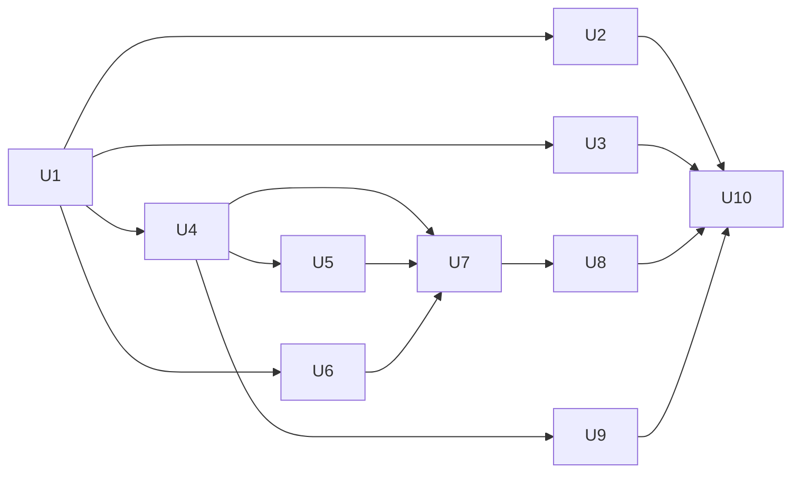

# Plan: M2, the walking skeleton

Status: proposed · 2026-11-17 · follows ADR 0013

M2 is the first milestone with code. This plan cuts it into ten units of
work, each small enough for one pull request, in the order they depend on
each other. It is a plan: nothing in it is built.

## Exit criteria

From `AGENTS.md` section 9: `docker compose up` works; an end-to-end test
sends a message and receives the echo; CI is green.

The skeleton has no model, no dashboard and no bookings. It proves the path
a message takes, and the rules that are cheapest to get right first: tenant
isolation, exactly-once handling, the lease and the send policy.

## Units and order

| Unit | Issue | What | Needs | Done when |
| --- | --- | --- | --- | --- |
| U1 | #262 | Monorepo tooling and the local check | — | `make check` passes on an empty workspace; a deliberately wrong file fails it. |
| U2 | #263 | CI pipeline with the document checks | U1 | A pull request with a planted secret, a broken OpenAPI file and a missing traceability row each fail. |
| U3 | #264 | One source for shared names | U1 | Changing a name in one of the places the check reads fails the check. As built: five lists, seventeen places; mentions in prose are not checked (#278). |
| U4 | #265 | Database, roles and tenant isolation | U1 | A query as the application role without a tenant returns nothing; cross-tenant read and write attempts fail (US-C2); a new table without a policy fails the test. |
| U5 | #266 | Jobs, the conversation lease and worker health | U4 | Two workers never process one conversation at once (NFR-R6); a job that keeps failing ends in dead-letter; a lost lease discards the late result. |
| U6 | #267 | Channel interface and the mock channel | U1 | Contract tests against dated synthetic fixtures; a bad signature stores nothing; an oversized body is refused. |
| U7 | #268 | Webhook: verify, store, queue | U4, U5, U6 | The same message five times gives one row (NFR-R2); answers are 200, 401, 413 and 503 as specified; the request does nothing else (NFR-P1 measured, not yet gated). |
| U8 | #269 | Worker: echo reply and the send policy | U7 | The restart test stops the worker before the call, after the call, and between the two, and shows the three outcomes NFR-R2 allows. |
| U9 | #270 | Operator commands | U4 | Each command writes its two log rows; the application role cannot update or delete them; no route reaches the cross-tenant role. |
| U10 | #271 | End to end, production guard and the pack boundary | U2, U3, U8, U9 | The M2 exit criteria of `AGENTS.md` section 9. |

## Scope of each unit

### U1: Monorepo tooling and the local check (#262)

Package manager workspaces, TypeScript in strict mode, formatter, linter, commit-message lint, and a `Makefile` whose `make check` runs exactly what CI runs. Each dependency's licence, maintenance and known vulnerabilities are recorded in the pull request.

### U2: CI pipeline with the document checks (#263)

GitHub Actions running `make check` on every pull request: locked install, format, lint, type check, tests, secret scan, dependency scan. Actions pinned to a commit, least-permission token, no secrets to forks (#163). Document checks: the OpenAPI file lints; every story has a row in the traceability table; required sections exist.

### U3: One source for shared names (#264)

A package of shared definitions: message statuses and classes, handover reasons and states, flags, settings with their units and ranges. A check that the tables in the glossary, data model, state machines and OpenAPI file match it (#204, #183).

**As built:** message statuses, classes and directions, and handover states and reasons. Flags and settings with their units and ranges were not done; they and the rest of #183 and #204 are in #278.

### U4: Database, roles and tenant isolation (#265)

Local PostgreSQL in docker-compose; a migration runner; three roles: migration, application, cross-tenant (#162); the core tables the skeleton needs; a row-level security policy on each tenant-owned table; `withTenant`. The policy test uses an explicit allow-list of tables without a policy (#191).

### U5: Jobs, the conversation lease and worker health (#266)

The jobs table: claim, retry with backoff, dead-letter. The lease per conversation with a token check (ADR 0004). A worker heartbeat and readiness probe (#187). The poll interval is set and recorded.

### U6: Channel interface and the mock channel (#267)

The channel interface; the `mock-whatsapp` app; a decision, recorded, on what each mock is for and which tests use which (#202). Signature check over the raw body in constant time; body size limit; rate limit on bad signatures (#154).

### U7: Webhook: verify, store, queue (#268)

`GET` and `POST /webhooks/whatsapp` and the health endpoints. One transaction stores the event and enqueues its job. Duplicate, unknown-number and unparsed events as `api.md` section 3 says. One table states what each event kind writes and enqueues (#177).

### U8: Worker: echo reply and the send policy (#269)

Steps 1 to 4 of the order of checks and an echo reply in place of the model. The outbound message machine with `sending`. The send policy by message class, including a timeout (#235, #236).

**As built:** the worker's loop and heartbeat, the echo, the send policy as one function with a row for every class, and one send job per conversation. Of step 4, the message is stored; sessions and the reply window are not built. No template can be sent and no pre-send check runs. Credentials are one setting for every tenant. These and the rest are in #290.

### U9: Operator commands (#270)

`ops tenant create` (the tenant only; the owner's invitation arrives in M4, #201), `ops tenant list`, `ops jobs list-dead` and `retry`. The insert-only `operator_log` (ADR 0011).

### U10: End to end, production guard and the pack boundary (#271)

`docker compose up` gives a working stack. An end-to-end test sends a message through `mock-whatsapp` and receives the echo. Start-up refuses development components in production (#165). The places where the core still names bookings are removed and the boundary test of ADR 0012 is switched on (#237, #253). M2 retro and tag.

## The loop for every unit

1. **Confirm the design.** Read the passages the unit implements. If they
   are unclear or contradict each other, fix the document first, in the same
   pull request, and say so.
2. **Write the tests** named under "Done when", and see them fail.
3. **Write the code.**
4. **Run every check** with `make check`.
5. **Independent code review** (Gate 4) by a separate agent, on that pull
   request only. Its report goes in the pull request, with a response.
6. **Before asking for a merge,** search for every other statement of any
   fact the unit changed, and list the files in the pull request.

If a check fails twice for the same reason, the agent stops and opens a
`needs-human` issue.

## Review findings handled in M2

The open findings were sorted on 2026-11-17 by the milestone that builds
their subject. Those that M2 must settle, by unit:

| Unit | Findings |
| --- | --- |
| U2 | #163 (CI hardening) |
| U3 | #183 in part (the names of handover states and reasons and of message statuses, classes and directions). Not done in U3 and moved to #278: model flags, #204 (units and names of settings), #249 (pack settings), the rest of #183 |
| U4 | #162 (roles and keys), #191 (cross-tenant role and the policy test), #184 in part (tables the skeleton needs) |
| U5 | #187 (worker health), #195 in part (timers that exist in M2) |
| U6 | #154 (webhook limits), #202 (two mocks) |
| U7 | #177 (job shapes), #178 (what `api` may call) |
| U8 | #235, #236 (send policy by class and on timeout) |
| U9 | #201 (tenant creation without the invitation) |
| U10 | #165 (production guard), #237, #253 (core still names bookings) |
| Any | #199 (story-to-component map), #200 (decisions with no record), #231, #245 (Low findings) |

After the sort, open `review-finding` issues by milestone: 23 in M2, 39 in
M3, 7 in M4, 11 in M5; the rest are in earlier or later milestones or have
none. The findings of M3 to M5 are sorted again when each milestone is
planned.

## What the maintainer must decide or do first

None of these blocks U1 to U3.

| Item | Needed by | Where |
| --- | --- | --- |
| Whether commits should carry the maintainer's own git identity | U1, since every commit after it is code | #7 |
| Squash or merge commits | U1 | OQ-11 |
| Confirm the licence and the copyright holder's name | U10, before the first tag | #7 |
| A model provider and its key | M3, not M2 | #7, ADR 0010 |
| A hosting target | M6, not M2 | #7, ADR 0009 |

## What this plan does not settle

- The package manager, test runner and other tools: each is chosen in the
  unit that needs it, with the licence and maintenance check the working
  agreement requires.
- Performance targets are measured in M2 and gated later.
- Whether ten units is the right cut. A unit that turns out too large is
  split, with a new issue.
