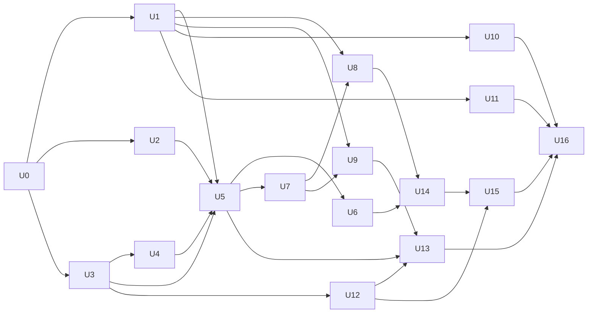

# Plan: M3, the AI core

Status: proposed · 2026-11-22 · follows ADR 0013 and the M2 retro

M3 puts a model where M2 has an echo. A customer's messages are gathered
into a batch, answered in their language from the business's own data,
checked by code before anything is sent, and recorded. An eval harness
measures what code cannot check. This plan cuts M3 into sixteen units, each
small enough for one pull request, in the order they depend on each other.
It is a plan: nothing in it is built.

## Exit criteria

From `AGENTS.md` section 9: grounded multilingual answers pass the eval
thresholds; the eval job runs in CI.

Three things the agent cannot supply stand between this plan and that
sentence, and the plan is arranged so that everything else can be finished
first:

| What | Who | Needed by | On `decisions-needed.md` |
| --- | --- | --- | --- |
| The supported languages, and a speaker to read each language's cases | Maintainer | U14 (the dataset); the wording of U7's fixed texts | Row 4 |
| AWS credentials and a spending limit | Maintainer | U12's check against the real service; U15 | Row 6 |
| Acceptance of the baseline as the thresholds | Maintainer | U15 | `ai/eval-plan.md`, section 7 |

Until the third, M3 can be built and tested but **cannot be called done**:
thresholds are set from a measured baseline that the maintainer accepts,
and there is no baseline without a real model.

## What M3 is not

- No handover queue, no staff, no dashboard, no sign-in (M4).
- No bookings, no slots, no reminders, no templates sent (M5). The model has
  **no tools** in M3: the only pack a tenant can answer from is the profile
  itself. The tool loop is built and tested with a tool of the tests' own.
- No real WhatsApp. No real customer's message goes to the model: the evals
  and every test use synthetic conversations.

## Four questions to settle before the units that depend on them

Each is put with the agent's proposal. They are design questions, raised
here so that they are answered once and not inside a pull request.

1. **Handover in M3.** Several M3 criteria end in "the session is handed
   over": a sensitive topic (US-C8, 5), provider failure after 15 minutes
   (US-C15, 4), an emergency phrase (order of checks, 4a). Handover is
   US-C6, in M4, and only two criteria are listed as delivered later
   (US-C11, 4; US-C12, 4). *Proposal:* M3 builds the handover **record**
   and its first transition (unit U9): the session is marked handed over
   with its reason, the assistant stops answering it, and the customer is
   told a person will reply. The queue, staff, notifications and every
   later transition are M4's. Without this, M3 would have to pretend to
   hand over.
2. **Email in M3.** Degraded mode sends one email to each tenant (US-C15,
   6 and 8); the emergency event sends one (4a). Email sending has no ADR
   (#200) and is M4's. *Proposal:* M3 queues the notice as a job and a
   writer that only logs takes it; the production guard refuses that
   writer (#165). The real sender is M4's.
3. **Evals on pull requests need the provider key in CI.** The eval plan
   runs a subset against the real model on every pull request that touches
   prompts or the AI code. That spends money on each push. *Proposal:* as
   the eval plan says, but only once the maintainer has put the key in the
   repository's secrets and set the cap; until then CI runs the harness's
   own tests on the fake client and says in its summary that no score
   exists.
4. **Who a customer is, and what may be sent twice** (rows 1 to 3 of
   `decisions-needed.md`). U1 builds sessions on the contact rules as they
   stand, and U11 keeps the send policy as it stands. A "no" to any of the
   three is cheaper before those units than after.

## Units and order

| Unit | What | Stories and criteria | Needs | Done when |
| --- | --- | --- | --- | --- |
| U0 | Settle the findings that are about documents, and write the ADR for the pack interface | — | — | Every finding listed under U0 is closed with its reason or moved; the ADR is merged |
| U1 | Sessions, the reply window and the batch | US-C11, 1 to 3 and 5; order of checks, 4 and 12; NFR-P5 | U0 | A burst of messages inside the window gets one reply, in order; a message that arrives while a reply is being made replaces it; two workers never answer one conversation at once; `handled_at` is gone |
| U2 | The business profile and what the model is given | ADR 0006; US-C4, 1 and 12 | U0 | Services, policies and opening hours are stored per tenant, seeded by an operator's command, and assembled into one context with nothing of the contact in it (NFR-V7) |
| U3 | `LlmClient`, the fake client and the prompt loader | ADR 0005; #158 | U0 | A scripted fake returns a reply, a failure or malformed output as a test states; a prompt is loaded by name and version; every call is bounded in input, output and tool rounds |
| U4 | Traces and cost | US-C10 | U3 | Every model call leaves one trace with no message text, number or name in it; an end-to-end run's logs are scanned for both |
| U5 | The turn: the model in place of the echo, and the customer's language | US-C3; US-C8, 1 to 4; order of checks, 15 | U1, U2, U3, U4 | With the fake client, a batch is answered from the profile; the session records its language; an unsupported language is attempted and marked |
| U6 | Output checks | US-C4, 2 to 10, 14 and 15; guardrail policy, section 4 | U5 | Each claim kind passes only against the stored value it names; a value with no claim fails; a failed check sends the fallback and counts |
| U7 | Fixed texts and disclosure | US-C5; guardrail policy, sections 7 and 8 | U5 | The first message of a session carries the disclosure, added by code, in the contact's language or the tenant's default; every fixed text exists in every supported language, or the gap is listed |
| U8 | What code decides before the model | US-C7, 1 and 4 to 7; US-C12, 1 to 3; order of checks, 4a, 5 and 13 | U1, U7 | An opt-out keyword is applied without the model in every state; an emergency phrase sends its text; a batch with no text gets the unsupported-type reply |
| U9 | The handover record (if question 1 is answered yes) | US-C8, 5; US-C15, 4 and 5; order of checks, 10 and 11 | U1, U7 | A session handed over for any M3 reason is never answered by the assistant again, and the customer is told once |
| U10 | Limits: one sender, one tenant | US-C17; #157 | U1 | The twenty-first message in five minutes gets one notice and fifteen minutes of silence, with no model call; a tenant's daily budget stops model calls and says so |
| U11 | Delivery tracking and order | US-C18, 6; NFR-R7 | U1 | The next message of a conversation goes when the one before is delivered, or ten seconds after it was sent |
| U12 | The Bedrock adapter and the guard for the fake client | ADR 0010; #165 | U3 | Contract tests pass against recorded, synthetic answers; in production the fake client is refused; **one call against the real service, when credentials exist** |
| U13 | Provider failure and degraded mode | US-C15 | U5, U9, U12 | Three failures in a row send the fallback once in fifteen minutes; five sessions failing in two minutes run a health check, and only its failure starts degraded mode |
| U14 | The eval harness, and the first dataset | `ai/eval-plan.md`; NFR-A1, A2, A4 | U6, U8, and the languages | `make eval` drives the same code as production against the fake client and against a real model; the dataset has its planned minimum sizes in each supported language |
| U15 | Baseline, thresholds and the eval job in CI | NFR-A1 to A4; OQ-6, OQ-7 | U12, U14, credentials, a speaker's review | Two or three candidate models are measured; the results are in ADR 0010; the maintainer accepts a baseline; the job blocks a merge that falls below it |
| U16 | End to end with the model, and close | The exit criteria | All | The end-to-end test of M2 passes with a scripted model in place of the echo; README, STATUS, the retro and the tag |

U1, U2 and U3 do not depend on each other and can be built in any order.
U10 and U11 are off the main line and can be built whenever U1 is in.

## How the units are worked

As in M2 (`AGENTS.md`, section 2; ADR 0013), with the changes the M2 retro
made:

- A pull request is opened as a **draft** and marked ready only when its
  review and the check of the review's fixes are both in.
- **A design note comes before the code** for any rule about people or
  money: the cases as a table, reviewed before the build. In M3 that is U1
  (what a session and a batch are), U6 (what passes), U8 (opt-out and the
  emergency text), U9, U10 and U13.
- Each finding listed under a unit is **read in full in that unit's design
  note** and answered there: settled by the unit, moved with a reason, or
  closed as overtaken. The lists below were made from the findings' titles.
- Anything the agent cannot run on its own machine is named in the pull
  request before the push.

## Scope of each unit, and the findings it must settle

Every open issue in the M3 milestone on 2026-11-22 is in one of these
lists. An issue under two units is listed where it is first needed.

### U0: Documents, and the pack interface's ADR

No code. The findings that are about what the documents say, read now so
that no later unit builds on a contradiction: #76, #77, #92, #111, #125,
#132, #147, #150, #199, #218, #219, #220, #221, #223, #225, #226, #229,
#230, #232, #234, #253. An ADR for the pack interface and how a pack is
registered, which the Gate 2 review called the central bet with no record
(#200, #237, #278); it is built in M5, and M3 must not shape the turn in a
way it would then have to undo.

Sorted into M3 by the rule of the triage but, by their titles, not M3's.
U0 reads each and moves it: #80 and #82 (handover rules, M4), #85 (a failed
reply shown to staff, M4), #184 (stored data for sign-in, M4), #224
(inviting a user, M4), #222 (a forged button naming a booking, M5), #240
(what counts as a booking tool, M5). #227 (the application role and the
operator's record) was settled in M2 and is closed with that reason, if the
maintainer says yes to row 16 of the decisions page.

### U1: Sessions, the reply window and the batch

The `sessions` table and its machine (state machines, section 3); the
reply window; the batching window as the delay of the job that answers;
the batch as the customer's messages since the last answered one. A reply
not yet sent when a new message arrives is discarded (the `discarded`
status, unused until now). Replaces `messages.handled_at`. US-C11 (#47);
the worker's and the webhook's leftovers (#288, #290); #86, #99, #179,
#189.

### U2: The business profile and what the model is given

`services`, `policies` and opening hours as core tables (ADR 0012, "What
the core owns"), an operator's command to load a profile from a file, since
no dashboard exists to enter one, and the function that assembles what the
model sees: the profile, the calendar, the batch, and nothing that
identifies the contact. US-C4 (#13, in part); #228.

### U3: `LlmClient`, the fake client and the prompt loader

The interface of ADR 0005 in this project's own types; `FakeLlmClient`,
scripted; prompts under `prompts/` with a version and a `meta.yaml`; the
output schema (reply, claims, flags, tool calls); the limits on every call
(#158). No provider yet.

### U4: Traces and cost

`ai_traces` and `tool_calls`; the wrapper that writes a trace for every
call, failed ones included; cost from token counts and a price table that
is a setting. US-C10 (#19); #186.

### U5: The turn, and the customer's language

The worker's turn calls the model through U3 with what U2 assembles and
stores the reply as U1 allows. The tool loop, exercised by a tool of the
tests'. The session's language and the unsupported-language mark. Customer
text and owner-entered text are delimited as data. US-C3 (#12); US-C8
(#17, criteria 1 to 4, as far as code can show; the rest is the evals').

### U6: Output checks

The checks of the guardrail policy, section 4: the claim checker for each
kind, the scan for values with no claim, links and contact details, the
fallback and its counter. US-C4 (#13); #102, #207, #208, #209, #211, #213,
#239, #242.

### U7: Fixed texts and disclosure

Every text code sends: disclosure, fallback, opt-out and opt-in
confirmations, the unsupported-type reply, the rate notice, the emergency
text, the holding message. One table, one source, each language or a
stated gap. US-C5 (#14); #107, #212. The wording in languages other than
English waits on row 4 and a speaker; the mechanism does not.

### U8: What code decides before the model

Opt-out and opt-in keywords and buttons, applied in every state (machine
6) with `consent_records`; a free-text request to stop, from the model's
flag; the emergency phrase list (4a); the unsupported-type reply and its
count. US-C7 (#16); US-C12 (#48); #78, #79, #100, #112, #129, #206, #233;
who a customer is (#284).

### U9: The handover record

If question 1 is answered yes. The `handovers` table, the transition that
creates one, the session's handed-over mark, the holding message, the
person button (order of checks, 11) and what a handed-over session does
with a new message (10). Nothing a member of staff would see.

### U10: Limits

The per-contact rate limit and pause (order of checks, 9), and the
tenant's limits on model calls and new contacts. US-C17 (#66); #87, #130,
#131, #157, #190.

### U11: Delivery tracking and order

What M2 left of US-C18: the wait for delivery before the next message
(NFR-R7). US-C18 (#67); #139.

### U12: The Bedrock adapter and the guard

The first real adapter (ADR 0010, amendment): region, inference profile,
model and retention mode as settings; no retry of its own; errors mapped
to the interface's typed failures. Contract tests against recorded,
synthetic answers. The production guard refuses the fake client (#165).
The rest of the end-to-end unit's leftovers (#295). A call against the
real service is made once, by hand, when the maintainer supplies
credentials; until then the adapter is checked against recordings only,
and the pull request says so.

### U13: Provider failure and degraded mode

Retries, `awaiting-retry`, the fifteen-minute rules, the health check,
degraded mode and recovery (state machines, section 8). The notices to
tenants are queued and logged (question 2). US-C15 (#64); #188.

### U14: The eval harness and the first dataset

The runner, the case format, the graders, the report, `make eval` and
`make eval-fast`, against the same code as production with only the
channel absent. The first dataset at its planned minimum sizes. The
findings of the Gate 2 review of the eval plan: #93, #94, #210, #214,
#215, #216, #217, #241, #243, #244. The languages (#168).

### U15: Baseline, thresholds and the job in CI

The comparison of candidate models that ADR 0010 asks for; cost per
session from the traces (OQ-7); the baseline the maintainer accepts; the
CI job with its spending cap and its key kept from forks (#163).

### U16: End to end, and close

The M2 end-to-end test with a scripted model; the compose stack with the
fake client; README and STATUS; the retro; the tag.

## What could make this plan wrong

- **Sixteen units is more than M2's ten,** and M2's ten were merged over
  five days, 2026-11-17 to 2026-11-21, with a review round each. The count is a guess at where the
  seams are, and U6 and U14 are the likeliest to split.
- **The model has no tools in M3.** If the tool loop cannot be tested well
  without a real tool, part of U5 moves to M5.
- **A "no" to question 1** removes U9 and leaves three criteria to be
  delivered in M4; the table in `user-stories.md` would then list them.
- **The findings were assigned by title.** A design note may find that a
  finding belongs to another unit, or that two units cannot be separated.
- **No real model is called until U12's credentials.** Everything before
  that is tested against a script the agent wrote, which shows that the
  code does what the script says and nothing about a model.
