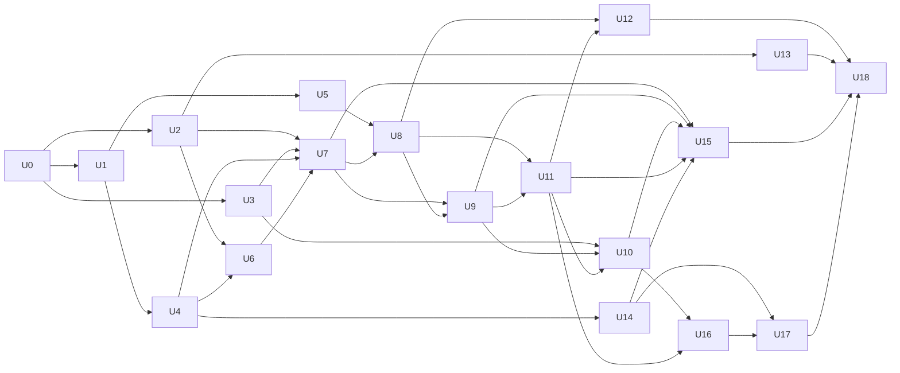

# Plan: M3, the AI core

Status: proposed · 2026-11-22 · follows ADR 0013 and the M2 retro ·
the first draft was checked by a second agent and the rework by a third;
both reports, and what was done about them, are in `docs/reviews/`

M3 puts a model where M2 has an echo. A customer's messages are gathered
into a batch, answered in their language from the business's own data,
checked by code before anything is sent, and recorded. An eval harness
measures what code cannot check. This plan cuts M3 into nineteen units, U0
to U18, each meant for one pull request. The table's "Needs" column gives the
order; the numbers are close to it but U11 comes before U10. It is a plan: nothing in it is built.

## Exit criteria

From `AGENTS.md` section 9: grounded multilingual answers pass the eval
thresholds; the eval job runs in CI.

Three things the agent cannot supply stand between this plan and that
sentence, and the plan is arranged so that everything else can be finished
first:

| What | Who | Needed by | Where it is asked |
| --- | --- | --- | --- |
| The supported languages, and a speaker to read each language's texts and cases | Maintainer | U7 (the supported set at run time), U8 (wording), U10 (keyword and emergency phrase lists), U16 (the dataset) | `decisions-needed.md`, row 4 |
| AWS credentials and a spending limit | Maintainer | U17, which begins with one call against the real service | Row 6 |
| Acceptance of the measured baseline as the thresholds | Maintainer | U17 | `ai/eval-plan.md`, section 7; asked when the baseline exists |

Until the third, M3 can be built and tested but **cannot be called done**.

What "pass the eval thresholds" can mean in M3 is itself a question
(question 5): the model has no tools until M5, so the M3 baseline covers
only what can be measured without them.

## What M3 is not

- No handover queue, no staff, no dashboard, no sign-in (M4).
- No bookings, no slots, no reminders, no templates sent (M5). The model has
  **no tools** in M3. The tool loop is built and tested with a tool that
  exists only in test files.
- No real WhatsApp. No real customer's message goes to the model: the evals
  and every test use synthetic conversations.

## Eight questions to settle before the units that depend on them

Each is put with the agent's proposal. Questions 1 to 3 and 5 to 8 are
rows 29 to 35 of `decisions-needed.md`. Row 36 was added by U0 and is
set out on its page.

1. **Handover in M3** (row 29). Handover is US-C6, in M4, but M3's own
   criteria and checks end in it: a sensitive topic (US-C8, 5), provider
   failure after 15 minutes (US-C15, 4), an emergency phrase (order of
   checks, 4a) or the model's emergency flag. The stories file lists four criteria as delivered
   later; two of them, US-C11, 4 and US-C12, 4, are there only because
   handover is M4's, and it says that in M3 acting on a request for a
   person "is US-C6, in M4". *Proposal:* M3 builds the handover **record**
   and its first transition (U11), and every trigger of the guardrail
   policy's section 6 whose detection M3 builds creates one:

   | Reason | Trigger | With a yes |
   | --- | --- | --- |
   | `emergency` | Phrase list; the model's flag | M3 (U10 for the phrase, U9 for the flag; U11 acts) |
   | `requested` | The person button; the model's flag | M3 (U11); US-C11, 4 leaves the later table |
   | `sensitive-topic`, `data-request` | The model's flag | M3 (U11) |
   | `repeated-failure` | Two fallbacks in a row | M3 (U9 counts, U11 acts) |
   | `unsupported-content` | Three batches with no text | M3 (U10 counts, U11 acts); US-C12, 4 leaves the later table |
   | `limit` | The turn cap or the token budget | M3 (U12, U11) |
   | `provider-failure` | An unanswered message 15 minutes old | M3 (U15, U11) |
   | `late-change`, `staff` | — | M5, M4 |

   The session is marked handed over with its reason, the assistant stops
   answering it, and the customer gets the handover text. The queue, staff,
   notifications, claiming, returning and every later transition stay in
   M4, as do the tests the state machines call H1 and H3 beyond the first
   transition. Two more transitions have to come with it, or a customer
   once handed over would be silent for good in M3, where nobody can close
   a handover: when the session ends the handover is detached and the
   assistant answers the customer's next message (US-C6, 8), and a new
   trigger in a later session re-attaches the same record and adds its
   reason. This is most of the triggers of US-C6, an M4 story, built
   early; its queue and its staff are not. **In M3 nobody can reply:** the customer is told a person
   will, and no screen exists for that person. That is acceptable only
   because nothing is live. With a no, U11 is not built; the assistant
   goes on answering in each of those cases; U10 sends the emergency text
   with no handover; U15 sends its fallback and stops there; U12's caps
   end the assistant's replies in that session with the fallback text and
   no handover; no text carries the person button; U16 has no cases whose
   expected outcome is a handover; and those criteria join the later
   table.
2. **Email in M3** (row 30). Degraded mode sends one email to each tenant
   (US-C15, 6 and 8); the emergency event sends one. Email sending has no
   ADR (#200) and is M4's. *Proposal:* M3 queues the notice as a job, and
   a writer that only logs takes it (built in U10, which needs it first).
   The production guard refuses that writer. The real sender is M4's.
   Either way no email is sent before M4; with a no, the notices of
   US-C15, 6 and 8 are not built until then.
3. **Evals on pull requests, and a rule of `AGENTS.md` that cannot yet be
   kept** (row 31). Section 6 says no change to AI behaviour merges without
   an eval run attached. U7 to U15 change AI behaviour and merge before
   any score can exist: the harness is U16 and a real model is U17.
   *Proposal:* until U17, such a pull request attaches the run of its own
   tests against the scripted client and says that no score exists; from
   U17 the rule holds as written, and the eval plan's subset runs against
   the real model on each such pull request, once the maintainer has put
   the key in the repository's secrets and set the cap. Each push then
   spends money. The key must not reach a run from a fork (#163, now in
   M6; U17 needs it and takes it).
4. **Rows already on the decisions page that units build on.** A "no" is
   cheaper before the unit than after: U2 on rows 1 (who a customer is)
   and 18 (`handled_at`, which U2 removes); U13 on rows 2, 3, 7 and 8 (the
   send policy); U9 on row 21 (the pack's hooks, which ADR 0014 leaves to
   M5); U4 on row 37; U0 closes the
   first part of #227 only on a yes to row 13.
5. **What the M3 evals cover with no tools** (row 32). The eval plan's
   minimum sizes are for v1.0 and say the M3 dataset will be smaller. Some
   of what they grade does not exist in M3: tool use and bookings, inquiry
   labels (US-C19), and most red-team cases on tool misuse; with no tool
   offered, the one case left is a call to a tool that was not offered. *Proposal:* U16's design note lists,
   by dimension of the eval plan, what the M3 dataset holds and how many
   cases, and what waits for M5; the M3 baseline and thresholds are for
   those dimensions only; the baseline is measured again in M5 when tools
   and the pack's part of the prompt arrive; the M3 tag's notes say so.
6. **Buttons and captions** (row 33). The channel interface built in M2
   receives text or "unsupported" and sends text. M3's criteria need more:
   the stop and start buttons (US-C7, 1 and 5), the opt-in question with a
   button (US-C7, 7), the person button on the fallback and the
   unsupported-type reply, and a caption read as text (US-C12, 2).
   *Proposal:* build them in M3 as their own unit (U5), in the interface,
   the WhatsApp adapter and both stand-ins, from Meta's pages read and
   dated at that time. A tap is checked for whose conversation it came
   from, as #222 asks for booking buttons.
7. **Whether a tenant is answering** (row 34). Steps 4a, 5 and 8 of the
   order of checks read it or the tenant's credentials, and the handover
   text and the notices need business hours, a support contact and a
   notification address that no table holds (the default language is
   stored). *Proposal:* U3 stores those settings and
   builds a test that every required setting is present and a channel is
   connected, which is weaker than machine 9's verified credentials; step
   8 is built in U10. The credential checks, the daily
   timer, the emails and the unanswered list of machine 9 stay in M4.
8. **Parts of M3 criteria that need M5** (row 35), not yet in the stories
   file's table of criteria delivered later. *Proposal:* U0 adds them:
   US-C4, 4 and 14 and the booking clause of 10 (slot, booking and
   calendar claims are the pack's, ADR 0012); US-C5, 1 for a template;
   US-C8, 4 for a real tool's result; US-C15, 9 (a reminder in degraded
   mode). The core builds the place a pack registers its claim kinds, as
   U1's ADR decides, and tests it with a claim kind of the tests' own.

## Units and order

| Unit | What | Stories and criteria | Needs | Done when |
| --- | --- | --- | --- | --- |
| U0 | Settle the findings that are about documents; move what is not M3's | — | — | Every part of every finding listed under U0 has an end: fixed, a named unit's, moved, or already answered (an issue with a unit's part stays open for that unit); the stories file's later table is as question 8 was answered |
| U1 | The ADR for the pack interface | ADR 0012 | U0 | The ADR is merged: how a pack is registered; the three parts M3 builds (prompt fragment, tool, claim kind); the rules M3 keeps for the parts left to M5 (ADR 0014) |
| U2 | Sessions, the reply window and the batch | US-C11, 1 to 3; order of checks, 4 and 12; NFR-P5 | U0 | A burst inside the window gets one reply, in order; a message that arrives while a reply is being made replaces it; two workers never answer one conversation at once; `handled_at` is gone, with a tested way back |
| U3 | The business profile, the tenant's settings, and what the model is given | ADR 0006; order of checks, 8 (the test only) | U0 | Services, policies, opening hours and settings are stored per tenant, loaded by an operator's command, and assembled into one context with nothing of the contact in it (NFR-V7); its size is measured and a budget set |
| U4 | `LlmClient`, the fake client, the prompt loader, and the pack interface's packages | ADR 0005; ADR 0014; US-C4, 2 (the schema); #158 | U1 | A scripted fake returns a reply, a failure or malformed output as a test states; a prompt is loaded by name and version; every call is bounded; no provider's library is imported outside its adapter; the interface and registry packages exist, `faq-only` is registered as row 37 is answered, and the boundary test is changed as ADR 0014 lists |
| U5 | Buttons and captions in the channel | US-C12, 2; NFR-M2 | U1 | A tap arrives as a typed event tied to its conversation; a text with buttons can be sent; a caption is read as text; both stand-ins do the same; a test keeps channel-specific imports out of the core |
| U6 | Traces, cost and the log line | US-C10, 1 and 2; NFR-O2 | U2, U4 | Every model call leaves one trace, linked to its session, with no message text, number or name in it; a test of the log line's shape passes for the api and the worker |
| U7 | The turn: the model in place of the echo, and the customer's language | US-C3, 4; US-C8, 4 with a test tool; US-C11, 5; order of checks, 15 | U2, U3, U4, U6 | With the fake client, a batch is answered from the profile; the session records its language; an unsupported language is attempted and marked; the lease is renewed before each attempt |
| U8 | Fixed texts and disclosure | US-C5, 1 to 3 | U5, U7 | The first message of a session carries the disclosure, added by code; every fixed text M3 sends exists in every supported language, or the gap is listed |
| U9 | Output checks | US-C4, 3, 5 to 9, 15, and 10 but for bookings; US-C15, 10; guardrail policy, section 4 | U7, U8 | Each core claim kind passes only against the stored value it names; a value with no claim fails; a failed check sends the fallback and counts; a fake that returns hostile output is stopped |
| U10 | What code decides before the model | US-C7, 1, 2 and 4 to 7; US-C12, 1 to 3, and 4 with U11; order of checks, 4a, 5, 8 and 13 | U3, U9, and U11 if it is built | An opt-out keyword or button is applied without the model in every state; an emergency phrase sends its text; a batch with no text gets the unsupported-type reply |
| U11 | The handover record (if question 1 is answered yes) | US-C8, 5; US-C11, 4; order of checks, 10 and 11 | U8, U9 | A session handed over by a trigger that exists then (the person button, the model's flags, two fallbacks in a row) is not answered by the assistant again while it lasts, and the customer is told once; the triggers of U10, U12 and U15 are shown in those units |
| U12 | Limits: one sender, one tenant | US-C17; NFR-C2; #157 | U8, and U11 if it is built | The twenty-first message in five minutes gets one notice and fifteen minutes of silence, with no model call; the turn cap and the token budget stop a session |
| U13 | Delivery tracking and order | US-C18, 6; NFR-R7 | U2 | The next message of a conversation goes when the one before is delivered, or ten seconds after it was sent |
| U14 | The Bedrock adapter and the guard for the fake client | ADR 0010; #165 | U4 | Contract tests pass against answers hand-written from a dated page; in production the fake client is refused; its logs carry no message text. Done without a call to the real service |
| U15 | Provider failure and degraded mode | US-C15, 1 to 8; order of checks, 14 | U7, U9, U10, U14, and U11 if it is built | Three failures in a row send the fallback once in fifteen minutes; five sessions failing in two minutes run a health check, and only its failure starts degraded mode |
| U16 | The eval harness, and the first dataset | `ai/eval-plan.md`; US-C3, 1 to 3; US-C4, 1, 11 to 13; US-C8, 1 to 3 and 6; NFR-A1, A2, A4 | U10, the languages, and U11 if it is built | `make eval` drives the same code as production against the fake client; the dataset holds what question 5's answer says, in each supported language. The criteria that are the model's behaviour are shown only in U17, against a real model |
| U17 | Baseline, thresholds and the eval job in CI | NFR-A1 to A4; NFR-V6; OQ-6, OQ-7 | U14, U16, credentials, a speaker's review | One call against the real service succeeds; two or three candidate models are measured; the provider's terms, licence, prices and model list are read, dated and linked in ADR 0010; the maintainer accepts a baseline; the job blocks a merge that falls below it |
| U18 | End to end with the model, and close | The exit criteria; US-C10, 3 | U12, U13, U15, U17 | M2's end-to-end test passes with a scripted model in place of the echo, and its logs are scanned for message text and numbers; traceability, README, STATUS, the retro and the tag |

The "Needs" column lists what a unit uses directly and does not already
get through another listed unit. Steps 6 and 7 of the order of checks
(a reminder's Confirm button; a followed-up handover) are not built in
M3.

US-C18, 1 to 4 were built in M2; their tests are entered in
`traceability.md` by U13, which finds any that is missing.

U2, U3 and U5 do not depend on each other. U13 is off the main line and
can be built whenever U2 is in. The three arrows out of U11 to U10, U12
and U15, and the one to U16, exist only if U11 is built.

## How the units are worked

As in M2 (`AGENTS.md`, section 2; ADR 0013), with the changes the M2 retro
made:

- A pull request is opened as a **draft** and marked ready only when its
  review and the check of the review's fixes are both in.
- **A design note comes before the code** for any rule about people or
  money: the cases as a table, reviewed before the build. In M3 that is
  U2, U3 (what of a person may reach the model), U8, U9, U10, U11, U12,
  U13, U15 and U17 (the spending cap).
- Each finding listed under a unit is **read in full in that unit's design
  note** and answered there: settled by the unit, moved with a reason, or
  closed as overtaken. The lists below were made from the findings' titles
  and, for about a sixth of them, their text.
- The README's state table and `traceability.md` are updated in the pull
  request that changes what they describe.
- Anything the agent cannot run on its own machine is named in the pull
  request before the push.
- An issue is opened for each unit when this plan is merged.
- A new dependency (the provider's library in U14 is the one foreseen) is
  checked for licence, upkeep and known faults, and the pull request
  records it (`AGENTS.md`).

## Scope of each unit, and the findings it must settle

Every open issue in the M3 milestone on 2026-11-22 is in one of these
lists. #13 and #184 are shared by two units, and M2's three leftover
issues (#288, #290, #295) are divided among units by U0.

### U0: Document findings, and what is not M3's

No code. The findings that are about what the documents say, read now so
that no later unit builds on a contradiction: #76, #77, #92, #111, #125,
#147, #150, #199, #218, #221, #223, #225, #226, #229, #232, #234, #253.

**U0's page, [`m3-u0-findings.md`](m3-u0-findings.md), overrides the
lists in this section and adds to every unit's list below:** it read the
issues in full, kept #82, #85, #199, #219 and #226 in M3, and names the
unit for each part. A unit's design note reads its rows there as well as
its list here.

Sorted into M3 by the rule of the triage but, by their titles, not M3's.
As first planned, U0 reads each and moves it: #80 and #82 (handover rules, M4), #85 (a failed
reply shown to staff, M4), #224 (inviting a user, M4), #219 and #220 (the
cross-tenant credential and the order of the webhook's checks; U0 finds
their milestone), #222 (a forged button naming a booking, M5; its second
half, where the stop button appears, is U8's), #230 (the inquiry label as a second
use of the model, M5), #240 (what counts as a booking tool, M5), and the
parts of #184 no unit below takes. The first part of #227, the
application role and the operator's record, was settled in M2 (row 13);
its other parts go to U4 (a way back for a prompt) and U15 (what the
operator's switch does to open sessions). U0 also looks again at the
query builder, as ADR 0003 said to at the start of M3 (row 16).

U0 also reads the three leftover issues of M2 (#288, #290, #295) item by
item, says which unit takes each item, and moves the rest: per-tenant
credentials, operator alerts, deletion after 30 days, the image scan and
the deployment definition are not M3's.

### U1: The ADR for the pack interface

What the Gate 2 review listed as a decision with no record (#200; #237
is about the documents that still name bookings):
how a pack is registered and hands over its parts. As first planned it
was to cover tools, claim kinds, prompt text, fixed texts, buttons and
session outcome. As written (ADR 0014) it decides registration and three
parts, the prompt fragment, the tool and the claim kind, and gives a
rule for each of the others, which M5 shapes. U2, U4 to U11 keep those
rules, each as ADR 0014's table names it; steps 10, 13 and 15 of the order of checks
name no button but the core's own.

### U2: Sessions, the reply window and the batch

The `sessions` table and its machine (state machines, section 3); the
reply window; the batching window as the delay of the job that answers;
the batch as the customer's messages since the last answered one; the
`discarded` status for a reply overtaken by a new message; the send-time
check of the reply window (state machines, section 7). A migration gives
existing messages a session, removes `messages.handled_at`, and says what
happens to a message unanswered at that moment; its way back is tested
(NFR-O4). US-C11 (#47); #86, #179; the shared lists of states and flags
(#278); who a customer is (#284); the items of #288 and #290 that U0
assigns here.

### U3: The business profile, the tenant's settings, what the model is given

`services`, `policies` and opening hours as core tables (ADR 0012, "What
the core owns"); the settings of question 7; an operator's command to load
them from a file, since no dashboard exists; the test of whether a tenant
is answering; the function that assembles what the model sees, with
nothing that identifies the contact; the size budget ADR 0006 asks for,
from measured counts. The calendar is not assembled here: dates are the
pack's. US-C4 (#13, the storage); #228; the settings of #278.

### U4: `LlmClient`, the fake client, the prompt loader, the pack packages

The interface of ADR 0005 in this project's own types, `health()`
included; `FakeLlmClient`, scripted; prompts under `prompts/` with a
version and a `meta.yaml`; the output schema (reply, claims, flags, tool
calls, with the seven flags of the guardrail policy, #278); the limits on
every call (#158); the test that no provider's library is imported
outside its adapter. No provider yet. The packages of ADR 0014: the
interface, the registry, `faq-only`, and `booking`'s own object; the
loader takes a pack's fragment;
the boundary test changed in the places that record lists.

### U5: Buttons and captions in the channel

Question 6. Inbound: a tap as a typed event, a caption as text. Outbound:
a text with up to the number of buttons Meta allows. The interface, the
WhatsApp adapter, the contract tests, both stand-ins and dated fixtures.
What Meta's pages say is read and dated in the pull request, not recalled.

### U6: Traces and cost

`ai_traces` and `tool_calls`; the wrapper that writes a trace for every
call, failed ones included, with the spans NFR-P2 is measured from; cost
from token counts and a price table that is a setting. The shape of a
log line for the api and the worker, with a test of it (NFR-O2; added by
U0). US-C10 (#19); #186.

### U7: The turn, and the customer's language

The worker's turn calls the model through U4 with what U3 assembles and
stores the reply as U2 allows. The first prompt, holding what the
guardrail policy's section 9 requires. The tool loop, exercised by a tool
that exists only in test files. The session's language and the
unsupported-language mark. Customer text and owner-entered text are
delimited as data. US-C3 (#12); US-C8 (#17). Criteria that are the
model's behaviour are shown by the evals, not here.

### U8: Fixed texts and disclosure

The texts of the guardrail policy's section 7 that M3 sends: disclosure,
fallback, unsupported type, handover inside and outside business hours,
emergency, opt-out and opt-in confirmations, rate notice, opt-in question,
automated-assistant answer, which the model's "is this a person?" flag
sends. The booking texts, "booking unchanged" among them, are M5's; the
holding message for an overdue handover is M4's. Which M3 text carries
the stop button, if any, is decided here (#222, second half); if none
does, the button clause of US-C7, 1 waits for M5's templates. Where the
texts are stored (#184, part l). One table, one source, each
language or a stated gap, with the buttons of U5. US-C5 (#14); #107, #212.
The wording in languages other than English waits on row 4 and a speaker;
the mechanism does not.

### U9: Output checks

The guardrail policy's section 4: the claim checker for the core's kinds
(price, opening hours, service details, policies) and the place a pack
registers its own; the scan for values with no claim; links and contact
details; the model's seven flags read in one place after the checks, each
passed to its unit (person, sensitive topic, data request and emergency
to U11; stop and receive-again to U10; is-it-a-person to U8); the canary
and repetition checks (O6);
empty and over-long replies (O7); a reply that does not match the schema;
the fallback and its counter. US-C4 (#13); #102, #207, #208, #209 (its
part), #210, #211, #213, #239.

### U10: What code decides before the model

Opt-out and opt-in by keyword and button, in every state (machine 6), with
`consent_records`; a free-text request to stop, from the model's flag; the
emergency phrase list (4a); step 8; the unsupported-type reply and its
count; the notice writer of question 2 and its guard. US-C7 (#16); US-C12
(#48); #78, #79, #100, #112, #129, #206, #233. Several mechanisms: this
unit is likely to be two pull requests.

### U11: The handover record

If question 1 is answered yes. The `handovers` table, the transition that
creates one for each trigger in question 1's table, the session's
handed-over mark, the handover text, and what a handed-over session does
with a new message (order of checks, 10 and 11), the detaching at the
session's end and the re-attaching of question 1. Nothing a member of
staff would see.

### U12: Limits

The per-contact rate limit and pause (order of checks, 9); the turn cap
and the token budget (NFR-C2), whose number is a setting until U17's
traces give a measured one (OQ-7); the tenant's limits on model calls and
new contacts, which come from a finding (#157) and from no story, with
numbers that are settings. The stored counters and usage (#184, parts c
and j). US-C17 (#66); #87, #130, #131, #157, #190.

### U13: Delivery tracking and order

What M2 left of US-C18: the wait for delivery before the next message
(NFR-R7). A status that arrives before the message's identifier is
recorded is lost today (#290), and every such message would wait the full
ten seconds; U13 settles that first. US-C18 (#67); #139.

### U14: The Bedrock adapter and the guard

The first real adapter (ADR 0010, amendment): region, inference profile,
model and retention mode as settings; no retry of its own; errors mapped
to the interface's typed failures; `health()`. Its contract tests run
against answers the agent writes by hand from a dated page of the
provider's documentation, since nothing can be recorded without
credentials; the pull request says so. The production guard refuses the
fake client (#165). The items of #295 that U0 assigns here. The first
call against the real service is U17's.

### U15: Provider failure and degraded mode

Retries and how they nest with the job's own (#99); `awaiting-retry` and
its clock (#189); the fifteen-minute rules; the health check; degraded
mode, its invariant (#132) and recovery (state machines, section 8); the
operator's switch (guardrail policy, section 10) and what it does to open
sessions (#227); the stored trigger and which tenants were told (#184,
parts c and i). The notices to tenants go to U10's writer. US-C15 (#64);
#188.

### U16: The eval harness and the first dataset

The runner, the case format, the graders, the report, `make eval` and
`make eval-fast`, against the same code as production with only the
channel absent; the named cases the eval plan promises for M3; a tenant at
U3's size budget. The findings of the Gate 2 review of the eval plan: #93,
#94, #214, #215, #216, #217, #241, #242, #243, #244. The languages (#168).

### U17: Baseline, thresholds and the job in CI

The comparison of candidate models that ADR 0010 asks for; the reading
NFR-V6 waits on; cost per session from the traces (OQ-7); the baseline the
maintainer accepts; the CI job with its spending cap and its key kept from
forks (#163).

### U18: End to end, and close

The M2 end-to-end test with a scripted model; the compose stack with the
fake client; the scan of a whole run's logs; README and STATUS; the retro;
the tag.

## What could make this plan wrong

- **Nineteen units is nearly twice M2's ten,** and M2's ten were merged
  over five days, 2026-11-17 to 2026-11-21, with a review round each. The
  count is a guess at where the seams are; U2, U9, U10 and U16 are the
  likeliest to split.
- **Tests are named only by each unit's "done when".** How time is driven
  in the batching and waiting tests, with a clock the test owns or real
  time, is decided in U2's design note; M2 had one flaky timed test.
- **The model has no tools in M3.** A tool loop shaped by a test's tool,
  and a baseline measured without tools, may both need redoing in M5.
- **A "no" to question 1** changes U10, U12, U15 and U16 as that question
  says, and leaves more of M3's criteria to M4. **A "yes"** builds a
  partial `handovers` table and a logging notice writer that M4 may have
  to reshape.
- **The findings were assigned mostly by title.** A design note may find
  that a finding belongs to another unit, or that two units cannot be
  separated.
- **No real model is called until U14's credentials.** Everything before
  that is tested against a script the agent wrote, which shows that the
  code does what the script says and nothing about a model.
- **NFRs whose check falls in M3 are not all cited above** (NFR-R4, R6,
  S7, V2, A5, A6 among them). U0 lists each against a unit.
